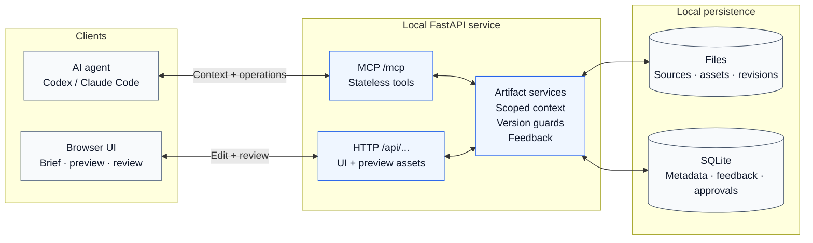
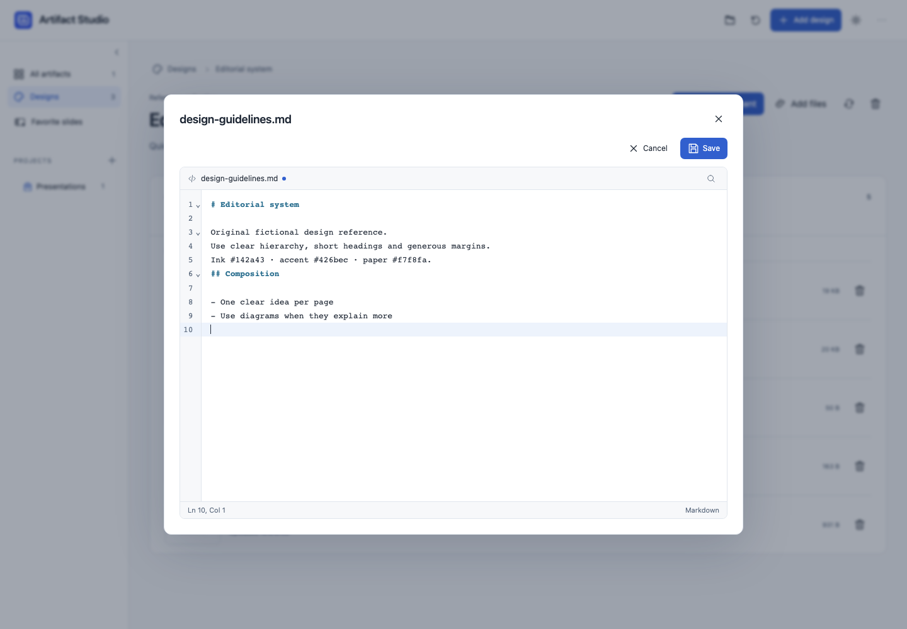
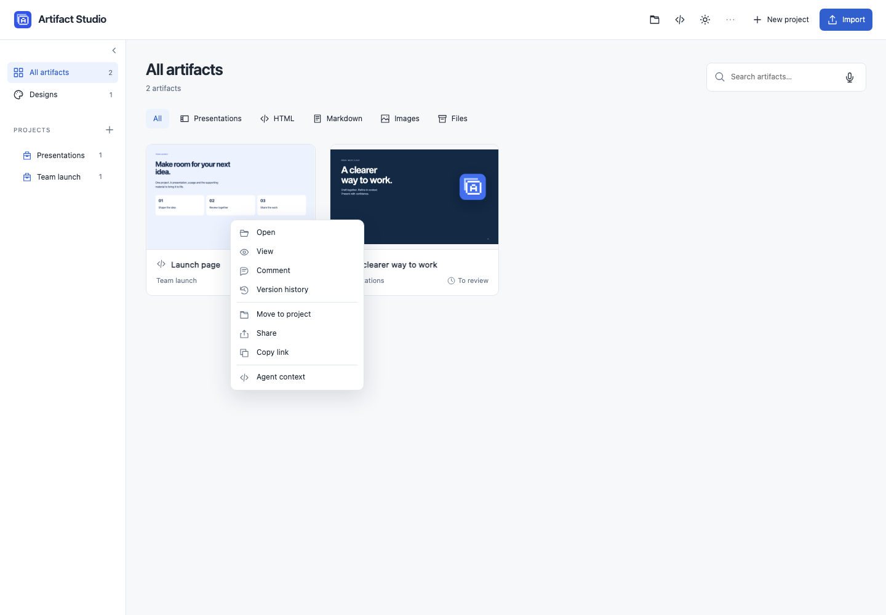
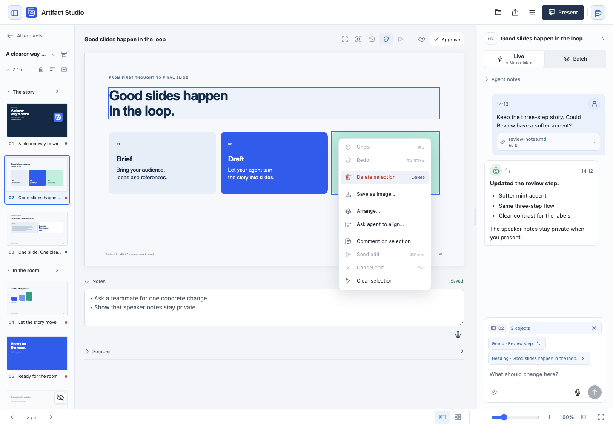

<p align="center">
  
</p>

<h1 align="center">Artifact Studio</h1>

<p align="center">
  A local artifact workspace for you and your agent.<br>
  Keep presentations, pages, documents and images together. Review the work where it lives.
</p>

<p align="center">
  <a href="#how-it-works">How it works</a> ·
  <a href="#quick-start">Quick start</a> ·
  <a href="#connect-your-agent">Connect an agent</a> ·
  <a href="#live-or-batch">Live &amp; Batch</a> ·
  <a href="docs/GETTING-STARTED.md">Full guide</a> ·
  <a href="docs/KEYBOARD-CONTROLS.md">Keyboard shortcuts</a>
</p>


**Local files · Free composition · Stateless MCP · Human approval**

[Voice input](docs/VOICE-INPUT.md) lets you dictate into text fields with your browser. Spoken feedback retains the object or group selected for each section; review it before sending.

The **Library** is the home screen. Browse all your work, filter by project or format, and open an artifact with its own conversation. Projects hold a shared brief and related artifacts. Existing presentations open in the slide editor, with their files, links, notes and review history preserved.

Sort **All artifacts** or a project overview by **Name**, **Last changed**, **Created**, or **File type**. File type shows separate format groups; the arrow reverses the order. One choice is remembered in this browser across overviews. [Library controls](docs/GETTING-STARTED.md#designs-and-work).

| Artifact | Review it in its own format |
| --- | --- |
| Presentations | Slide thumbnails, element feedback, sections, notes, animations and a private presenter view. |
| HTML pages and browser bundles | Responsive page preview with authored JavaScript, isolated from private workspace APIs. |
| Markdown | Rendered document or original source, with text selections. |
| Images and SVG | Original proportions, zoom and region selections. |
| Other files | Original files and downloads, with artifact-level discussion. A native editor is not supplied for every format. |

Agents choose their tools, code and layouts. Import a file or folder, or have the agent register an authored bundle. A type selects the viewer; it does not prescribe components or require a design pack. General HTML bundles can contain their own CSS, JavaScript, SVG, fonts and data. External services are not enabled automatically, and opening a preview never runs installation or build scripts.

Presentation composition is free within a fixed 16:9 canvas. Slides support local CSS/backgrounds and isolated custom documents with scripts, styles, iframe content and media. Agents can update a deck's theme and import staged fonts/images/assets through MCP. [Authoring capabilities and examples](docs/INTERACTIVE-HTML.md).

## How it works



Feedback retains the selected artifact, targets and content hash. **Live** releases submitted comments immediately; **Batch** releases them when you choose **Send batch**. Agents read released feedback through MCP; automatic continuation requires configured presentation host hooks. Approval records the exact version reviewed.

## Quick start

**Prefer guided setup?** Open this checkout in your agent and run **`/setup` in Claude Code** or **`$setup` in Codex**. The bundled [setup skill](.agents/skills/setup/SKILL.md) checks existing settings and connects the agent. [First-run details](docs/GETTING-STARTED.md#guided-setup).

Requires [Git](https://git-scm.com/), [uv](https://docs.astral.sh/uv/getting-started/installation/) and access to this private repository. Your existing agent supplies the AI connection; the app needs no separate AI API key.

```sh
git clone https://github.com/kaiketsu-labs/artifact-studio.git
cd artifact-studio
uv python install 3.14
uv sync --locked --python 3.14
uv run playwright install chromium --only-shell
```

Choose **one** way to run it:

| Mac menu-bar app | Terminal |
| --- | --- |
| On macOS 13+ with Apple's Command Line Tools, run `uv run --no-sync python scripts/install_macos.py --launch-at-login`, then open `~/Applications/Artifact Studio.app`. | Run `uv run --no-sync uvicorn artifact_studio.app:app --host 127.0.0.1 --port 8790` and keep the Terminal open. Stop with **Ctrl+C**. |
| Status, Open, Start/Stop/Restart, Update, and Settings for launch at login and backup. [Mac setup](docs/MACOS.md). | On macOS, `./start.command` is a shortcut after setup. |

Open **[127.0.0.1:8790](http://127.0.0.1:8790/)**. Stop a Terminal server before switching to the Mac controller. Chromium enables cached rendered previews and agent capture tools; the library can show format fallbacks when no preview is available.

The supported installation is this source checkout. The Mac controller needs the checkout and `.venv` to remain in place. No standalone notarized download, npm package or PyPI release is published by this project yet.

Versions and changelogs are prepared with Release Please, starting at **0.1.0**.
Publishing a GitHub release is a separate manual action. See [Versions and releases](docs/RELEASING.md).

## Connect your agent

Both clients use **Streamable HTTP** at `http://127.0.0.1:8790/mcp`.

**Codex**

```sh
codex mcp add artifact-studio --url http://127.0.0.1:8790/mcp
```

**Claude Code** — run from the agent's working project.

```sh
claude mcp add --transport http artifact-studio http://127.0.0.1:8790/mcp
```

Reload the agent session if the connection is not visible, then start with:

> List the projects and artifacts in Artifact Studio. Read the working context for the selected project, then help me make a page and a matching handout from my brief.

Use `get_working_context(artifact_id=...)` for selected work or `project_id=...` before creating related work. Existing decks also accept `deck_id=...` and retain their design guidance. The [agent contract map](agent/README.md) explains the canonical bootstrap, guides, tools and context receipts.

**Microsoft 365 Copilot:** use a Copilot Studio agent with the optional [authenticated gateway](docs/MICROSOFT-COPILOT.md). Select one project or explicitly allow the workspace. The gateway needs an approved HTTPS endpoint; the local editor stays private. Start from **Agent connection → Microsoft 365 Copilot**, or the hub menu. Microsoft sign-in, connector policies and an actual Copilot tool call must be verified separately. Automatic Copilot wake-up is not included.

Open **Designs → Add design**, enter a name, then drop in reference files or choose them from your computer. Master slides, guidelines, PDFs, logos, images, fonts and other file types are supported. The description is collapsed and optional; files can also be added later. **Add design** saves the collection and opens its context files. A design does not need example slides.


Click a design card to see the context files, add more, download a source or remove an attachment. **Use with agent** prepares a message you can copy into your connected agent's chat to use the design for your next task. If clipboard access is blocked, the message remains selected for manual copying. Registered slide design packs also offer **Open example slides**; the workspace default is marked. Normal presentations using a design remain in the artifact library.

Click a text file to preview it, then **Edit** for a VS Code-style source editor with highlighting, line numbers, find/replace and undo/redo. **Save** updates the local file and any enabled backups; **Cancel** leaves it unchanged. Markdown keeps its formatted preview. Concurrent edits are protected, and truncated previews stay read-only.




The trash icon removes a design from the library; **Deleted designs** restores it. Existing presentations and source files are preserved. Agents discover designs with `list_design_contexts` and inspect their file inventory with `get_design_context`. For project work, pass `design_id` to `get_working_context` alongside the project or artifact ID. File pointers show what is available; the agent must open the actual files. Attaching references does not automatically apply their styling.

Cards preview a pack's example slide or an attached image/SVG. File collections without a visual source show a compact document cover. Previews are read-only; clicking still opens the context file inventory.


### Your first project

Choose **New project** and save its name and optional shared brief. **Import** accepts files or a folder; choose the entrypoint the viewer should open first. Alternatively, ask the agent to author local files and call `register_artifact` with the project ID. The hub keeps an owned copy and leaves the originals intact.

Use a card's folder action to **Move to project**. This groups related work while preserving stable source paths. Changes to one artifact do not implicitly authorize changes to its neighbours.

The sidebar **+ → New folder** creates groups such as Allianz; folder menus can add nested folders. Folder icons identify groups, briefcase icons identify projects. Drag a project or folder onto a folder to move it inside, or between rows to reorder. **… → Move to…** provides the same organization without dragging. **Option/Alt + ↑/↓** reorders a focused item; **Option/Alt + ←** moves it out. Selecting a folder shows artifacts from every project inside it. Removing a folder keeps its contents. Navigation is saved in the collection's readable `project-tree.json`; project briefs, artifact paths and agent context stay unchanged.

Right-click an artifact card or related-artifact row for open/view, comment, history, move, share, link and context actions. Presentations offer **Open** and **Present**. Project/folder menus organize work and create or import artifacts; blank library space offers creation actions. **Shift+F10** or the keyboard Menu key opens the focused item's menu. Text fields, links and authored controls retain their native menus outside element selection.



For a presentation, open the hub's **… → New presentation**. Bring a PPTX, POTX, website or image as a design reference and let the agent create the design. PowerPoint files are reference inputs; PPTX export is not currently available. The existing editor exports HTML/PDF and saves editable presentation projects. [First presentation](docs/GETTING-STARTED.md#make-your-first-presentation).

## Point to the change


In the slide editor, click an object directly. In other viewers, choose **Select**, then point to an element, document text or image region. Hold **⌘, Ctrl or Shift** to add or remove targets. Each selected object has an outline and a removable context chip. The slide's **Objects** picker also reaches overlapping elements. One message can refer to all selected elements, with their original version and coordinates or text anchors retained. Text editing, dragging and arrow-key positioning apply to one object at a time. Right-click a slide object for edit, format, arrange, alignment and feedback actions; HTML selection menus retain their edit/comment controls. [Keyboard controls](docs/KEYBOARD-CONTROLS.md) include Ctrl/⌘+Z, redo, Delete and F2 for text editing.

For multiple slide objects, **Delete selection** and supported layer changes preview locally with Undo/Redo. Other arrangements and **Ask agent to align…** record labeled requests without previewing the final layout. **Send edit** submits one JSON group-feedback request with the original targets and content hash; it does not change source files directly. Cancel restores the local preview and cannot retract a sent request. HTML artifacts support single-object direct edits and group comments.

The conversation belongs to the artifact. **Enter** sends; **Shift+Enter** adds a line. Attach files through the paperclip, drag-and-drop or paste, including file-only messages. Limits are five files, 25 MB each and 50 MB together. Unsent file selections stay in browser memory; sent attachments are stored locally. Draft text and targets stay with their artifact.

**Auto-update** is on by default: incoming revisions appear while preserving feedback drafts and their original targets. Direct element edits, moves and animation previews finish before the slide changes. Turn it off to load new versions manually; the choice is remembered in this browser. General artifact viewers check for changes periodically, so updates can take a few seconds.

**Updated** is an orange revision marker until you open that version. **Approve** records the exact version you reviewed. Source files, the content hash and context are available in **Sources & files**. The **Agent context** inspector shows scope, canonical paths, hashes and recorded delivery; an available pointer is never labelled as proof that an agent read it.

`capture_artifact` returns an actual rendered image with revision and viewport metadata. It can sample elapsed animation time in a fresh offline runtime. Use a browser for user-driven interaction states; use the existing slide capture tools for presentations. Preview cards use cached images, not a running iframe per artifact.

## Explore slide designs


Ask your agent for several directions for a slide. Hover the slide's stacked-card count for clickable previews, or open **Designs**. Previewing leaves the chosen slide unchanged. **Compare** shows any two designs; **Keep current** or **Use this design** records your decision and puts the options away. The chosen design has a stronger gold border and a check icon.

Alternatives stay in **Version history → Design decisions & saved alternatives**, and the decision has Undo. Feedback written while previewing stays attached to that proposal. Speaker notes remain intact. [Workflow, agent tools and limits](docs/SLIDE-DESIGNS.md).

## Live or Batch

| Live | Batch |
| --- | --- |
| Each submitted comment is released immediately. | Comments and their attachments stay private until **Send batch**. |
| The agent can read released feedback using its delivery cursor. | The agent receives the released batch together. |

Automatic host continuation currently applies to **presentation review only**, through the supported Codex/Claude Code hooks. General artifact feedback is durable, but does not automatically wake an agent. The Live availability indicator and tooltip distinguish these capabilities. Plain MCP cannot wake a closed chat.

For a deck, open the editor's **Menu → Agent connection → Automatic feedback → Copy setup prompt**, follow the [hook setup](docs/LIVE-REVIEW.md), the agent then connects automatically when it selects or works on the presentation. Copying a prompt alone does not configure or activate the host.

Drag from empty canvas space to select several objects; hold **Shift, Cmd or Ctrl** to add more. Right-click for **Save as image…** (transparent PNG), or **Save original image…** on a picture. Exports include the displayed local edit preview without sending feedback or saving edits.



## Present with context


Existing decks keep the full slide workflow: sections, sorter, hidden slides, multi-slide moves, recovered deletions, notes and per-slide discussion. **Present** starts the full-size audience slide directly. **Presenter view** opens a separate audience window while keeping current/next slides, notes and the timer private. Move that window to your other monitor and click **Fullscreen**; supported browsers can also place it automatically with screen access. [Editor controls and browser differences](docs/GETTING-STARTED.md#review-and-present).

The self-contained HTML export scales the complete slide canvas in audience/presenter views and **All slides**, keeping fixed-size text, SVG and spacing proportional. Re-export an older file to include runtime fixes. [All keyboard shortcuts](docs/KEYBOARD-CONTROLS.md).

Right-click slide thumbnails for new, duplicate, hide/unhide, delete and movement actions; section menus manage their groups. These structural controls are separate from the selected object's unsent edit history.

**Speaker notes save automatically**, including when switching slides. Failed saves retain a browser draft; conflicting edits offer **Review changes**. Present and project export wait for pending saves.

The editor keeps tools in one row. Top-bar icons toggle the slide list and conversation; in narrower windows, chat opens as a drawer instead of moving below the slide. Notes start collapsed and remember your choice. Slide navigation sits beside the position count at the bottom.

The hub's **… → Presentation tools** opens the existing editor menu for design references, reference libraries, instructions and agent connection. **← All artifacts** at the top of the presentation sidebar returns to the hub, including from slide overview. Existing `/?deck=...` links remain valid.

## Your files stay local

| What | Default location |
| --- | --- |
| Presentations, designs, project briefs and owned artifact bundles | `~/Documents/Artifacts/` |
| New artifact sources and immutable revisions | `projects/<project-id>/artifacts/<artifact-id>/` inside the collection |
| Review database and workspace settings | `.state/` inside this checkout |
| Unsent text and target drafts | Browser-local storage |

Back up **both the collection and the state folder**. Set `ARTIFACT_STUDIO_COLLECTION` and `ARTIFACT_STUDIO_DATABASE` to choose other locations. New artifact revisions publish a complete snapshot through an atomic database pointer; a readable `artifact.json` sits beside the working sources. Out-of-band source edits are reconciled into a new revision before review.

HTML, Markdown, images and presentations have a **View** action that removes Studio’s surrounding controls without requiring fullscreen. Move to the top-right corner to reveal the return button, or press **Esc**; interactive pages retain their state. Collapse either side panel with its edge arrow or by dragging its divider outward, then use the arrow to reopen it. Drag library cards onto project folders to organize related work; the keyboard-accessible Move action remains available.

Select a slide or HTML element to open a compact floating toolbar without moving the content. The pencil opens text editing; **…** holds slide positioning, rotation and removal. Familiar size numbers and Smaller/Larger buttons handle CSS units internally. Changes preview locally; **Send edit** records a structured request against the original version for the agent to apply, while Cancel restores the preview. Authored HTML/SVG/JavaScript remains unrestricted. Preview downloads support generated HTML, JSON and CSV.

**Share** exports one artifact or a project ZIP. Choose **HTML** or **PDF** for presentations, then **Share…** opens your device’s native share sheet. Choose Teams, Mail or another compatible installed app there. **Save file** remains available when the browser cannot share the file; Outlook drafts are also available on supported Macs. HTML presentation files embed local assets and keep animations; PDF includes all slides. Multi-file HTML artifacts retain their bundle in a ZIP. Private review chats and speaker notes are omitted. Outlook handoff is available on macOS with Outlook installed; nothing is sent automatically. [Sharing and exports](docs/PROJECTS.md#share-an-artifact-or-project).

**Save presentation / Import presentation** transfers a portable editing archive, including private review state. A shared project ZIP contains audience files, not a restorable Studio workspace. Opted-in repository backup includes current artifact bundles, project briefs and manifests alongside presentations; creating a project does not opt it into uploads. Repository connections default to reference only. [Reference libraries and sync](docs/REPOSITORY-SYNC.md).

The app's **Menu** and [Mac menu-bar app](docs/MACOS.md) put active agent reviews first, marked with green dots. **Recent projects →** opens a submenu of your last five projects, shared across both interfaces. Hover, click or use arrow keys to switch projects.

The **storage icon** in the library and editor shows the working folder and actual GitHub delivery status. **Back up all artifacts** enables one-way backup to a selected private repository; review chat, approvals and revision history stay local. The Mac menu’s **GitHub Backup** submenu exposes the same setting, last delivery, Sync Now/Retry and backup settings.

In **Storage and backup**, **Save workspace** downloads a full local archive with projects, folders, sources, review chats, approvals and retained versions. **Restore workspace** previews a connected backup or local archive and restores files into a new sibling folder. The running workspace stays unchanged. GitHub recovery rebuilds current content and folder structure; private review history requires a local archive. [Recovery guide](docs/WORKSPACE-RECOVERY.md).

The **history icon** above a slide or artifact opens a timeline with small previews of saved content. Click a thumbnail for the larger preview; use ↑/↓ to browse. Thumbnails load as you scroll and use a bounded local cache. **Content changes** filters consecutive identical content by default; **All saves** includes internal-title/source-only saves and repeated restores. Filtering deletes no saved versions. Rapid saves are grouped and expand to individual versions. **Restore version** creates a new save while preserving current speaker notes and slide placement. Artifact revisions retain their local dependencies; historical slides reuse current shared theme/assets, so their appearance may differ from the original. Current-only GitHub backups cannot recover missing earlier revisions.

Workspace rules remain primary; learned preferences are secondary. Project and artifact context refine the work within that scope. The app ships without corporate designs or assets. [Preference learning](docs/PREFERENCE-LEARNING.md).

## Documentation

| Guide | Covers |
| --- | --- |
| [Getting started](docs/GETTING-STARTED.md) | Installation, projects, imports, review, presentations and troubleshooting. |
| [What agents receive](agent/README.md) | Canonical bootstrap, tool catalogue, guides, skills and context receipts. |
| [Artifact architecture and remaining scope](docs/ARCHITECTURE.md) | Implemented foundation and subsequent work. |
| [Artifact authoring](agent/guides/artifacts.md) | Free file composition, versioned edits and scoped feedback. |
| [Mac menu-bar app](docs/MACOS.md) | Server controls, startup and updates. |
| [Automatic presentation feedback](docs/LIVE-REVIEW.md) | Host hooks, activation and limitations. |
| [Agent token efficiency](docs/TOKEN-EFFICIENCY.md) | Compact context and targeted reads. |
| [Presentation authoring](docs/AGENT-GUIDE.md) | Slide edits, notes and visual review. |
| [Presentation visual review](docs/VISUAL-REVIEW.md) | Captures, contact sheets and reveal timing. |
| [Design packs](docs/DESIGN-PACKS.md) | Import a design from a supplied reference. |
| [Keyboard and pointer controls](docs/KEYBOARD-CONTROLS.md) | Shortcuts, selection, context menus and image export. |
| [Development checks](docs/CI.md) | Automated coverage, local commands and application/display limits. |

<details>
<summary><strong>Development checks</strong></summary>

```sh
uv sync --locked --python 3.14
uv run pytest
uv run basedpyright
uv run ruff check artifact_studio tests
uv run ruff format --check artifact_studio tests
node --test tests/*.cjs
```

Node.js is needed for frontend behavior tests and optional rebuilds of the vendored [text editor](docs/DESIGN-PACKS.md); it is not required to run the app. Documentation screenshots use fictional projects, not personal files. [CI](docs/CI.md) · [Screenshot inventory](docs/screenshots/README.md).

</details>
