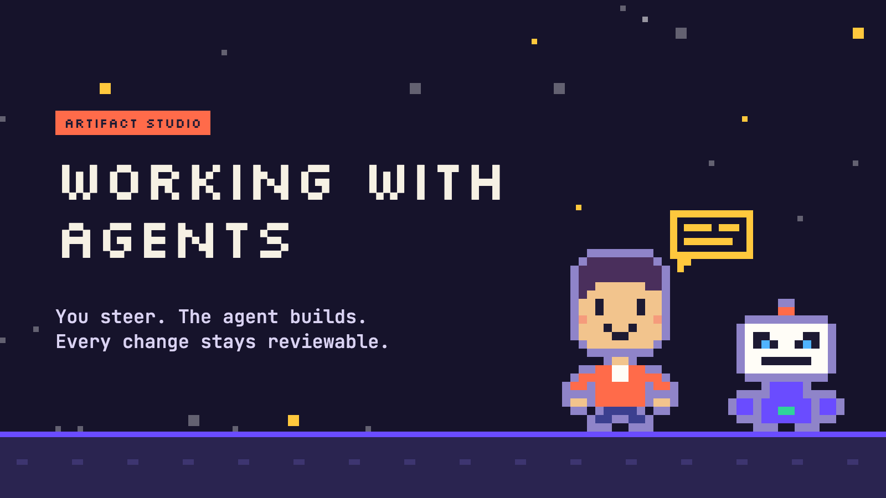
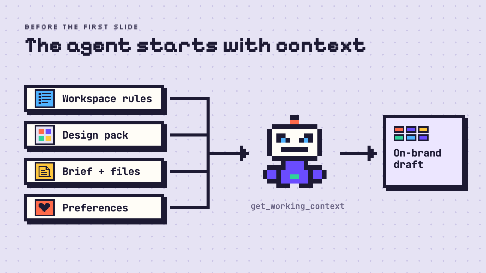
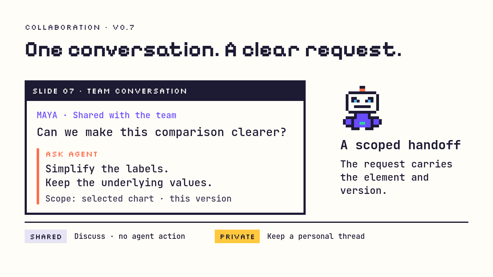
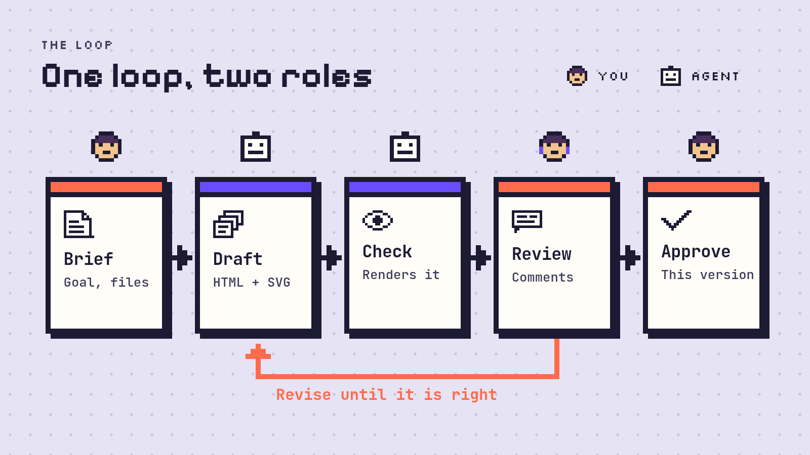
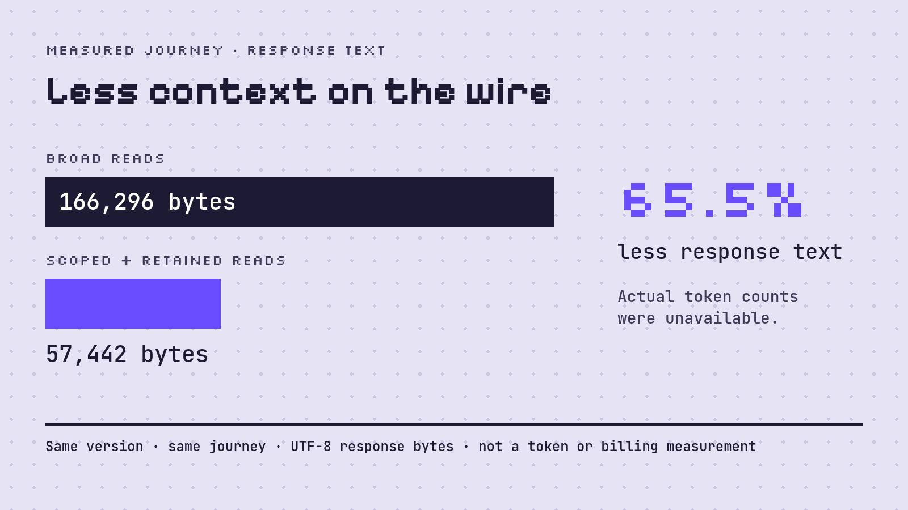

<p align="center">
  
</p>

<h1 align="center">Artifact Studio</h1>

<p align="center">
  A workspace for you, your collaborators and your agents.<br>
  Create presentations, pages, documents and images. Review the work where it lives.
</p>

<p align="center">
  <a href="#quick-start">Quick start</a> ·
  <a href="#connect-your-agent">Connect an agent</a> ·
  <a href="#create-review-and-present">Review workflow</a> ·
  <a href="#documentation">Guides</a> ·
  <a href="#token-usage-and-workflow-benchmark">Token usage</a>
</p>



**Local files · Free composition · Stateless MCP · Versioned human review**

Run Studio on your computer or [your own server](docs/HOSTED.md). The Library groups related artifacts into projects with shared briefs; folders, favorites, search, grid/list views and context menus keep work accessible. [Shared projects](docs/MULTIPLAYER.md) let collaborators review selected work and give each agent a scoped connection.

Agents author ordinary files with their preferred tools. Studio supplies previews, targeted feedback, retained versions and approvals. A design reference can guide the work, but a component catalogue or design pack is not required. HTML bundles can include their own CSS, JavaScript, SVG, fonts and data; opening a preview does not run install or build scripts.

| Artifact | Workspace support |
| --- | --- |
| Presentations | Fixed 16:9 slide canvas, free HTML/CSS/SVG composition, interactive slides, sections, notes, animations, design alternatives and presenter view. |
| HTML pages and browser bundles | Responsive previews with authored JavaScript, isolated from private workspace APIs. |
| Markdown | Rendered document and source, with text-selection feedback. |
| Images and SVG | Original proportions, zoom and region feedback. |
| Other files | Source downloads and artifact-level discussion; a native editor is not supplied for every format. |

## Quick start

### Install on Mac

Use macOS 13 or later, Git, [uv](https://docs.astral.sh/uv/getting-started/installation/) and Apple's Command Line Tools (`xcode-select --install` if missing).

```sh
git clone https://github.com/kaiketsu-labs/artifact-studio.git
cd artifact-studio
uv python install 3.14
uv sync --locked --python 3.14
uv run playwright install chromium --only-shell
uv run --no-sync python scripts/install_macos.py --launch-at-login
```

Open `~/Applications/Artifact Studio.app`, then choose **Open Artifact Studio** from its menu bar. Keep the checkout and `.venv` in place. The controller manages the local server, startup, updates and backups. See the [Mac guide](docs/MACOS.md) for update and troubleshooting steps.

For guided setup, open the checkout in your agent and run **`/setup` in Claude Code** or **`$setup` in Codex**. It checks the existing installation and agent connection. [Guided setup](docs/GETTING-STARTED.md#guided-setup).

### Other environments

| Environment | Guide |
| --- | --- |
| Run from a terminal | [Native server and configuration](docs/GETTING-STARTED.md#run-from-terminal) |
| Docker | [Persistent storage, rendering, hooks and updates](docs/DOCKER.md) |
| Self-hosted / shared workspace | [Hosted setup and configuration checks](docs/HOSTED.md), [collaboration and scoped access](docs/MULTIPLAYER.md), [authentication](docs/AUTH-PROVIDERS.md) |
| SageMaker Studio Code Editor | [Single-worker setup and resource diagnostic](docs/SAGEMAKER.md) |

The Mac controller manages the local installation. Hosted deployments need their own HTTPS, authentication and network configuration. [Moving an existing workspace](docs/MULTIPLAYER.md#remote-hosting-architecture) requires backing up its files and private state together.

## Connect your agent



Keep Studio running. Codex and Claude Code use **Streamable HTTP** at `http://127.0.0.1:8790/mcp` for the default local installation.

**Codex**

```sh
codex mcp add artifact-studio --url http://127.0.0.1:8790/mcp
```

**Claude Code** — run from the agent's working project:

```sh
claude mcp add --transport http artifact-studio http://127.0.0.1:8790/mcp
```

Open a new agent session if the connection is not visible, then try:

> List my projects and artifacts. Read the working context for the selected project, then help me make a presentation and a matching handout from my brief. Check the rendered results before asking me to review them.

Agents start with `get_working_context` for the selected project, artifact or deck, then read the relevant source files and on-demand guides. The [agent contract map](agent/README.md) explains source authority, tool schemas, context receipts and revision guards. Workspace rules remain primary; [learned preferences](docs/PREFERENCE-LEARNING.md) are secondary. The app ships without corporate designs or assets.

For a shared hosted workspace, use its [scoped agent connection](docs/MULTIPLAYER.md#author-presentations-with-a-hosted-agent). Optional [lightweight client hooks](docs/HOSTED-AGENT-HOOKS.md) support continuation in open sessions.

**Microsoft 365 Copilot** uses a separate optional [authenticated gateway](docs/MICROSOFT-COPILOT.md) and an approved HTTPS endpoint. Select one project or explicitly allow the workspace; verify Microsoft sign-in, tenant policies and an actual tool call separately. Automatic Copilot wake-up is not included.



Shared conversations let people discuss the work; **Ask agent** marks a message as an explicit agent request. A private thread keeps personal agent discussion separate. See [collaboration controls](docs/MULTIPLAYER.md).

### Automatic feedback

With loaded Codex/Claude Code lifecycle hooks, selecting or working on an artifact attaches its review session. **Send** delivers a new message and attachments; the agent can continue in the open chat for presentations, HTML, Markdown, images and other files. Older saved messages require **Send saved messages**. **Copy conversation** copies displayed text without delivering it.

Follow the [hook setup and native trust/reload steps](docs/LIVE-REVIEW.md). The editor's **Menu → Agent connection → Automatic feedback → Copy setup prompt** prepares the instructions. The connection status shows availability; **End review** stops listening. Keep the server and agent chat open: an MCP connection cannot start a closed chat.

## Create, review and present



1. **Start with a brief.** Create a project, import files or a folder, or have the agent register an authored bundle. Studio keeps an owned copy and preserves the originals. Add optional design references through **Designs → Add design**; agents must open the reference files to use them.
2. **Point to the change.** Select slide objects, HTML elements, document text or image regions. Hold Cmd, Ctrl or Shift to combine targets. Write feedback, attach files, dictate with [voice input](docs/VOICE-INPUT.md), or type `@` to attach a saved [project, artifact or slide reference](docs/CHAT-REFERENCES.md).
3. **Review the revision.** Feedback retains its original version and targets. Direct edit controls preview changes locally; **Send edit** asks the agent to apply them. **Auto-update** shows incoming revisions while retaining drafts; it can be turned off. Agents capture rendered output and inspect interactions before handing work back.
4. **Choose and approve.** Compare whole-slide designs or element alternatives, keep the direction you want, and approve the exact reviewed version. Later revisions need review again. History retains earlier saves and design decisions; restore creates a new save.

The [getting-started guide](docs/GETTING-STARTED.md) covers imports, organization, editing and troubleshooting. [Keyboard controls](docs/KEYBOARD-CONTROLS.md) document multiselection, context menus, undo/redo and selected-object image exports. [Design references](docs/DESIGN-PACKS.md), [interactive authoring](docs/INTERACTIVE-HTML.md) and [slide alternatives](docs/SLIDE-DESIGNS.md) cover deeper composition workflows.

### Presentations

Use sections, the slide sorter, hidden slides, multi-slide moves and per-slide discussion to shape a deck. Speaker notes save automatically; failed saves keep a browser draft and conflicting edits offer review. **Present** opens the audience slide. **Presenter view** keeps current/next slides, notes, clock and timer private in a separate control window. External display placement and fullscreen depend on browser support.

Right-click a slide thumbnail and choose **Copy → Copy as image** to copy the rendered slide as PNG. This requires the Chromium renderer and browser clipboard access on HTTPS or localhost.

Ask the agent for slide directions or headline, text and graphic options. Preview and compare them in context; the human chooses. Saved options remain in history. [Presentation workflow](docs/GETTING-STARTED.md#review-and-present) · [Visual review](docs/VISUAL-REVIEW.md) · [Alternatives](docs/SLIDE-DESIGNS.md).

The [collaboration study](docs/performance/presentation-workflow-study.md) records owner and reviewer feedback, layout repair, conflict recovery and export verification. Its initial fictional fixture was created before the original product deck was located in the authorized backup; the fixture is separate from the subsequent update to that deck.

### Share and export

**Share** exports an artifact or a project ZIP. Presentations support **HTML** and **PDF**; PPTX/POTX files are design references and PPTX export is not available. Self-contained HTML preserves local assets and animations. Multi-file HTML artifacts retain their bundle in a ZIP. Audience exports omit private review chats and speaker notes. PDF includes hidden slides by default; uncheck **Include hidden slides** in Share or the PDF print preview to export only visible slides.

Use **Save file**, the device's native share sheet when supported, or the supported Mac Outlook handoff. Nothing is sent automatically. **Save a copy… / Import presentation** is a separate portable editing archive that includes private review state. A shared project ZIP is not a restorable workspace. [Sharing and export details](docs/PROJECTS.md#share-an-artifact-or-project).

## Storage and recovery

| Data | Default location |
| --- | --- |
| Presentations, designs, project briefs and owned artifact bundles | `~/Documents/Artifacts/` |
| Artifact working files and retained revisions | `projects/<project-id>/artifacts/<artifact-id>/` within the collection |
| Review database and settings | `.state/` within the checkout |
| Unsent text and target drafts | Browser-local storage |

Set `ARTIFACT_STUDIO_COLLECTION` and `ARTIFACT_STUDIO_DATABASE` to choose other locations. Back up **both the collection and private state**. Files stay on the machine running Studio unless you explicitly configure sharing or backup.

**Storage and backup → Save workspace** creates a full archive including saved conversations, approvals and retained versions. **Restore workspace** previews recovery into a new folder; opening it requires configuring the recovered collection and database. Repository connections default to reference only. Optional one-way **GitHub current-source backup** excludes private review state and retained revisions; optional **full workspace backups** retain them. Backups are off by default.

Hosted deployments can separately enable [project GitHub sync](docs/HOSTED.md#hosted-project-github-sync) for operator-approved repositories and source bindings. Owners opt into two-way checks; independent per-file changes merge automatically, while differing edits to the same file require an explicit conflict choice. This source synchronization is distinct from one-way backup and excludes private review state.

Artifact revisions retain local dependencies; historical slide previews reuse current shared theme/assets and can differ from the original appearance. [Recovery and fidelity](docs/WORKSPACE-RECOVERY.md) · [Repository and backup scope](docs/REPOSITORY-SYNC.md).

## Documentation

| Guide | Covers |
| --- | --- |
| [Getting started](docs/GETTING-STARTED.md) | Installation, projects, imports, review and troubleshooting. |
| [Agent contract](agent/README.md) | Bootstrap, tools, guides, context delivery and authoring lifecycle. |
| [Presentation authoring](docs/AGENT-GUIDE.md) | Slides, notes, assets and review workflow. |
| [Artifact authoring](agent/guides/artifacts.md) | Free file composition, scoped feedback and revision guards. |
| [Collaboration](docs/MULTIPLAYER.md) | Invitations, access roles and hosted agents. |
| [Architecture](docs/ARCHITECTURE.md) | Implementation and remaining scope. |
| [Preview performance](docs/performance/library-preview-results.md) | Cached library covers, retry behavior and measurements. |
| [Runtime efficiency](docs/performance/runtime-efficiency.md) | Preview lifecycle, polling, scoped reads and remaining opportunities. |
| [Offline presentations](docs/OFFLINE.md) | Experimental hosted offline source editing and limits. |
| [Versions and releases](docs/RELEASING.md) | Release Please, CI-gated releases and nightly builds. |
| [Dependency updates](docs/DEPENDENCY-UPDATES.md) | Audits, generated bundles and protected automatic merging. |

## Development

Python 3.14 and uv are required. Node.js is needed for frontend behavior tests and optional vendored-editor rebuilds, not to run the app.

```sh
uv sync --locked --python 3.14
uv run pytest
uv run basedpyright
uv run ruff check artifact_studio tests
uv run ruff format --check artifact_studio tests
node --test tests/*.cjs
```

See [CI and development checks](docs/CI.md) for browser journeys, agent subprocess checks, Docker/macOS checks, release simulations and their environment requirements. Automated checks do not establish native-app or physical-display behavior. Documentation fixtures are fictional; the [screenshot inventory](docs/screenshots/README.md) records captures and links to real UI examples.

The application version comes from [`pyproject.toml`](pyproject.toml); a version file alone does not prove a published release. Follow the platform's update guide and [release process](docs/RELEASING.md).

## Token usage and workflow benchmark



The [reproducible presentation workflow benchmark](docs/performance/PRESENTATION-WORKFLOW.md) compares broad reads with scoped reads, retained-context hashes, feedback cursors and compact revision responses over real MCP. Its fictional 12-slide fixture includes 20 unrelated decks, 12 comments and a concurrent speaker-note edit. Both policies read the brief and full target source, reject a stale write, preserve the human note and validate the final deck.

| Measured per workflow | Broad reads | Scoped / retained reads |
| --- | ---: | ---: |
| Tool response text, UTF-8 bytes | 166,296 | 57,442 |
| Serialized MCP response JSON, bytes | 324,527 | 113,253 |
| Request parameters, bytes | 2,274 | 2,895 |
| Median local workflow time | 510.422 ms | 514.699 ms |

Response text fell **65.5%** in this fixture. One warmup per policy preceded three measured pairs in alternating order. Tool discovery adds a separate 147,956-byte catalogue. These are local payload and timing measurements, not HTTP wire sizes or evidence of faster model inference; the scoped policy was slightly slower in this run.

**Actual model token usage is unavailable.** Provider prompt/cache/output/reasoning usage, billed totals and image tokens were not recorded; the tokenizer download was unavailable, so no text-token estimate is reported. The separate [multi-role authoring and visual-review study](docs/performance/presentation-workflow-study.md) records the observed collaboration and its limitations; this scripted regression does not measure that complete session. See the [methods and raw results](docs/performance/PRESENTATION-WORKFLOW.md) and [token-efficient reading guidance](docs/TOKEN-EFFICIENCY.md).

The [follow-up rerun](docs/performance/workflow-iteration.md) implements and tests explicit stale-draft recovery, safe retries after a lost response, clearer authoring guidance and hosted guide reuse. Two independent browser personas checked concurrent notes, private visibility and recovery. An identical hosted workload with a resumed-guide check made 47 tool calls with one initialization on each source version; response text decreased from 105,079 to 104,329 bytes (0.71%). This modest payload saving does not establish billed-token or latency savings. The report separates observable agent choices and workarounds from test infrastructure accommodations.
