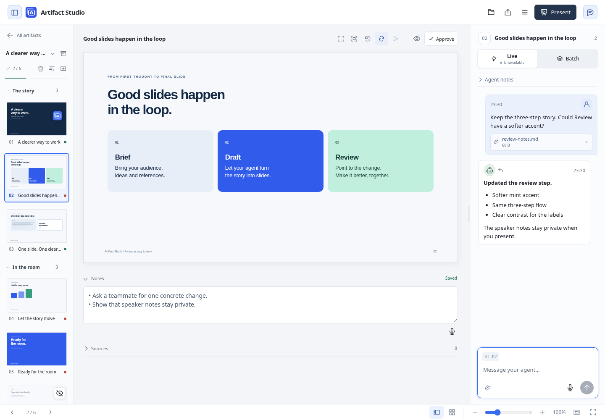
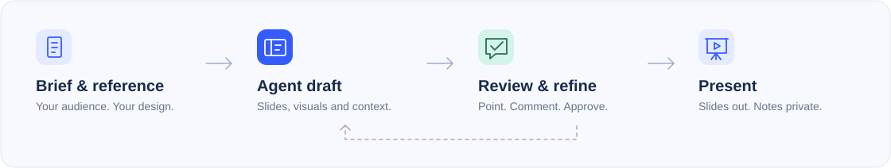
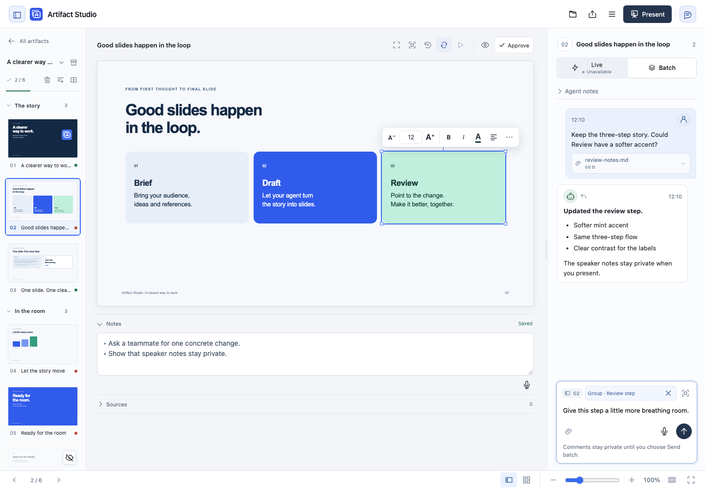
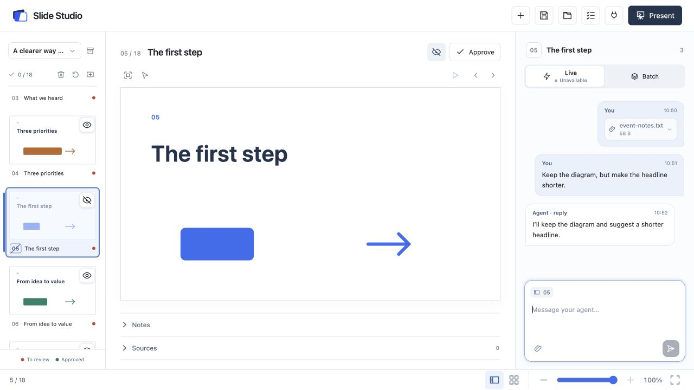
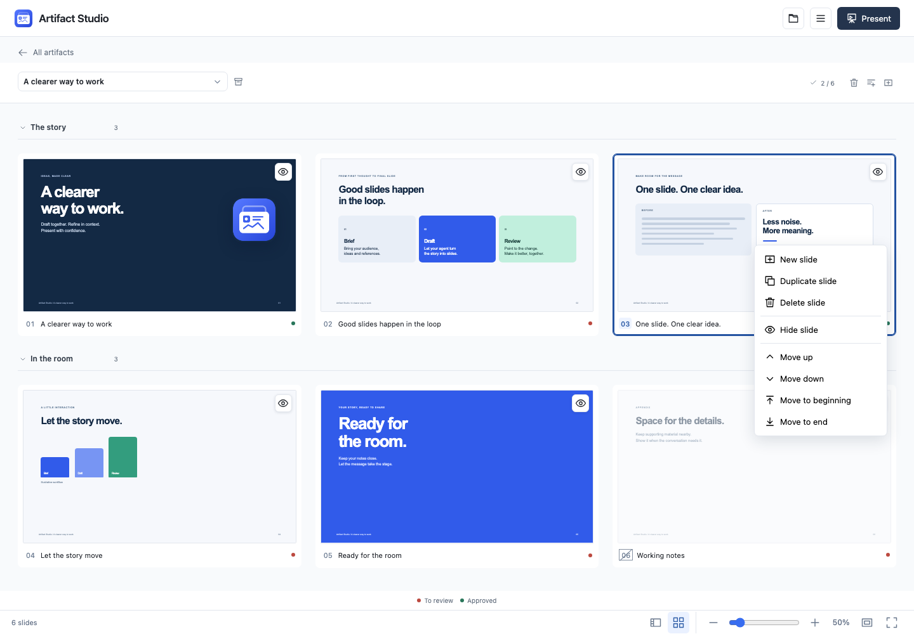
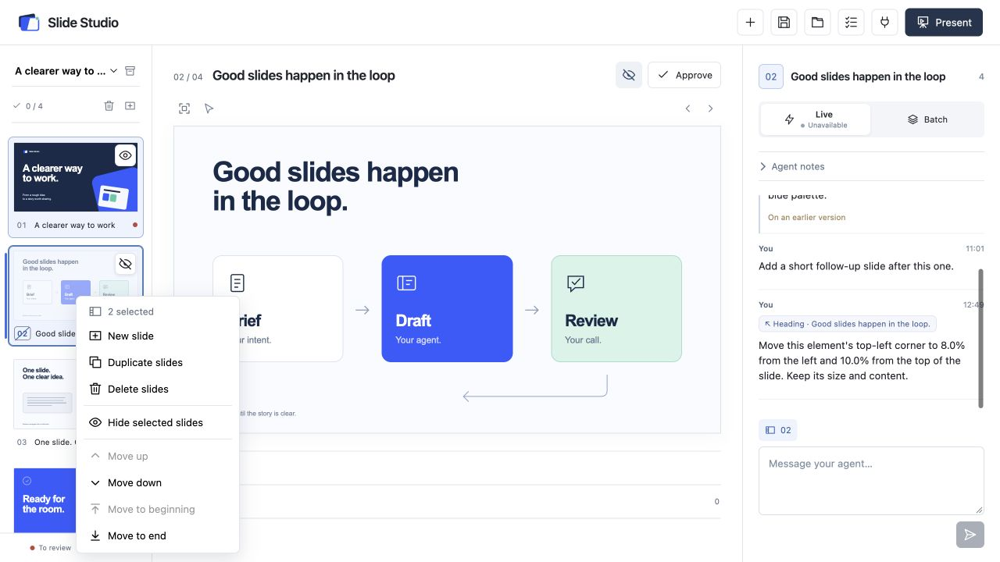
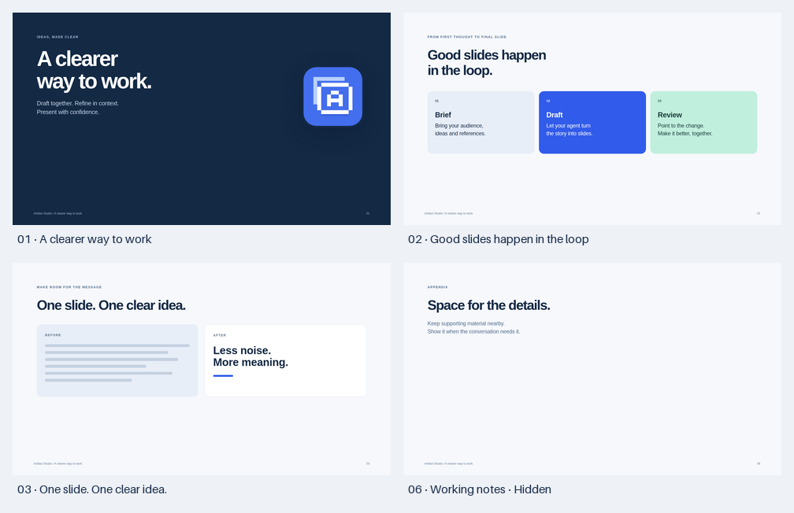
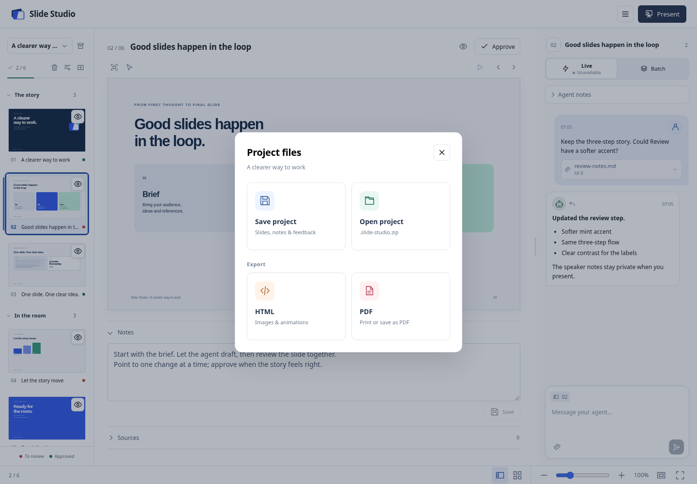
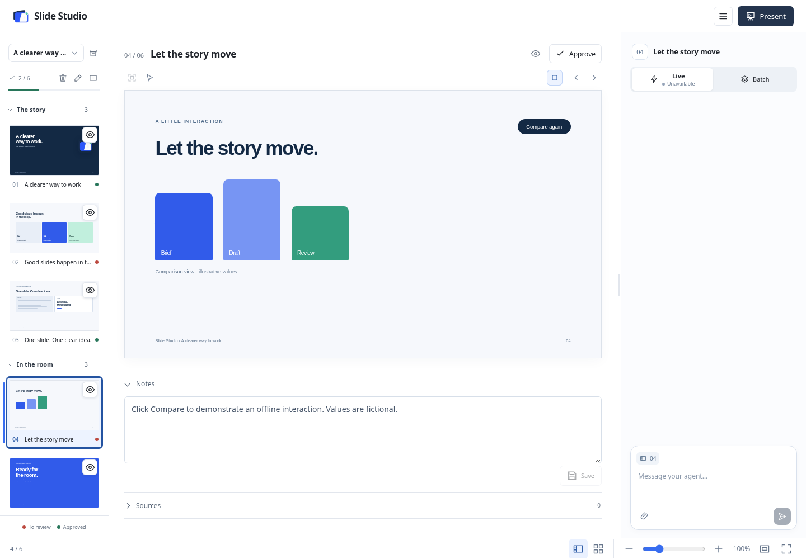

<p align="center">
  
</p>

<h1 align="center">Slide Studio</h1>

<p align="center">
  A local slide workspace for you and your agent.<br>
  Draft with Codex or Claude Code. Give feedback on the slide. Approve and present.
</p>

<p align="center">
  <a href="#quick-start">Quick start</a> ·
  <a href="#connect-your-agent">Connect an agent</a> ·
  <a href="#live-or-batch">Live &amp; Batch</a> ·
  <a href="docs/GETTING-STARTED.md">Full guide</a>
</p>



**Local HTML slides · Stateless MCP · Human approval · Private presenter notes**

Slides are editable HTML, CSS and SVG, saved on your machine. Bring a PPTX, website or image as a design reference; the agent turns it into a reusable design language. Layouts stay flexible. PPTX files are reference inputs; PowerPoint export is not currently available.

## From brief to presentation



| Compose | Review | Present |
| --- | --- | --- |
| Move text, shapes, icons, charts and images freely through the agent. | Each slide has its own chat. Select an element to edit, move or comment. | Start full-screen slides directly, with optional private presenter controls. |
| Add reference files to the brief. Reuse your designs. | Red means unreviewed. Green means approved. An orange outline marks a new revision until you open it. | Keep notes, sources and agent discussion off the audience screen. |

## Quick start

Requires [Git](https://git-scm.com/), [uv](https://docs.astral.sh/uv/getting-started/installation/) and access to this private repository. Your existing agent supplies the AI connection; the app needs no separate AI API key.

```sh
git clone https://github.com/kaiketsu-labs/slide-studio.git
cd slide-studio
uv python install 3.14
uv sync --locked --python 3.14
uv run playwright install chromium --only-shell
uv run --no-sync uvicorn studio.app:app --host 127.0.0.1 --port 8790
```

Open **[127.0.0.1:8790](http://127.0.0.1:8790/)** and keep the server running. Stop it with **Ctrl+C**. On macOS, `./start.command` is a shortcut after setup.

The Chromium step enables local agent visual review. Browsing and editing still work without it; capture tools report the setup command if it was skipped.

## Connect your agent

Both clients use the same **Streamable HTTP** endpoint: `http://127.0.0.1:8790/mcp`.

**Codex**

```sh
codex mcp add slide-studio --url http://127.0.0.1:8790/mcp
```

**Claude Code** — run from your agent's working project.

```sh
claude mcp add --transport http slide-studio http://127.0.0.1:8790/mcp
```

Other MCP clients can use the slide tools too. Reload the agent session if the new connection is not visible, then start with:

> Call `get_working_context` in Slide Studio and help me create a presentation. I'll provide the design reference, audience and key points.

The **plug icon → Copy agent prompt** resumes work on the selected deck. Copying a prompt does not configure MCP or start an idle agent.

### Your first deck

1. **Add a design.** Open **New presentation → + beside Design library**, then send a PPTX, image or link. Ask the connected agent to read the pending design request and build/register the design. An empty design library on first launch is expected.
2. **Give it context.** Choose the design, enter a title and brief, and attach reference files with the paperclip. Up to five files, 25 MB each and 50 MB total.
3. **Draft together.** Create the presentation, then use the copyable agent prompt to ask for a draft. Creation starts with one branded cover; the agent builds the rest from your brief.

## Point to the change



Select a thumbnail to switch both the slide and its chat. Matching slide numbers show the context, which accompanies every message. Unsent drafts stay with their slide. You can still ask for a new slide or a different order; the agent infers the scope.

The project menu at the top left marks the current project and wraps long names to two lines. **+ New project** is its final option and opens the title, brief and design dialog. Arrow keys navigate the menu; Home/End jump to its ends, and Esc closes it.

Select an element to edit text, drag its selection border, align it or rotate it using the round handle or degree field. The trash icon stages a deletion request. Use the check icon to send the suggestion or Esc to cancel; switching slides never sends an unfinished edit. For keyboard movement, focus the move icon and use arrows (Shift for larger steps), then Enter to send. The status icon distinguishes an unsent edit, a queued Batch request and a request saved for the agent. The agent applies suggestions to the canonical slide. Speaker notes are editable below the slide. Explanations and sources stay collapsed; questions remain visible.

Use **Slide objects** above the canvas to select overlapping text, diagrams or named groups. The picker highlights objects on hover and supports arrow-key navigation.

The **Play icon** above the slide replays its animation and reveal steps in place. It is disabled on static slides. Click **Stop**, press **Esc** or switch slides to return to editing; unsent edits and drafts stay intact.

In feedback and design chat, **Enter** sends and **Shift+Enter** adds a new line. The slide chat accepts files through its paperclip, drag-and-drop or paste, including file-only messages. Remove an attachment with its × before sending; download it from the message afterward. Limits are five files, 25 MB each and 50 MB together. Selected unsent files stay in browser memory; sent files persist locally and travel with saved projects. Batch attachments stay withheld until release.



Revisions appear live. Orange clears when you open the changed slide; approval remains a separate action. Incoming changes preserve your drafts and their original element targets.

The slideshow’s right-edge position ticks expand slightly on hover. Click a tick to jump directly to that slide; the existing design colors are retained.

In the slideshow, click the slide or press a normal key to advance. Arrows navigate, Home/End jump to the first/last slide, and **Esc** returns directly to the editor at the current slide. Notes and focused controls keep their normal keyboard behavior.

Right-click a thumbnail for **Hide Slide / Unhide Slide**, or click its eye icon directly. An open eye means shown; a crossed-out eye and slide number mean hidden. Hidden slides stay editable and keep their notes and approval. Normal slideshow navigation and the next-slide preview skip them. Use **See all slides** or the private presenter filmstrip to show one deliberately, following [PowerPoint's interaction](https://support.microsoft.com/en-us/powerpoint/hide-or-show-a-slide).

Click the grid icon in the bottom bar, or zoom below 55%, to see the slide sorter. A single click selects; double-click or Enter returns to editing. The fit icon sizes the overview for the deck, and Esc returns to the previous editor zoom. Arrow keys follow the grid.



Drag thumbnails to reorder slides. **Shift-click** selects a range; **Cmd/Ctrl-click** selects individual slides to move together. The insertion line marks the destination, and dragging near the rail's edge scrolls longer decks. Right-click for move commands, or use **Cmd/Ctrl + Up/Down** and add **Shift** for beginning/end, matching [PowerPoint's shortcuts](https://support.microsoft.com/en-us/accessibility/powerpoint/use-keyboard-shortcuts-to-create-powerpoint-presentations). **Undo** in the confirmation or **Cmd/Ctrl+Z** with a thumbnail focused reverses a move; **Cmd/Ctrl+Shift+Z** redoes it. Notes, conversations, approvals and hidden states stay with their slides.

The **slide +** below the presentation selector inserts a blank slide after the active one. Right-click thumbnails to duplicate or delete the selection; Cmd/Ctrl+D and Delete/Backspace work while a thumbnail has focus. Deleted slides keep their notes and history: use **Undo**, Cmd/Ctrl+Z immediately after deletion, or the **trash icon** to recover them later. Project files carry this recovery history too. Hide/Unhide in the menu applies to the whole selection.

See the [PowerPoint comparison](docs/POWERPOINT-COMPARISON.md) for current capabilities and remaining gaps.



## Live or Batch

| Live | Batch |
| --- | --- |
| Each submitted comment is released immediately. | Comments stay queued until **Send batch**. |
| A connected review session can continue between responses through host hooks. | The agent receives the released batch together. |

For automatic continuation in **Codex or Claude Code**, open **plug → Automatic feedback → Copy setup prompt**. Follow the one-time [project-local hook setup](docs/LIVE-REVIEW.md), including native host loading/trust, then call `start_live_review` in the connected agent. **Available** indicates an active connection; **End review** stops listening and preserves comments.

Plain MCP cannot wake a closed chat. Keep the review session open, or resume the agent to read saved feedback. Native host activation and physical display placement have separate [verification limits](QA.md).

## Present with context

Agents can inspect slides directly through MCP, including completed slides, reveal steps, animation timing and reduced motion. [Visual-review tools](docs/VISUAL-REVIEW.md) return actual images, version/dependency hashes and diagnostics. A contact sheet provides the overview; full-size captures provide the detail. Host access restrictions still apply.




**Present** starts the full-size slide immediately. Arrow keys navigate; **Esc** ends the slideshow. Presenter view adds current/next slides, editable notes, a pause/reset timer, clock, filmstrip and display controls. When browser capabilities, permissions and a second display allow it, audience slides go on the other screen. On one screen, the default is the full-size audience slide.

A slim right-edge rail shows one point per visible slide, including long decks. Darker points mark earlier slides; the wider coloured marker shows your current position. Hover for the slide title or click a point to jump there. Hidden slides stay out of the rail.

To open presenter controls manually, move the pointer to the bottom toolbar and choose **Presenter view**. Use **Open audience window** to open or retry the audience display.

## Your files stay local

The **save icon** opens project files:

| Action | Result |
| --- | --- |
| Save project | One `.slide-studio.zip` containing the slides, design assets, context, brief attachments, notes, chats, review states and unfinished browser drafts. |
| Open project | Restore the workspace and selected slide. Existing projects stay intact; a restored copy gets its own name. |
| Export HTML | One audience file with local images, fonts, CSS animations and reveal controls embedded. Private notes and conversations are excluded. |
| Export PDF | Open the browser's **Save as PDF** dialog. All slides, including hidden slides, are included with every reveal visible; notes and chats stay private. |

Projects are local downloads. Workspace rules travel as reference snapshots and never replace the destination workspace's primary rules. Reconnect your agent after opening a project in a new workspace. [Project format and limits](docs/PROJECTS.md).



The **checklist icon** opens workspace rules in a rich text editor. These are the primary instructions for every presentation, saved as `INSTRUCTIONS.md` in your collection. Each deck has its own brief and README context. `LEARNED-PREFERENCES.md` is separate, secondary guidance; it cannot override explicit rules. MCP returns both on working-context, presentation and feedback reads.

Rich editing supports headings, lists, emphasis, links, quotes and code. Documents with advanced Markdown such as tables or images use source editing to preserve their formatting. The bundled **[$slide-studio-learn](.agents/skills/slide-studio-learn/SKILL.md)** skill can review presentation transcripts and released feedback weekly through your agent harness. General preferences need explicit cross-presentation intent or repeated evidence, while client, audience and content feedback stays with its deck. [Set up weekly learning](docs/PREFERENCE-LEARNING.md).

| What | Default location |
| --- | --- |
| Presentations, design packs and brief attachments | `~/Documents/Presentations/` |
| Approvals, feedback and workspace settings | `.state/` inside this checkout |
| Unsent feedback and note drafts | Browser-local storage |

Back up **both the presentation collection and state folder**. Set `SLIDE_STUDIO_COLLECTION` and `SLIDE_STUDIO_DATABASE` to choose other locations. Removing a presentation from the selector preserves its files and history; use **Undo** or the restore icon to bring it back.

The app ships without corporate masters, logos or fonts. Repository connections default to reference only. Enable **Auto-sync all presentations** for an explicitly selected private repository to save workspace changes to GitHub while Slide Studio runs. See [reference libraries and sync](docs/REPOSITORY-SYNC.md).

## Documentation

| Guide | Covers |
| --- | --- |
| [Getting started](docs/GETTING-STARTED.md) | Installation, storage options, first deck, controls and troubleshooting. |
| [Automatic feedback](docs/LIVE-REVIEW.md) | Codex/Claude Code hooks, activation, continuation and limitations. |
| [Agent token efficiency](docs/TOKEN-EFFICIENCY.md) | Compact context, targeted reads, revision receipts and local asset embedding. |
| [Agent guide](docs/AGENT-GUIDE.md) | Free composition, feedback cursors, conflict-safe edits and visual review. |
| [Build animations](docs/BUILD-ANIMATIONS.md) | Growing bars, synchronized counters, delayed results and blurred reveals. |
| [Agent visual review](docs/VISUAL-REVIEW.md) | MCP image captures, contact sheets, reveal timing, setup and verification scope. |
| [Preference learning](docs/PREFERENCE-LEARNING.md) | Bundled skill, transcript sources, weekly scheduling and scoped preferences. |
| [Projects and exports](docs/PROJECTS.md) | Portable project save/open, standalone HTML and PDF output. |
| [Design packs](docs/DESIGN-PACKS.md) | Import a design from the user's reference. |
| [Reference libraries & sync](docs/REPOSITORY-SYNC.md) | Reuse previous decks and opt into private snapshots. |
| [Verification](QA.md) | Automated checks, fresh installation and application test scope. |

<details>
<summary><strong>Development checks</strong></summary>

```sh
uv sync --locked --python 3.14
uv run pytest
uv run basedpyright
uv run ruff check studio tests
uv run ruff format --check studio tests
node --test tests/*.cjs
```

Node.js is needed only for frontend behavior tests. Test fixtures and README screenshots use original fictional designs; no personal decks or corporate assets are bundled.

</details>

### Free composition and custom interactions

Agents can compose freely with HTML, CSS and SVG; design examples and helpers are optional. Custom JavaScript, canvas, media and interactions are supported through isolated `interactive_html`, with selectable static fallbacks and portable HTML/PDF output. [Authoring contract, assets and review hooks](docs/INTERACTIVE-HTML.md).


