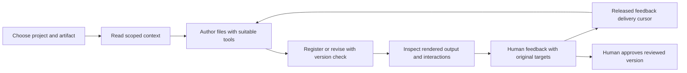

# Artifact Studio — architecture and implementation status

Status: **first implementation available, 2 November 2026**. The visual library, project/artifact foundation, adaptive viewers, generic MCP tools and versioned review workflow are implemented. The original clickable concept is a design reference; it is no longer the only available artifact interface.

The hub preserves existing presentation locations, editor links and review history. Opening the hub does not migrate personal sources or broaden repository uploads. Whole multi-artifact archives, expanded sync and general artifact host hooks remain subsequent work.

## Implemented surface

| Area | Available now | Boundary |
| --- | --- | --- |
| Library | All-artifact grid, project/search/format filters, cached real previews and format fallbacks | Cards use images, not one running iframe per artifact. |
| Projects | Shared brief, related artifact rows, project creation and membership changes | Moving membership preserves canonical source paths. Related content is not edited automatically. |
| File bundles | Import files/folders; register an agent-authored local file or tree; automatic kind detection and an entrypoint | No fixed templates, design pack requirement or automatic build/install execution. |
| HTML | Responsive page preview, authored JavaScript and element multiselection | Opaque-origin sandbox with scoped local assets. External services are not automatically enabled. |
| Markdown | Rendered document and original source, text/block selections | Raw HTML is escaped. Owned image resources retain revision identity. |
| Images/SVG | Original proportions, zoom and region multiselection | Regions retain normalized coordinates and original dimensions. |
| Other files | Original storage, file downloads and artifact-level discussion | Native editing/rendering is not promised for arbitrary binary formats. |
| Review | Per-artifact drafts, grouped targets, attachments, Live/Batch release, replies and human approval | Generic feedback release is implemented; automatic Codex/Claude host continuation remains presentation-only. |
| Revisions | Immutable snapshots, expected-version writes, idempotent retries and out-of-band source reconciliation | SQLite publishes the current revision pointer; the adjacent manifest is a readable mirror. Arbitrary external file writes are not a multi-file transaction. |
| Context | Scoped paths/hashes, available sources and latest recorded delivery | A returned pointer is not proof of reading or retention. |
| Visual inspection | `capture_artifact` with exact revision, viewport, elapsed time and optional full-page output | A fresh offline capture does not reproduce every user interaction. Inspect those states in a browser. |
| Existing decks | Original editor, slide tools, design guidance, presenter, archives and audience exports | Keep specialized presentation operations for presentation changes. |

The documentation screenshots use fictional QA projects. They show the running implementation, not a migration of private user content.

## Product model

An artifact is a named, versioned file or bundle with an entrypoint. Its type selects a viewer and review affordances; it does not constrain the agent's authoring technology or layout.

```text
Workspace
  Explicit rules, secondary preferences, designs and connections
  Project
    Shared brief and related artifact references
    Presentation → slides → elements
    HTML page → elements and interaction states
    Markdown document → text and blocks
    Image/SVG → regions
    Other file → artifact-level feedback
```

Project context supplies defaults. Artifact-specific audience, purpose and instructions refine those defaults within applicable explicit rules. Related artifacts are references rather than automatic prompt content or edit targets. Suggest related updates before applying them.

### Architectural choice

| Approach | Advantage | Cost |
| --- | --- | --- |
| Represent everything as a slide deck | Reuses the original editor quickly | Forces slide dimensions, navigation and notes onto unrelated formats. |
| Separate format applications | Independent viewer behavior | Duplicates projects, context, feedback and review state. |
| **Shared artifact model with adaptive viewers** | Shared review/context with natural format behavior and extensible viewers | Requires compatibility adapters for presentation storage and feedback. |

The third approach is implemented. There is no global Slides/Documents/Image mode. The library opens the appropriate viewer, while existing `/?deck=...` destinations continue to use the slide editor.

## Library and review workspace

The home page is a visual library with cached previews, title, project, kind and review status. An orange circular revision marker identifies updated work; approval is a separate state. A format fallback remains useful when capture is unavailable.

Inside an artifact, a compact left rail has one project selector and related artifact rows. The central viewer keeps the artifact's natural format. Conversation stays on the right, or below the preview on narrow screens. Sources, paths, context and receipt details are available in disclosures and the Agent context inspector. The existing presentation editor retains slide thumbnails and its specialized controls.

The Import action accepts arbitrary files or a folder and an entrypoint. **… → New presentation** reaches the existing deck-creation flow; **Presentation tools** reaches its workspace menus. New generic artifacts do not require a corporate design or conversion into slide HTML.

Select an element, text block/range or image region. Cmd/Ctrl/Shift adds targets to a group; each target can be removed independently. A message records the originating artifact, source hash and selection group. HTML selections use a scoped bridge across the iframe boundary; authored code does not receive the parent workspace's privileges.

## Authoring and agent flow



Implemented generic operations are registered in [artifact_studio/artifact_tools.py](../artifact_studio/artifact_tools.py). The generated [tool catalogue](../agent/tools.json) reflects runtime registration; [agent/README.md](../agent/README.md) maps the complete contract.

| Operation | Responsibility |
| --- | --- |
| `list_projects` / `list_artifacts` | Discovery without source bodies. |
| `create_project` | Shared brief and identity without an imposed design. |
| `get_working_context` | Applicable rules, selected project/artifact context, capabilities and provenance. Legacy selections also retain their deck design context. |
| `get_artifact` / `read_artifact_files` | Manifest and only requested source files, including retained revisions. |
| `register_artifact` | Copy a local authored file/tree into owned storage; preserve the original. |
| `revise_artifact` | Publish a changed-file set using an expected revision/hash and request ID. |
| `capture_artifact` | Actual rendered image with revision/viewport evidence; offline JavaScript execution and elapsed-time sampling. |
| `read_artifact_feedback` | Released requests in delivery order, excluding withheld Batch drafts. |
| `reply_to_artifact_feedback` | Agent replies against an explicit version. |

Writes return compact identity/version/destination receipts. They do not echo complete file trees or base64 assets. Current tool annotations, descriptions and parameter models remain the capability contract. Guides and optional skills explain workflow rather than defining an allowed catalogue of visual components.

Plain MCP is stateless and does not wake a closed agent chat. Generic Live means immediate release; Batch requires explicit release. Existing presentation lifecycle hooks remain supported without claiming equivalent generic host continuation.

## Review identity and source ownership

Feedback carries project/artifact identity, source revision/hash and optional anchors. A grouped target contains individual anchors, rather than concatenated HTML. Image regions include the original dimensions; text anchors retain quoted content. Targets are best-effort and remain attached to their recorded version. The UI does not silently relabel old targets as current.

Owned bundles retain complete immutable source snapshots. Managed revisions stage changed files, preserve unrelated files and publish the current pointer through a database transaction. Optimistic version checks reject competing writes; request IDs make exact retries safe. The human-readable manifest mirrors the committed state. Working-source edits made outside the hub are detected and reconciled before review; altered retained snapshots report a conflict.

Approval belongs to the exact reviewed source snapshot. Dependency bytes, entrypoint, kind and viewer identity participate in review identity. Local file changes invalidate earlier approval. Potential remote dependencies are recorded and visibly qualified; local hashes do not freeze remote content or prove deterministic runtime behavior.

Registered originals remain intact. The owned source path is the artifact's working source. Project reassignment changes membership while retaining stable storage paths, so an artifact can live under its original project directory after a move. Legacy decks remain in place through the compatibility adapter.

Explicit shared-asset dependency graphs, capability opt-ins for external services and reproducible frozen interaction captures are not fully implemented. Current owned bundles keep local dependencies together and block unsupported network access rather than silently claiming universal application execution.

## Canonical files and transparent context

```text
agent/
  README.md                       Human-readable contract map
  bootstrap.md                    Canonical MCP startup guidance
  guides/artifacts.md             Generic authoring/review guide
  tools.json                      Generated runtime tool catalogue
.agents/skills/                   Host-discoverable workflows
artifact_studio/
  app.py                          Existing and shared MCP/API integration
  artifact_tools.py               Generic MCP handlers
  artifact_api.py                 Browser API
  artifact_models.py              Typed manifests and review envelopes
  artifacts.py                    Owned files, snapshots and review storage
  artifact_context.py             Scoped context receipts
  artifact_preview.py             Isolated previews and resource policy
  artifact_capture.py             Offline rendered evidence
web/
  hub.html, hub.js, hub.css        Library and adaptive workspace
  artifact-bridge.js              Scoped selection bridge
```

This is the implemented structure. Presentation guides and existing modules retain their established paths. A larger package refactor and separate HTML/document/image guide files remain optional future changes; they are not prerequisites for the current runtime.

Workspace files remain separate from the tool repository:

```text
<collection>/
  INSTRUCTIONS.md
  LEARNED-PREFERENCES.md
  <existing presentation/design folders>
  projects/<project-id>/
    project.json
    README.md
    artifacts/<artifact-id>/
      artifact.json
      files/
        index.html | document.md | image.svg | other entrypoint
        assets/
      revisions/<revision>/
        artifact.json
        files/
```

The database and other review state remain at the configured state location. Back up both source collection and state. Opening the hub does not move existing collections, rewrite rules or replace canonical preview links.

The Agent context inspector shows source scope, canonical path, hash and delivery state alongside the latest recorded receipt. Sources can be available, returned, or omitted because the caller asserted retention. The current rules retention hash still combines workspace rules and learned preferences; separate displayed source hashes do not imply independent retention caches. Tracking reads performed through unrelated tools or proving model memory is outside the server's capability.

Resolve applicability before precedence. Direct user instructions and applicable explicit workspace rules remain authoritative. Learned preferences are secondary. Presentation-only rules about notes, slides and presenter behavior do not automatically become document/image rules. Reorganizing personal instruction scope requires an intentional reviewed change.

## Remaining scope

| Follow-up | Required boundary |
| --- | --- |
| Complete multi-artifact archives and restore | Include owned files, relationships, revisions and review state; stage restores and handle ID collisions without silent replacement. Existing presentation archives continue to work. |
| Expanded repository sync | Preserve existing presentation scope by default. New artifact types need an explicit opt-in, with private review state and source ownership handled deliberately. |
| Generic automatic host continuation | Add supported lifecycle delivery adapters; do not equate immediate feedback release with waking an agent. |
| Shared assets and external capabilities | Track dependencies and ownership explicitly, invalidate affected reviews, and report unavailable or mutable inputs. |
| Richer interaction evidence | Capture meaningful user-driven states where supported; report unresolved replay/anchor limitations. |
| Large collection refinements | Extend pagination, preview scheduling and navigation based on measured behavior. |

Verification should continue to cover unchanged legacy deck links and exports; freeform HTML/JS without a design; safe long Markdown and SVG/image proportions; multiselection and draft isolation; immutable revision previews; conflicting writes; Batch privacy and attachment downloads; real captures and interactive behavior. Browser checks do not substitute for physical multi-display or native-host checks. Current verification evidence belongs in [QA.md](../QA.md).
