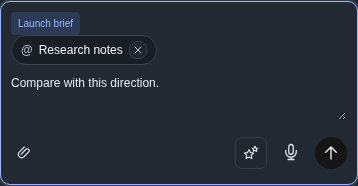
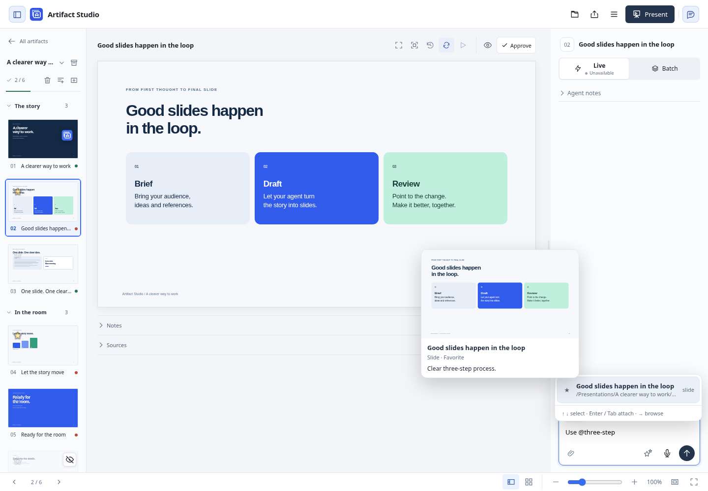
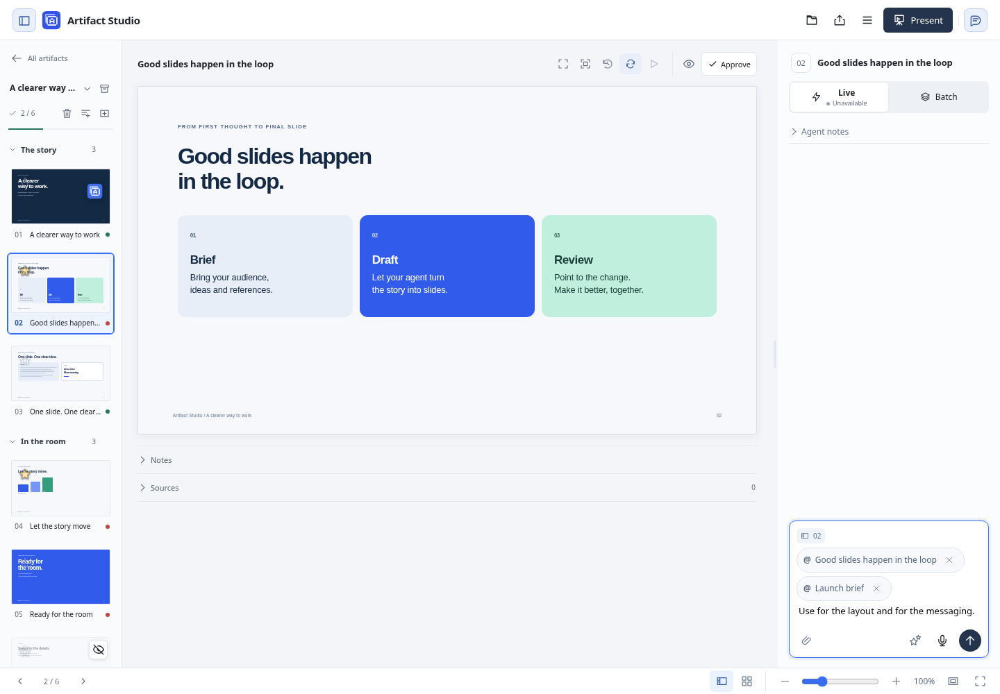
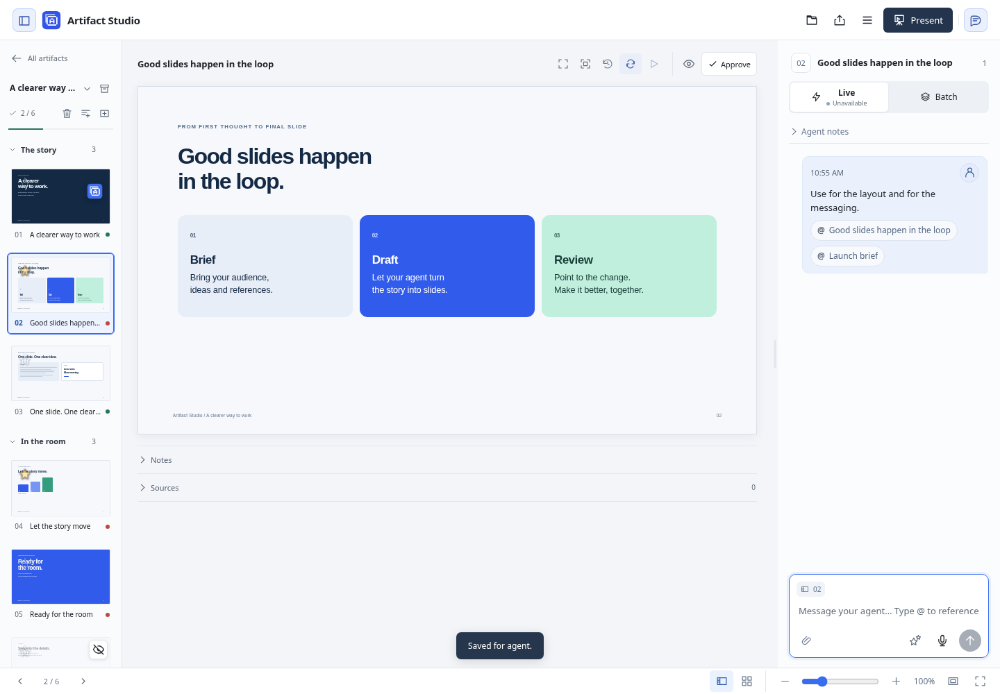
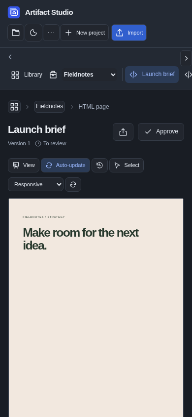
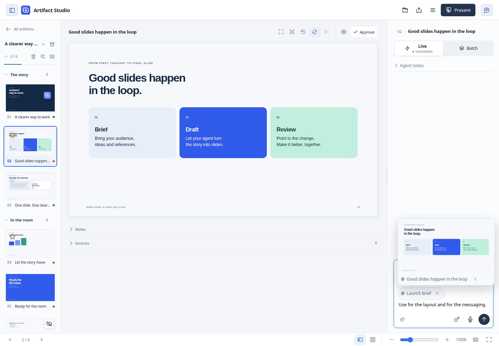
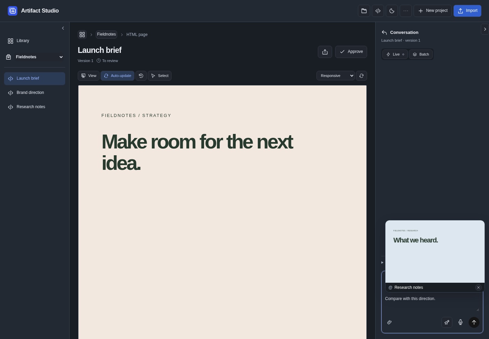

# Referencing work in chat

Type **@** in presentation or artifact chat. Search by a project, artifact,
presentation or slide title; favorite-slide descriptions are searchable too.
Choose a suggestion to attach its saved context.

- **↑ / ↓** selects a suggestion; **Enter** or **Tab** attaches it without sending the message.
- **→** browses into the selected project or presentation. Continue typing after
  `/` to narrow the path, for example `@Fieldnotes/Launch brief`.
- **Escape** dismisses suggestions. Enter sends normally after the picker closes.
- Hover over a suggestion for a preview next to the cursor. Keyboard selection
  shows the preview beside the list. Touch selection works without hover.

Artifact and presentation previews reuse saved library covers. When a cover is
being updated, the previous saved preview can stay visible; moving away or
dismissing suggestions stops waiting for the update. Individual slides retain
their live slide preview. The title and reference remain available if a cover
cannot be rendered.

The selected query becomes a compact pill showing the slide, project or artifact
title. Full paths stay out of your message. Hover over a pill, or focus it with
the keyboard, to unfold the saved slide upward from the same surface. The title
and composer stay in place. Moving onto the slide keeps it open; moving away
folds it back into the title. Press **Escape** to fold it without moving focus.
Reduced-motion settings make opening and closing instant. Near the top of the
window, the pill unfolds downward to keep the preview visible.
Remove a draft pill with its **×**. Sent references remain title pills you can click
to download the frozen source. Repeating the same version in one message reuses
its attachment. Up to five attachments fit in one message.

Click the **button with two stars beside the paperclip** to choose several favorite slides
at once, including slides from other presentations. These use the same compact
title pills; descriptions stay inside the frozen reference delivered to your agent.
The two stars represent the collection; the single star on a slide saves that slide
to Favorites.

Pill previews use the attachment captured when you selected the reference, even
after its source changes or disappears. Slides show their saved canvas;
presentations show the first saved slide. HTML artifacts show a static thumbnail
with saved styles and images; scripts stay paused. Project references show their
saved brief and artifact index. Unsupported or large sources remain available to
download. On touch screens, tap a draft pill to open or close it, or tap outside
to close it. Tap a sent pill once to preview and again to download its source.

## What the agent receives

| Selected item | Saved context |
| --- | --- |
| Project | The project brief and an artifact index, including IDs and versions. Select individual artifacts when their source is needed. |
| Artifact | Its authored brief and audience files, with text sources first, local dependencies included, and external dependencies and excluded paths identified. |
| Presentation | The full audience presentation, including embedded local assets and interactive dependencies. |
| Slide | The chosen slide and its optional favorite description, with theme and local assets. It does not need to be starred. |

Private feedback, unreleased Batch messages and speaker notes are excluded.
References preserve the selected version after the source is renamed, moved or
edited. Changes while a reference is being selected require choosing it again.
Readable paths are labels; stable IDs distinguish identical titles. Selecting a
reference does not grant permission to edit its source.

References use the existing feedback attachment delivery. Local agents read the
saved path. Hosted agents use `read_feedback_attachment` on the destination
chat's released message. Source content is loaded only when selected; the
workspace reference catalog is not added to agent startup context.

