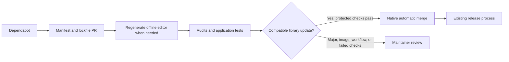

# Dependency updates

Dependabot opens updates against `main`. Compatible Python and npm updates can
merge automatically after the protected **Dependency safety** check passes on
an up-to-date branch. Major upgrades, Docker changes and workflow/action updates
remain open for review. A security fix requiring a major upgrade can still be
proposed when dependency resolution permits it; there is no blanket major-version
ignore rule.



## Coverage

| Dependencies | Discovery and update behavior |
| --- | --- |
| Python, `pyproject.toml` and `uv.lock` | Daily version updates include direct and transitive packages, including development tools. Dependabot security updates respond to supported alerts. |
| npm, `scripts/text-editor` and `scripts/release` | Daily direct version updates and lockfile security fixes, including vulnerable transitive dependencies when the resolver can find a compatible fix. |
| GitHub Actions | Weekly updates retain SHA pinning. These updates require review because they affect the checks themselves. GitHub does not provide dependency-graph security alerts for SHA-only action references; bundled action internals depend on upstream releases. |
| Docker base images | Daily tag/digest update proposals. Digest pins detect republished base images. Image changes require review and a tested rebuild. |

Security updates have their own groups and are not delayed until the scheduled
version-update run. Compatible routine changes are grouped to reduce PR traffic;
major changes remain visible. Security groups can contain a major change, in
which case the whole PR requires review.

`uv audit --locked` checks the resolved Python graph for Linux, macOS and Windows,
including development groups and platform-only packages. `npm audit --package-lock-only`
checks both npm trees. These run in CI and
in a lightweight daily workflow, so a new advisory can be detected without a
source change. A reported vulnerability or unavailable audit service fails the
check. Audits find known advisories; they do not prove code is vulnerability-free.

Dependabot cannot fix an unavailable upstream release or an incompatible parent
constraint. For uv, a transitive security update cannot automatically upgrade its
parent dependency when that is also required; the maintainer must update the
parent. npm can attempt parent updates for transitive security fixes. See
[GitHub's security-update limitations](https://docs.github.com/en/code-security/concepts/supply-chain-security/dependabot-security-updates).
npm routine version updates do not refresh every transitive package;
security updates and audits cover that separate case. Docker OS packages and
Playwright's downloaded Chromium are outside the Python/npm lockfile audits:
base-image and Playwright upgrades plus fresh image rebuilds are needed. No
running installation or published image is automatically replaced by these PRs.

## Automatic merge and editor regeneration

The trusted `pull_request_target` workflow validates the real PR, repository,
branch, exact head, full file inventory and verified Dependabot commits. Only
the six Python/npm manifest and lockfile paths are eligible. It uses verified
Dependabot metadata to distinguish patch/minor from major or unknown changes.
Missing metadata, changed heads, human commits, unexpected files and unreadable
settings prevent a new automatic-merge request. A new event first revokes a
previous queue entry before checkout and reevaluation, including base changes
and conversion to draft.

The workflow only asks GitHub to enable **native auto-merge**. It never directly
merges a PR or bypasses protection. It requires repository auto-merge plus an
active branch ruleset for `main` with strict status checks and **Dependency safety**
bound to the GitHub Actions app. Rules are read through GitHub's metadata-only
branch-rules API; the built-in workflow token cannot read classic-protection
details. Existing classic protections can remain alongside the ruleset.
Other repository or organization rules continue to apply.

Repository writers remain trusted. Disable auto-merge before manually editing
or retargeting a queued PR: event-based cancellation is asynchronous and cannot
atomically revoke a writer's change before GitHub acts on the existing queue.
Native auto-merge enforces required checks, not this workflow's author policy on
future edits. The cancellation step reduces that window but does not eliminate it.

Editor npm updates also rebuild the shipped CodeMirror JavaScript and license
files; a lockfile-only update would leave the old code in the app. The build job
has a read-only token, no persisted checkout credentials, and disables npm
lifecycle scripts. A separate job checks out trusted base source, accepts only
three bounded generated files from that same workflow run, revalidates the
original Dependabot head, and atomically appends a generated-files commit.
No PR source or installed dependency executes with the write token.

An automatic merge already queued for the verified dependency change remains
subject to successful checks on the generated head. The writer explicitly
dispatches full CI because `GITHUB_TOKEN` commits do not trigger ordinary PR
workflows. **Dependency safety** requires audits, unit/frontend/release tests,
agent and browser journeys, and applicable Docker/macOS checks. Unknown change
history and explicit CI dispatch run both platform suites. Expected platform
skips are distinguished from missing, cancelled or failed checks.

If the generated commit succeeds but CI dispatch fails, run
`gh workflow run ci.yml --ref <dependabot-branch>` after checking the branch.
Reopening or editing an already-generated PR revokes automatic merging and
requires maintainer review; it is not treated as a fresh all-Dependabot commit
history. Do not bypass the gate to recover a failed update.

## GitHub settings

Repository administrators should enable:

1. Dependency graph, Dependabot alerts and Dependabot security updates under
   **Settings → Advanced Security** (GitHub may label this **Code security**).
2. **Allow auto-merge** under **Settings → General → Pull Requests**.
3. Under **Settings → Rules → Rulesets**, create an **Active** branch ruleset
   targeting `main`. Require pull requests, conversation resolution, and the
   **Dependency safety** status check from the **GitHub Actions** app, with
   **Require branches to be up to date** enabled. Block force pushes and deletion.
   Leave the bypass list empty, including for administrators. No human approval
   count is required for the automatic dependency path.

A classic rule alone is insufficient for the automatic eligibility check:
GitHub denies its details to the built-in workflow token. Do not add a personal
token to work around this. The active branch-rules endpoint exposes the needed
strict-check policy with metadata-read permission, without bypass credentials.
GitHub omits disabled/evaluate-only rules from that endpoint. Administrators
must also verify the ruleset's bypass list when configuring it.

Activate the required check when the CI change is available in the PR being
merged. Older PRs without that check need updating. Dependabot configuration and
the trusted update workflow become active when they reach the default branch.
Adding YAML alone does not enable the security settings. Integration tokens
without repository-administration permission cannot change these settings.

## Validation and current fixes

The policy tests execute the real runners with a simulated GitHub API. They
exercise signed/forged PRs, stale heads, missing inventories, unknown/major
updates, protection settings, revoked queues, failed checks, artifact allowlists,
atomic writes and explicit CI dispatch. These simulations do not impersonate a
real Dependabot event or prove a repository setting is enabled.

The initial audit required Pillow **13.0.0** for reported fixes. This major
upgrade is reviewed and tested in the implementation PR. The release simulation
tree also overrides `@google-automations/git-file-utils`'s minimatch dependency
to **^11.0.5** for GHSA-g3hv-75wg-m249, because its parent still allows a vulnerable
major. Release simulations and real file-discovery calls test compatibility;
remove the override when the parent permits a fixed version. This override
affects the npm simulation tree, not the separately bundled Release Please action.

Local checks:

```sh
uv audit --locked --preview-features audit-command --python-platform linux
uv audit --locked --preview-features audit-command --python-platform macos
uv audit --locked --preview-features audit-command --python-platform windows
npm audit --prefix scripts/release --package-lock-only
npm audit --prefix scripts/text-editor --package-lock-only
node --test tests/test_dependency_automation.cjs
npm ci --prefix scripts/release --ignore-scripts --no-audit --no-fund
node --test scripts/release/*.cjs
npm ci --prefix scripts/text-editor --ignore-scripts --no-audit --no-fund
npm run --prefix scripts/text-editor build
node scripts/text-editor/check.mjs
```
