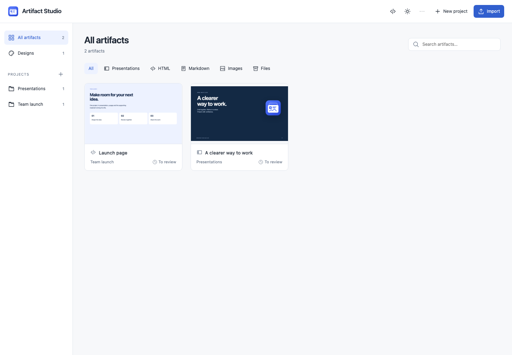
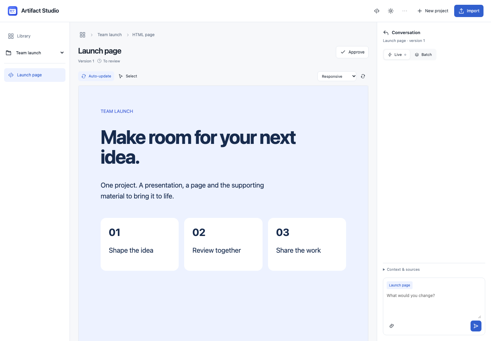
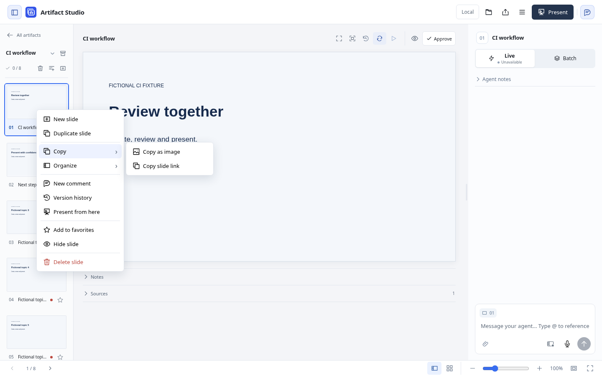
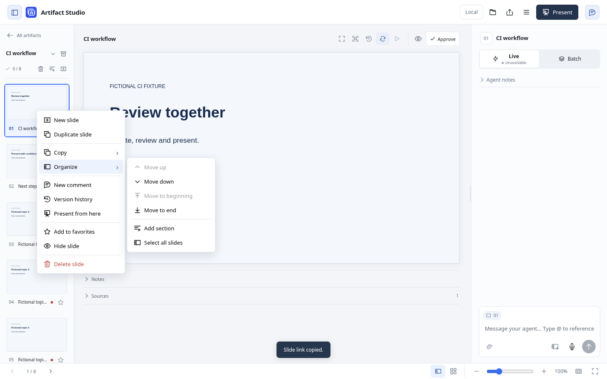
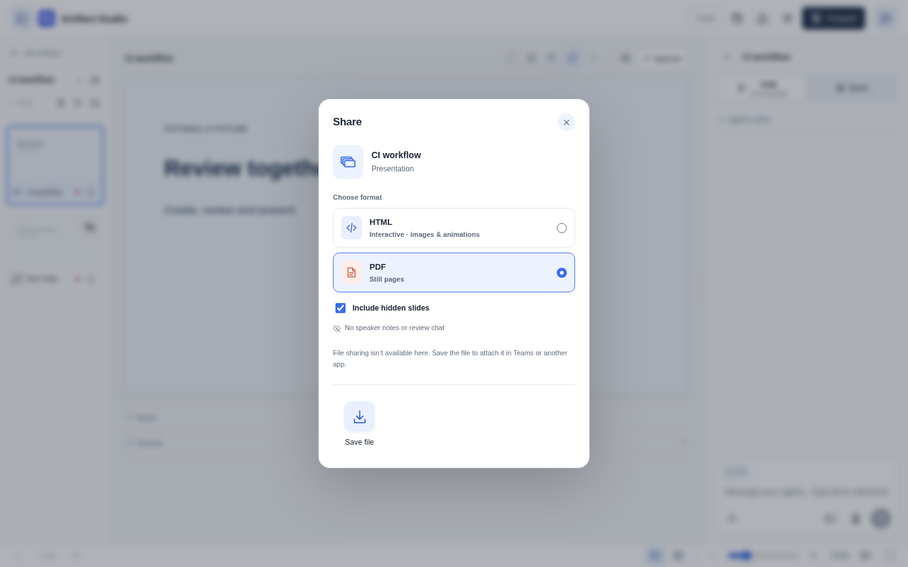
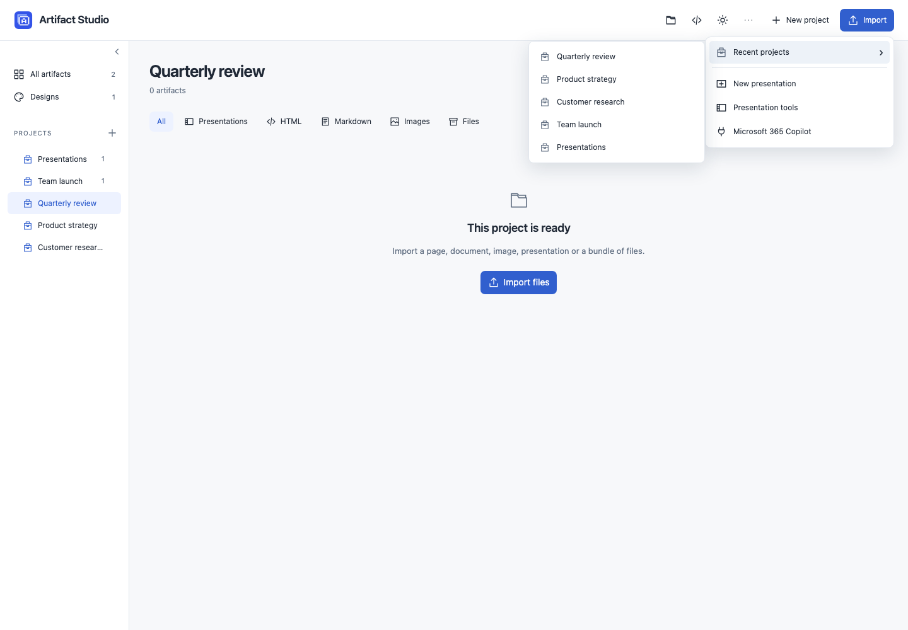

# Set up and use Artifact Studio

Create and review related artifacts with an existing AI agent. The home page is the **Library**: a visual library of presentations, HTML pages, Markdown documents, images and other files, grouped by project. Each artifact opens with its own preview and conversation. Agents connect through **stateless Streamable HTTP MCP**; local files and review history persist between connections.

General artifacts need no design pack or fixed template. The viewer supports authored HTML/CSS/JavaScript bundles, safe Markdown rendering and images at their original proportions. **Design packs and example presentations are not bundled.** For presentations, add a design from a PPTX, website, PDF or reference images. PowerPoint files remain reference inputs; the app creates HTML presentations and does not export PPTX.

## Install

### Install on Mac

Install the menu-bar app from the source checkout, then choose **Open Artifact Studio** from the artifact icon beside the clock. The app starts the server and can launch at login. [Install on Mac](../README.md#install-on-mac)

A filled status square means the server is responding. Use the menu to start, stop or restart it. **Update…** appears when a newer release is available. **Settings** includes Launch at Login, GitHub Backup and the nightly update channel. [Mac menu controls and settings](MACOS.md)

Chromium enables new previews and agent captures. Saved library covers still load when Chromium is unavailable. Capture tools return images through MCP. [Visual review](VISUAL-REVIEW.md)

### Run with Docker

The container setup has its own persistent workspace and update process. [Docker installation and workspace restore](DOCKER.md)

## Guided setup

Clone the repository using Git, then open its folder as your agent's working project. Run:

| Agent | Command in the agent chat |
| --- | --- |
| Claude Code | `/setup` — bundled project command |
| Codex | `$setup` — bundled repository skill |

Both commands use the same setup workflow. It defaults to the menu-bar app on a new Mac, reuses existing settings and connects MCP. You can specify preferences such as “start at login” or “use Docker”. If the command is missing, reload the agent session. From another folder, give the agent the absolute path to this checkout's setup skill. [Setup workflow](../.agents/skills/setup/SKILL.md)

Use these commands in the agent chat. The agent may ask you to reload the session or approve its connection. [Codex skills](https://learn.chatgpt.com/docs/build-skills) · [Claude Code commands](https://code.claude.com/docs/en/slash-commands)

## Connect your agent

Keep Artifact Studio running. In an MCP-compatible agent, add this server:

| Setting | Value |
| --- | --- |
| Transport | Streamable HTTP |
| URL | `http://127.0.0.1:8790/mcp` |

For Codex CLI:

```sh
codex mcp add artifact-studio --url http://127.0.0.1:8790/mcp
```

For [Claude Code](https://code.claude.com/docs/en/mcp), run from the project where you will review slides:

```sh
claude mcp add --transport http artifact-studio http://127.0.0.1:8790/mcp
```

Use a new agent session if the newly added server is not visible in the current one. From the hub, **… → Presentation tools** opens the existing editor. Its **Menu → Agent connection** provides a copyable presentation prompt and the server URL. Copying the prompt does not configure an MCP client or start an idle agent.

For **Microsoft 365 Copilot**, choose the Microsoft 365 option in the hub menu or the editor's Agent connection dialog. Follow the [Copilot Studio setup guide](MICROSOFT-COPILOT.md) for the separate authenticated gateway, project scope and HTTPS endpoint. Keep the ordinary local server private. A local agent can prepare this setup; Microsoft sign-in, credentials and tenant permissions remain explicit steps. Cloud feedback must be requested in the Copilot conversation; local lifecycle hooks do not apply.

For general work, ask the agent to call `list_projects` and `list_artifacts`, then `get_working_context(project_id=..., artifact_id=...)` for the selected scope. It receives applicable rules, project/artifact context, source pointers and a delivery receipt. Read source files with `read_artifact_files`; load the generic guide through `get_authoring_guide(topic="artifacts")`.

Ask the connected agent to call `get_working_context(deck_id=...)` when resuming an existing deck, so it receives that deck's design preferences. For a new deck, use `get_working_context(design_id=...)` for the chosen brand, or omit the ID for the default, then call `create_presentation` with a brief. The compact context contains complete workspace rules and preferences, a short quickstart, available designs/presentations, reference libraries, local paths and workspace/MCP URLs. Load specific guides with `get_authoring_guide(topic=...)`. Read the full saved brief and relevant attachments through `get_presentation_outline(deck_id=..., include_context=True)` before drafting. Each tool call uses explicit presentation/slide IDs; there is no hidden active presentation.

In the presentation editor, open **Menu → Instructions** to edit **Workspace rules** with rich text. Expand **Learned preferences** for secondary guidance. Click **Save** to write the collection's `INSTRUCTIONS.md` and `LEARNED-PREFERENCES.md`; conflicts with another editor are reported without replacing either document. Applicable rules guide projects and artifacts, and learned guidance never overrides explicit workspace rules. Presentation-only requirements remain specific to presentations. Both are included in subsequent MCP context and feedback reads. Enabled GitHub auto-sync includes the saved files; reference-only connections do not upload them. Each presentation keeps its audience, client, content and brief in its own README. Advanced Markdown uses a source editor when needed to preserve formatting.

The bundled `$artifact-studio-learn` skill can review relevant human transcripts and released feedback weekly. Scheduling belongs to your agent harness; installing Artifact Studio does not create a schedule automatically. Explicit rules stay primary, and each learned preference records its evidence and scope. [Invocation and weekly setup](PREFERENCE-LEARNING.md).

## Create and review an artifact project

The library shows all existing artifacts. Use project filters, format tabs and search to find work. Preview cards contain cached rendered images; unavailable captures use a format fallback. Existing decks open in their established slide editor, and direct `/?deck=...` links remain valid.



Choose **New project** to save a title and optional shared brief. Choose **Import**, select the project, and add files or a folder. **Open first** selects the entrypoint; type detection chooses a viewer. Browser import currently accepts up to 1,000 files and 100 MB at once. Sources can include arbitrary HTML, CSS, JavaScript, SVG, images, fonts, data and native files. Importing never executes build or installation scripts.

An agent can instead author files using its preferred tools, then call `register_artifact` with the project ID, local source path and entrypoint. The hub creates an owned copy and preserves the original. Subsequent `revise_artifact` calls publish changed files with an expected revision/hash and an idempotency request ID.

A card's folder action or **Sources & files → Move to project** changes membership without relocating the canonical source. Related artifacts share the project brief, but retain their own purpose, review state and conversation. Ask for related changes explicitly; grouping is not permission to rewrite every artifact.

Use the **+** beside **Projects** to add a project or navigation folder. Folder menus create nested folders/projects, rename or move them; drag rows to reorder siblings or place them inside a folder. The same actions are available from each row's menu and the keyboard. Selecting a folder includes its descendant projects. Removing a navigation folder keeps its projects and sources. Drag an artifact card onto a project row, or use **Move to project**, to change its membership; navigation folders do not relocate source files.

Right-click a library card or related-artifact row for its open/view, conversation, move, share, link and context actions; owned artifacts also offer **Version history**, while presentations offer **Present**. Project and folder rows offer their navigation, creation and movement actions. Right-click blank library space to create or import work. **Shift+F10** or the keyboard Menu key opens the focused item's menu; arrows and Home/End navigate, and Escape returns focus. Inputs, links and authored controls keep native menus outside active element selection.

### Designs and work

The sidebar’s **Designs** opens registered design packs and their examples, with the workspace default marked. They are excluded from **All artifacts** and project counts. Presentations created from a design remain normal artifacts. Classification uses each pack’s `design.json`; files and existing links stay in place.

In **All artifacts**, project and folder overviews, use the sort control beside the format filters: **Name** (natural A–Z), **Last changed** (newest content first), **Created** (newest first), or **File type** (format groups with names A–Z inside each group). The arrow reverses the order. Search and format filters keep the selected order; one setting is shared across these overviews and remembered in this browser. Sorting does not move files or reorder projects. Legacy presentation dates use available history and filesystem timestamps.

### Adaptive viewers

| Format | Available controls |
| --- | --- |
| HTML | Natural page preview, responsive/desktop/tablet/mobile widths, replay and element selection. Authored JavaScript runs in an opaque-origin sandbox with scoped local resources. External services are not automatically available. |
| Markdown | Rendered document or original source. Raw HTML stays literal; owned images use revision-pinned resources. |
| Image/SVG | Original aspect ratio, fit/zoom, and drag a region while Select is active. |
| Other files | Original download, file inventory and artifact-level feedback. A dedicated preview may be unavailable. |

Choose **Select**, then click an element or text block, select document text, or drag an image rectangle. Hold **Cmd, Ctrl or Shift** to add targets. Remove a target with its × or clear the group. Image regions retain the original image dimensions; text and element targets retain quoted content. Dynamic anchors are best-effort and stay attached to their original revision.



Write feedback in the artifact's conversation. **Enter** sends and **Shift+Enter** adds a line. Use the paperclip, drop files or paste an image; a file-only message is supported. Limits are five files, 25 MB each and 50 MB combined. Remove an unsent file with its ×; sent files can be downloaded from the message. Text and target drafts persist in browser storage; unsent file selections remain in browser memory.

Images show small thumbnails in the composer and message history, in both presentation and artifact chats. Click a thumbnail for a larger preview, press **Esc** to return, or choose **Download original**. Preview generation leaves the original file unchanged.

**Live** releases a message immediately. **Batch** keeps messages and attachments private until **Send batch**. Loaded Codex/Claude Code lifecycle hooks continue the connected agent for every artifact type. The Live dot's tooltip identifies the connection; **End review** stops listening. Agents read released requests through `read_artifact_feedback`. An ordinary MCP connection cannot start a closed chat. See [hook setup](LIVE-REVIEW.md).

**Auto-update** is on by default and remembered in this browser. Incoming previews keep your feedback draft and its original target/version context. Slide updates wait for direct element edits, moves and animation playback; HTML previews wait while you interact inside them. Turn Auto-update off to open revisions manually. Generic viewers check periodically, so changes can take a few seconds.

**Updated** marks a new revision until opened. **Approve** records the displayed version, independently of the update marker. The preview and its local dependencies are pinned to the displayed revision. In the slide editor, click objects directly and hold **Cmd, Ctrl or Shift** to add or remove them; the **Objects** picker also supports multiple targets. Individual context chips remove objects without discarding the message. Direct text editing and keyboard positioning remain single-object actions.

Right-click a selected slide/HTML element, or press **Shift+F10**, for its edit menu. **Delete**, arrow-key movement and **Undo/Redo** preview the current unsent edit. **Send edit** creates a version-bound request for the agent; it does not directly write source files. Native text fields keep their usual editing shortcuts. [Element keyboard controls](KEYBOARD-CONTROLS.md).

For multiple selected slide objects, the menu offers **Delete selection**, alignment and layer changes. Deletion and supported layer changes preview locally; other arrangements and alignment are labeled requests without a final-layout preview. **Send edit** submits one request anchored to all original targets. Send or cancel before changing the selection or navigating. Cancel restores local originals; dismissing a sent preview does not retract its request. HTML multi-selection remains group feedback with single-object direct edits.

Drag from empty space on a slide, or in an HTML artifact with **Select** enabled, to enclose multiple objects. Hold **Shift, Cmd or Ctrl** to add objects; **Escape** cancels the drag. Right-click selected objects for **Save as image…** to download a transparent PNG. Right-click an image for its original file as well. Export uses the displayed version and local edit preview without submitting feedback or saving edits. Local images and canvas pixels are supported; unavailable external resources and nested frames are excluded. PNG export requires the local Chromium renderer used for visual review.

Right-click one slide in the sidebar or slide sorter and choose **Copy → Copy as image** to copy its saved artwork as a full-resolution PNG. **Copy slide link** is in the same submenu. Select one or more thumbnails and choose **Export → HTML** or **Export → PDF** to download only those saved slides, including selected hidden slides, in presentation order. Notes and review chat are excluded. **Organize** groups movement, sections and selection; review, presentation and visibility commands remain directly accessible, with Delete separated at the bottom. Paste copied artwork into another app, including PowerPoint. Notes, feedback and editor controls are excluded, and unsent drafts remain intact. This requires the Chromium renderer and browser clipboard access on HTTPS or localhost; if the slide changed, refresh before copying again.





Submenus expand inline in narrow windows. [See the narrow-window menu](assets/slide-menu-narrow.png).

For PDF exports, uncheck **Include hidden slides** to export only visible slides. This option is available in **Share → PDF** (including presentation PDFs inside project ZIPs) and in the PDF print preview before **Save as PDF**. It starts checked to preserve existing exports. Excluding every slide shows a clear empty-state message instead of exporting blank pages. Interactive HTML exports retain hidden slides for deliberate navigation.



Open **Sources & files** for downloads, canonical source path and content hash. The **Agent context** inspector shows applicable source paths, scopes, hashes and the latest recorded delivery. Available pointers are not read receipts. Matching retention hashes are useful only while the agent actually retains that guidance.

For visual inspection, agents can call `capture_artifact` with viewport dimensions, a revision, elapsed animation time and optional full-page capture. It returns actual rendered evidence from a fresh offline runtime. Browser inspection is still needed for user-driven interaction states. Use the specialized slide capture tools for existing decks.

## Make your first presentation

An empty workspace on first launch is expected.

1. From the hub, open **… → New presentation**. The existing editor also has **Menu → New presentation**. The hub's separate **New project** action creates a shared artifact project.
2. Click **+** beside **Design library**. Send a PPTX, URL or reference files through the design chat. Then tell your connected agent: **“Read my pending design request in Artifact Studio, inspect the reference, and build and register the design.”** If the request stays **Queued**, resume the agent with that prompt; connecting an agent alone does not keep it listening. You can also provide the reference directly in the agent's chat. [Design import details](DESIGN-PACKS.md).
3. Once the design appears, select it. Enter a title and a brief: audience, intended takeaway and key material. The **paperclip beside Brief** attaches reference files, up to five files, 25 MB each and 50 MB total.
4. Click **Create presentation**. This creates one branded draft cover and saves the brief and files for the agent; it does not generate the rest of the presentation automatically.
5. Use the **Menu → Agent connection → Copy agent prompt**, paste it into your connected agent's chat, and ask it to draft the presentation. Review the slides as the agent updates them.

Designs define a visual language, not locked layouts or a required slide count. Ask the agent to set a default design if you want it selected for future presentations. New installations have no brand-specific default.

## Review and present

The [keyboard shortcut reference](KEYBOARD-CONTROLS.md) lists the available file, slide, object, chat, slideshow, project, panel and version-history controls.

The following controls apply to the presentation editor. Its top-right **Menu** groups file actions, workspace settings and the agent connection; **Present** stays beside it. Return through the library to open related non-slide artifacts. Open the menu with **F10** or focus it and press Up/Down. Use arrows, Home/End, Enter or type an action's name; Escape returns focus to the menu button. Appearance opens a submenu with Right; Left returns.

| Action | Mac | Windows/Linux |
| --- | --- | --- |
| New presentation | ⌘N | Ctrl+N |
| Import presentation | ⌘O | Ctrl+O |
| Save presentation | ⌘S | Ctrl+S |
| Presentation files / choose format | ⇧⌘S | Ctrl+Shift+S |
| Present from current slide | ⌘Return | Shift+F5 |
| Present from beginning | ⇧⌘Return or F5 | F5 |

File and presentation bindings follow [PowerPoint's editing](https://support.microsoft.com/en-us/accessibility/powerpoint/use-keyboard-shortcuts-to-create-powerpoint-presentations) and [slideshow shortcuts](https://support.microsoft.com/en-us/accessibility/powerpoint/use-keyboard-shortcuts-to-deliver-powerpoint-presentations). Save downloads a portable project, including recovered drafts; slides already persist locally. Shortcuts leave modal editors and text entry alone, except Save can capture a text draft. Some browsers reserve New/Open or function keys before the page receives them; use the menu in that case.

| Control | What it does |
| --- | --- |
| Top-left selector | Switch presentations. |
| Archive icon beside the selector | Remove the selected entry from the list. Use **Undo**, or open the restore icon below the selector later. Files, notes and review history remain recoverable. |
| Slide thumbnail | Open a slide. With a thumbnail focused, Up/Down selects the previous/next slide; Home/End selects the first/last. Red means unreviewed; green means you approved that exact content and its assets. An orange outline appears live after a revision and clears when you open that slide. Opening does not approve it. |
| Hide / Unhide Slide | Right-click a thumbnail or hover/focus it to reveal its eye icon. Hidden slides keep the crossed-out eye visible, dim and show a crossed-out number. Content, notes and approval are retained. |
| Move slides | Drag thumbnails to the insertion line, including between sections. Shift-click selects a range; Cmd/Ctrl-click selects individual slides. Right-click for movement commands, or press Cmd/Ctrl + Up/Down; add Shift for beginning/end. |
| Sections | The section icon starts a section at the active slide, or renames it at an existing boundary. Fold with its chevron; use its menu to rename, move or remove a group. Removing a section keeps its slides. Active new/recovered slides reveal their group. |
| Layout undo / redo | With a thumbnail or section header focused, Cmd/Ctrl+Z undoes slide moves and section changes; Cmd/Ctrl+Shift+Z or Ctrl+Y redoes them. Conflicting changes from another editor are reported without overwriting their layout. |
| New / Duplicate / Delete | The slide-plus icon below the deck selector adds a blank slide after the active one. Right-click thumbnails for New, Duplicate or Delete. With a thumbnail focused: Ctrl+M or Cmd+Shift+N adds, Cmd/Ctrl+D (also with Shift) duplicates, and Delete/Backspace deletes. Browser-reserved shortcuts may require using the menu. Multi-selection applies to Duplicate, Delete and Hide/Unhide. Keep at least one slide. |
| Recover deleted slides | Use the confirmation's Undo or Cmd/Ctrl+Z immediately after deletion. The trash icon below the selector lists deleted groups for recovery after reopening the app or importing a project. Other structural changes can invalidate layout undo; durable deleted-slide recovery remains available. |
| Slide objects | The object icon above the canvas lists visible text, images, diagrams and named groups. Hover or focus highlights an object; select it to use the existing edit/move/comment controls. Arrows, Home/End and Esc work inside the picker. |
| Slide element | Select it to edit text, drag or align to the slide. The check icon sends; Esc cancels. The agent applies the suggestion; the local preview is provisional. Tab/Enter select elements; arrows on the move icon position them, Enter sends. Unfinished edits block switching until sent or cancelled. |
| Version history | The history icon above the slide or artifact opens retained versions. **Content changes** filters consecutive identical-content saves; **All saves** includes source-only saves and repeated restores. Rapid-save groups initially show their latest version; expand earlier versions to browse the rest. Source and animation changes may look identical in a still preview. **Restore version** creates a new revision while keeping current human notes and slide structure. Historical slides reuse current shared theme/assets. |
| Slide conversation | Each thumbnail opens its own messages and draft. Messages render Markdown, including lists, code, tables and links. The slide number/title show the context included with every message. Ask for local edits or deck-wide changes here; the agent infers the scope. **Enter** sends; **Shift+Enter** adds a new line. The same shortcuts apply to design chat. Agent questions remain visible; explanations and sources are collapsed. |
| Panels and chat width | Top-bar icons toggle the slide list and chat. Narrow windows open chat as a drawer; Escape closes it. On phones the slide list also opens as a drawer. Drafts and the preview stay loaded. On desktop, drag the chat divider or focus it and use Left/Right, Home/End, or Enter to reset. Double-click also resets. |
| Live / Batch | Live releases each submitted comment immediately. Batch holds comments until **Send batch**. Loaded review hooks can continue the connected agent automatically. |
| Notes | Start collapsed and remember whether you leave them open. Save automatically after a short pause or when leaving the field/slide. **Saving… / Saved** shows local file persistence. Failures retain a browser draft with Retry; **Review changes** compares conflicting versions. Project save and Present wait for pending notes. |
| Storage and backup | The icon beside Menu shows local saving and GitHub backup status. **Save workspace** downloads a full archive with retained revisions and saved private review state. **Full workspace backups** separately uploads full archives on a schedule to a private repository. Current-source Git backup remains a separate choice. **Restore workspace** previews recovery into a new folder. |
| Present | Start the full-size slideshow directly. Click the slide or press a normal key to advance. Arrows/Page Up/Page Down navigate; Home/End jump to the first/last slide. **Esc** and End presentation return directly to the editor at the current slide. Typing in notes and activating focused controls keep their normal behavior. |
| Fullscreen (bottom right) | Present the selected slide in native fullscreen. The separate Fit slide button resets the editor zoom. |
| Zoom | Ctrl/Cmd + scroll zooms toward the cursor. The slider and +/− zoom around the visible centre, from 10–400%. Scroll across enlarged slides. Fit slide returns to 100%; 50% or below opens the slide overview. Project save/open keeps the zoom level. |
| Appearance | Use **Menu → Appearance** to choose Light, Dark or System. Your choice is saved in this browser; slide designs keep their authored colours. |
| Hidden slides during a show | Normal navigation, progress dots and the next-slide preview skip hidden slides. **See all slides** in the bottom toolbar, a slide right-click, or the private presenter filmstrip lets you select one manually. Starting on a hidden slide skips to a visible slide; an entirely hidden deck starts empty. |

For automatic feedback in **Codex or Claude Code**, open **Menu → Agent connection → Automatic feedback → Copy setup prompt** and paste it into that agent. It follows the [project-local hook setup](LIVE-REVIEW.md), including the harness's native trust/reload step. Optional user-level hooks are covered in the same guide. After setup, the agent automatically connects when it selects or works on your presentation; no separate start request is needed. Keep its review session open. The Live selector shows **Codex**, **Claude Code** or **Unavailable**; its tooltip identifies the connected review session. **Menu → Agent connection → End review** stops listening and preserves comments. The pixel Mac menu-bar icon reports server health; green dots beside Connected entries identify active review connections. A closed agent still needs to be resumed. Other MCP clients can use all slide tools; automatic continuation requires a lifecycle adapter for that harness.

Present requests browser fullscreen directly from your click, without opening an intermediate page. Esc or End returns to the editor at the current slide, keeping unsent drafts. If the browser blocks or does not support fullscreen, the slideshow still fills its available viewport.

On one screen, Present shows the audience slide. Choose **Presenter view** in the slideshow toolbar to open a separate, synchronized audience window. Your original window keeps current/next slides, editable notes, elapsed time, clock and navigation private. Move the audience window to another monitor and click its **Fullscreen** button. **End** closes it and returns to the editor.

Firefox uses this manual window placement. Chrome and Edge can offer a display picker after you allow screen access; with access already granted, Studio tries to open the audience window automatically. If permission or pop-ups are blocked, the slideshow remains usable: allow pop-ups and choose **Open audience window** to retry, or continue on one screen. Browser and operating-system restrictions may still require moving or maximizing the audience window yourself. Check both physical displays before presenting; automated browser tests do not establish screen placement.

The running app supplies current presentation controls to existing decks. It leaves their source files, notes and offline viewer copies untouched; a new HTML export embeds the installed runtime.

## Work on several artifacts or decks

Use separate browser tabs and explicit artifact IDs for parallel general work. Each artifact keeps its own draft, conversation and approval. Project context is shared; sources and feedback from related artifacts are loaded only when requested.

Open each deck in its own browser tab and use a separate agent chat with that deck's copied prompt. They share one server and MCP URL. Slides, feedback, notes and approvals stay with their deck; workspace rules, learned preferences, design libraries and the design inbox are shared. Agents use explicit deck IDs, and one live reviewer owns each deck at a time. [Parallel work and conflict handling](MACOS.md#parallel-decks).

## Files, persistence and backups

### Storage locations

The native server creates its collection in `~/Documents/Artifacts` and its review state in `.state/` inside the checkout on first launch. Set other paths through the Mac installer or the Terminal environment. [Mac configuration](MACOS.md#existing-workspaces-and-updates) · [Terminal configuration](#run-from-terminal)

In the presentation editor, use **Menu → Presentation files** for **Save presentation**, **Import presentation**, **Export HTML** and **Export PDF**. These are presentation formats. Presentation project files retain private history and unfinished drafts; HTML/PDF are audience exports without private notes or chat. PDF includes hidden slides. [Formats, restoration and limits](PROJECTS.md).

For the whole workspace, open the storage icon and choose **Save workspace**. This archive includes collection sources, retained artifact revisions, saved review history, approvals and app-owned private attachments. Browser-only unfinished edits remain separate. To keep full archives on GitHub, expand **Full workspace backups** beside a connected private repository and check **Back up full workspace**. Set an interval of **1–720 hours** and keep **1–100 backups**, then choose **Save backup settings**. Defaults are daily and seven backups. The first backup starts when enabled; later backups run while the Studio server is open, with one missed run caught up after reopening. The section also offers **Back up full workspace now** and shows the last result, next time and errors. [Schedule and retention](REPOSITORY-SYNC.md#scheduled-full-workspace-backups).

**Restore workspace** accepts a local full archive, a full GitHub backup or a connected current-source snapshot, then restores to a new sibling folder. On another computer, connect the private repository as **reference only**, choose **Full GitHub backup** in the restore dialog, load backups, select one and preview it. Full archives recover saved private state and retained history; current-source snapshots recover current content and navigation. Existing folders are refused and the running server stays on its current workspace. Configure **both** the recovered collection and database to open it later; reconnect repositories and agents separately. [Recovery steps and limits](WORKSPACE-RECOVERY.md).

| Location | Contents |
| --- | --- |
| `<collection>/projects/<project-id>/README.md` | Shared artifact project brief. |
| `<collection>/project-tree.json` | Navigation folders and project sibling order; separate from physical source directories. |
| `<collection>/workspace-recovery.json` | Portable current-source metadata for restoring memberships and archived visibility; no private review state. |
| `<collection>/projects/<project-id>/artifacts/<artifact-id>/files/` | Canonical owned artifact source files. Membership changes preserve this path. |
| The artifact's `revisions/<revision>/` | Immutable source snapshot and manifest for that revision. |
| The artifact's `artifact.json` | Readable manifest; the review database publishes the current revision pointer atomically. |
| `<collection>/YYYY-MM-DD-short-title/index.html` | Canonical presentation, slide HTML, notes, sources and agent context. |
| The same folder's `README.md` | Brief, sources, user preferences and continuation context. |
| `brief-files.json` and `brief-attachments/` | Original brief attachments and their metadata. |
| Design folders in the collection | Brand styling, assets, supplied master and reusable examples. |
| `.state/` by default | Review database, approvals, feedback, removal/default-design settings, design-chat attachments and reference-library state. |

Back up **both the collection and the state folder**. If you override `ARTIFACT_STUDIO_DATABASE`, back up that database and its containing state folder instead of assuming `.state/`. Browser-local unfinished drafts are separate from saved server data. Removing a presentation from the selector changes local visibility; it does not delete its folder or unregister its design. Older HTML/PPTX files can be used as references, but only compatible Artifact Studio decks appear in the editable selector.

## Optional reference libraries and private sync

From **… → Presentation tools**, open **Menu → Storage and backup**. Add a local folder or GitHub repository URL so the agent can inspect earlier decks, original masters and custom assets. Repository contents are reference data, not agent instructions. Connecting a library does not install its designs automatically.

### Switch projects quickly

Open **Menu → Recent projects** in the hub or presentation editor, or **Recent Projects** in the Mac menu-bar app. Hover or click to see the last five projects you opened. With a keyboard, focus the submenu and press **→**; use **↑/↓** to choose, **Enter** to open, and **←/Escape** to go back. Recents are shared across the browser and Mac app for this workspace.

Active agent reviews appear directly at the top under **Connected**, with a green dot and their project context. Selecting one opens that artifact; a recent project opens its overview. Ended or expired connections disappear automatically.

A green plug beside a project in the sidebar or Recents means an agent is connected to work in that project. Hover the icon for the agent name.



GitHub access requires [GitHub CLI](https://cli.github.com/) with `gh auth login` and `gh auth setup-git`. New connections are **reference only**: agents can use earlier presentations for tone, design and context. Enable **Back up all artifacts** beside the repository, or **Back up automatically** when connecting it, to upload saved workspace files to a **private** repository. Changes are grouped after eight quiet seconds while Artifact Studio is running; delivery resumes on the next launch. The storage icon beside Menu shows delivery status even with the dialog closed; open it for the destination timestamp and retry control. Existing manual destinations retain their current-deck and collection upload buttons until you change the setting. Local files remain the working copy. This is one-way versioned storage; private review state is excluded. See [reference and sync behavior](REPOSITORY-SYNC.md) for conflicts, exclusions and recovery.

Current-source GitHub snapshots include owned artifact bundles, project briefs/manifests and navigation metadata. They exclude private review state and retained artifact revision directories. **Full workspace backups** is a separate explicit opt-in that uploads those private recovery archives as release assets under the backup repository's stable `artifact-studio-workspace-backups` tag. It does not add ZIPs to Git history or use Artifact Studio's application releases. [Backup scope, schedule and retention](REPOSITORY-SYNC.md), [workspace recovery](WORKSPACE-RECOVERY.md).

## Update an existing installation

When the Mac menu offers **Update…**, choose it to install the available release.
A running server asks for confirmation before updating and restarting; a stopped
server stays stopped. Commit or move unfinished source edits first. The menu-bar
app also updates itself. Refresh the browser and resume agent review afterward.
Stable releases are the default; **Include Nightly Builds** in Mac Settings or the
web About dialog opts into preview releases.

For container updates, follow the Docker guide. [Update with Docker](DOCKER.md#update-and-build-checks)

## Troubleshooting

Use **Menu → Report an issue** to draft a public GitHub issue. You can preview
an optional screenshot from a file or, in supported browsers, capture a tab
after approving the browser picker. Save the screenshot if you want to attach
it on GitHub. Review the draft and image for private information before posting.

| Symptom | Check |
| --- | --- |
| `uv: command not found` | Install uv, open a new terminal and check `uv --version`. |
| Clone fails | Check your GitHub repository access and Git authentication. |
| Port 8790 is already in use | Open the running workspace, or start on a different local port and use that port in the browser and MCP URL. |
| Mac app says “Running · started elsewhere” | Stop the original Terminal server with Ctrl+C, then choose Start in the Mac menu. The controller cannot stop a server it does not own. |
| Mac app fails to start | Choose Show Logs. Confirm the checkout and `.venv` still exist and dependencies are installed. [Mac setup](MACOS.md). |
| Empty design library | Add a reference through the design `+` and have your connected agent build/register the pack. No corporate assets ship with the app. |
| Only one cover appears | Resume the agent with the copyable prompt and ask it to draft the slides from the saved brief. |
| Presentation Live is unavailable / a request stays queued | Keep the server and agent session open. Check that the configured hooks are loaded/trusted and the agent has selected the presentation. After End review, use `start_live_review` to resume and read saved feedback. Plain MCP connection alone cannot start an idle chat. |
| Artifact feedback does not wake the agent | Keep its agent chat and server open; load/trust the lifecycle hooks, then read `get_working_context(artifact_id=...)`. Check `get_live_review_status(artifact_id=...)`. After End review, resume with `start_live_review(artifact_id=...)`. Batch comments need Send batch. |
| Artifact preview is unavailable | Check the entrypoint and owned local dependencies. External services are not automatically enabled; unsupported files can still be downloaded. Capture requires local Chromium. |
| Library thumbnails stay on placeholders | Temporary renderer or network failures retry automatically after a cooldown. Hover over the retry icon for the renderer setup message. If Chromium is missing, run `uv run playwright install chromium --only-shell` from the app checkout using the same environment as the server. Repeated failures leave a manual retry button; artifacts can still be opened. |
| An artifact revision reports a conflict | Reload its metadata and review the intervening changes before submitting a new expected revision/hash. Do not overwrite retained snapshots. |
| In v0.3.0, the library reports “An immutable artifact snapshot was modified outside the hub” for unchanged work | A filename-ordering regression can misidentify intact bundles containing both `assets.js` and `assets/...`. Update to a release containing the canonical snapshot-order fix. This fix preserves revisions, approval hashes and snapshot files; no reimport or history reset is needed. If the error persists, check for actual changes to retained files and use verified recovery. |
| Unchanged artifacts fail snapshot validation after moving to another computer | Host MIME registries can assign different types to identical files. Update to a release containing portable snapshot validation, which retains the saved MIME declarations and verifies file paths, sizes and SHA-256 hashes. Revisions and approvals remain intact; genuine changes to retained files still require verified recovery. |
| Design could not load | Use the retry icon; ask the agent to check local `theme.css`, font and image paths in the design pack. |
| A removed presentation is missing | Use the restore icon below the top-left selector. Keep the same state database across launches. |
| Slides or comments seem to have disappeared | Check the collection and database environment variables before creating new data; saved content may be in your previous locations. |

### Run from Terminal

Use Terminal for native development, troubleshooting, or running the native server on a system without the Mac menu-bar app. Run the source setup commands through Chromium installation, then run the server command below from the checkout. Stop any server already using port 8790 first. [Source setup commands](../README.md#install-on-mac)

```sh
uv run --no-sync uvicorn artifact_studio.app:app --host 127.0.0.1 --port 8790
```

Keep Terminal running and open Artifact Studio in your browser. Stop the server with **Ctrl+C**. On macOS, `./start.command` is a shortcut when `uv` is on your PATH. [Open the local workspace](http://127.0.0.1:8790/)

Set the collection and database explicitly when opening an existing workspace that uses custom paths.

```sh
ARTIFACT_STUDIO_COLLECTION="$HOME/Documents/My Slides" \
ARTIFACT_STUDIO_DATABASE="$HOME/Documents/Artifact Studio State/review.sqlite3" \
uv run --no-sync uvicorn artifact_studio.app:app --host 127.0.0.1 --port 8790
```

To update a Terminal installation, stop the server and back up the collection and state folder. Run the update commands from a clean checkout.

```sh
git pull --ff-only
uv sync --locked --python 3.14
uv run playwright install chromium --only-shell
```

Restart with the same collection and database paths, refresh the browser and resume agent review.

## Development and agent documentation

Use the native server command when developing locally. [Run from Terminal](#run-from-terminal)

```sh
uv sync --locked --python 3.14
uv run pytest
uv run basedpyright
uv run ruff check artifact_studio tests
uv run ruff format --check artifact_studio tests
node --test tests/*.cjs
```

Node.js is needed only for the optional frontend behavior tests. Tests generate fictional designs; no corporate masters, fonts, logos or personal decks are included. [CI](CI.md) describes automated checks and application/display limits.

Agents should start with the [contract map](../agent/README.md) and [artifact authoring guide](../agent/guides/artifacts.md). Presentation work also uses [AGENT-GUIDE.md](AGENT-GUIDE.md) and [DESIGN-PACKS.md](DESIGN-PACKS.md); explicit private presentation uploads use [REPOSITORY-SYNC.md](REPOSITORY-SYNC.md). The canonical MCP bootstrap is [agent/bootstrap.md](../agent/bootstrap.md).
