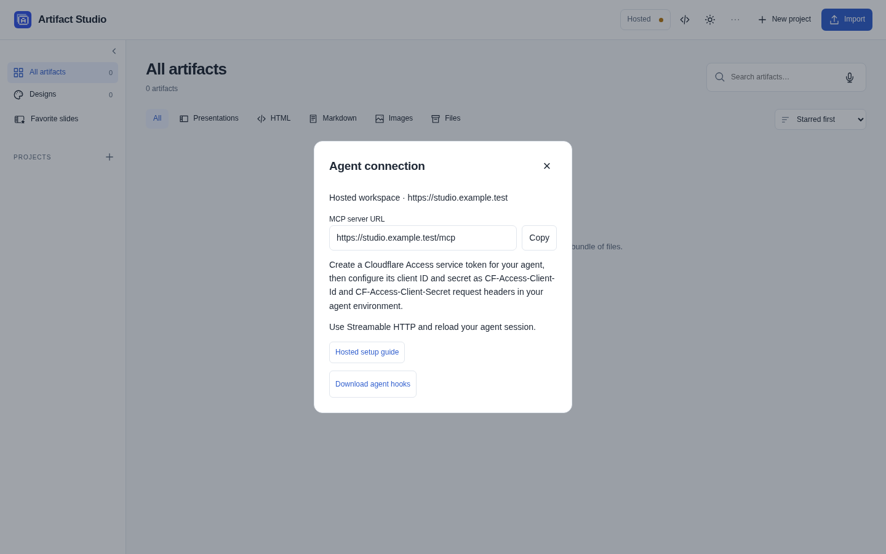
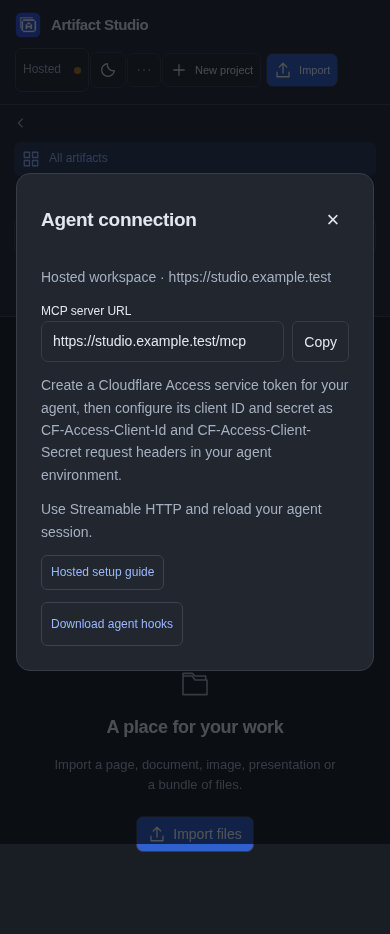

# Automatic review with a hosted workspace

Codex and Claude Code can continue an **open agent session** when hosted Live feedback or a released batch arrives. MCP provides editing tools; the optional client hooks provide lifecycle continuation. They cannot launch a closed chat or bypass native host trust, permissions or continuation limits. Other MCP hosts need their own lifecycle integration.



<details><summary>Phone in dark appearance</summary>

</details>

## Client-only setup

Configure the hosted MCP connection first. The agent computer needs Python 3.10 or newer and the same securely supplied `CF_ACCESS_CLIENT_ID` and `CF_ACCESS_CLIENT_SECRET` environment variables as its MCP connection. A GUI application must inherit those variables too. Never put their values in hook JSON, commands, project files or chat.

For agent-assisted setup, ask the agent to call `get_agent_hook_client`, verify the returned file hashes, and save the two client files in a stable private folder. This uses the existing authenticated MCP connection and needs no browser download or repository clone. Install only when requested and complete native hook trust afterward.

Alternatively, in **Agent connection**, choose **Download agent hooks**, or open `https://YOUR_WORKSPACE/api/agent/hooks-client` in your signed-in browser. The authenticated archive contains only `hook_client.py` and `local_http.py`. Extract both together into a stable private folder, for example `~/.local/share/artifact-studio-hooks`. No Artifact Studio server, checkout, uv, Docker, Playwright or third-party Python dependencies are needed on this computer. Treat these files as executable client code from your trusted workspace operator.

Prepare hooks for the agent's working project:

```sh
python3 ~/.local/share/artifact-studio-hooks/hook_client.py configure \
  --harness codex \
  --project /absolute/path/to/agent-project \
  --url https://YOUR_WORKSPACE \
  --server-name artifact_studio \
  --dry-run
```

Use `--harness claude-code` for Claude Code. Use your actual MCP connection name, and the workspace origin **without `/mcp`**. Inspect the dry run, then repeat without `--dry-run`. Existing unrelated settings/hooks are preserved; repeating setup is idempotent. `--global` explicitly selects user-level configuration instead of `--project`. Remove an older project copy when switching to global hooks so Codex does not run both.

If setup reports obsolete Slide Studio hooks, run the same command with
`--remove-obsolete-slide-studio-hooks --dry-run`. This previews removal of
generated Claude hooks pointing to a missing local `slide-studio` installation.
Repeat without `--dry-run` to apply the change, then reload Claude Code.

For Claude Code connected to a shared workspace, add `--claude-mode passive` if
you want feedback checks during active work without waking an idle session.
This installs a background hook that checks for released requests assigned to
the agent when it opens an artifact, starts review, or successfully saves edits
or design alternatives. A pending request adds a short pointer to the next Claude
turn. Use `read_feedback` to pick up requests directly. The agent does not
appear as **Listening** in passive mode. Both **Live** and **Send batch** still
release feedback. Choose `--claude-mode live` for automatic continuation.

If you previously installed Claude hooks at both user and project level,
inspect both in `/hooks`. Each setup command replaces the generated hooks
in the settings file it targets. An old live hook in another settings file
can still run.

Reload the agent session and review/trust its generated hooks through the host's `/hooks` interface. Keep native approval prompts enabled. Configure/download alone does not prove that the running host loaded or trusted the hooks. Regenerate settings if you move the client files or Python executable. Update the client files deliberately when upgrading the server.

## Verify the complete journey

1. Ask the agent to read `get_working_context(artifact_id=...)` for one selected artifact. An eligible successful tool call lets its `PostToolUse` hook attach the native session. Project-only discovery does not attach a review.
2. Check `get_live_review_status(artifact_id=...)` and the Studio connection indicator. Server session IDs are opaque and credential-scoped; they are not native Codex/Claude chat IDs. Status describes the target's current reviewer, which could be another session.
3. Leave the agent session open. Send a Live comment: Claude Code's Stop hook waits in the background and wakes the agent when feedback arrives; Codex waits synchronously and returns a continuation decision. The agent must read released feedback through MCP, revise and reply. Wake-up messages contain tool/cursor pointers, not feedback text, and do not acknowledge delivery.
4. Verify Batch stays private until **Send batch**, and **End review** stops further continuation. Use `start_live_review(artifact_id=...)` to explicitly resume an ended review. Presentation calls may use `deck_id` instead; select exactly one target.
5. Verify SessionEnd/Interrupt and loss of connectivity release or expire availability. A timeout, failed authentication, unavailable server or full request budget makes the client return without blocking unrelated work. An abruptly killed session can remain visible until its short lease expires.

One session follows one target, and one active reviewer owns a target at a time. The hosted adapter excludes the local design-request inbox and host administration. Local-only tools remain unavailable.

## Security and deployment

The normalized hook endpoint is `/api/review/hooks` on the authenticated workspace origin. It accepts configured **service identities only**, rejects browser Origin headers, and namespaces session ownership by the verified principal and harness. A different service identity cannot claim, release or advance another identity's session even when it supplies the same native session ID. Use separate service credentials where separate identities are required.

Configure the same Cloudflare Access application and Service Auth policy as MCP. The additional allowed agent route is only this hook endpoint. Human membership and other service route restrictions remain enforced. Existing deployment-specific path rules must permit the hook endpoint for selected service tokens too.

The helper uses HTTPS certificate verification, refuses redirects and login redirects, and reads credentials only from its process environment. It forwards normalized target/session/cursor metadata, never transcripts or complete tool results. Hosted hook bodies are limited to 64 KiB with eight active requests and a 35-second request deadline; a normal server poll lasts at most 25 seconds. These slots are separate from editing/MCP budgets. Claude Code renews its lease in the background for up to six hours, then exits quietly; a later agent turn re-arms the hook. Codex uses a host continuation after roughly nine minutes.

After revoking credentials, verify that old hook requests are denied and availability expires. Native host loading/trust, actual model continuation, and live provider authentication/revocation require acceptance tests in the chosen environment. Fixture tests alone do not establish them.
