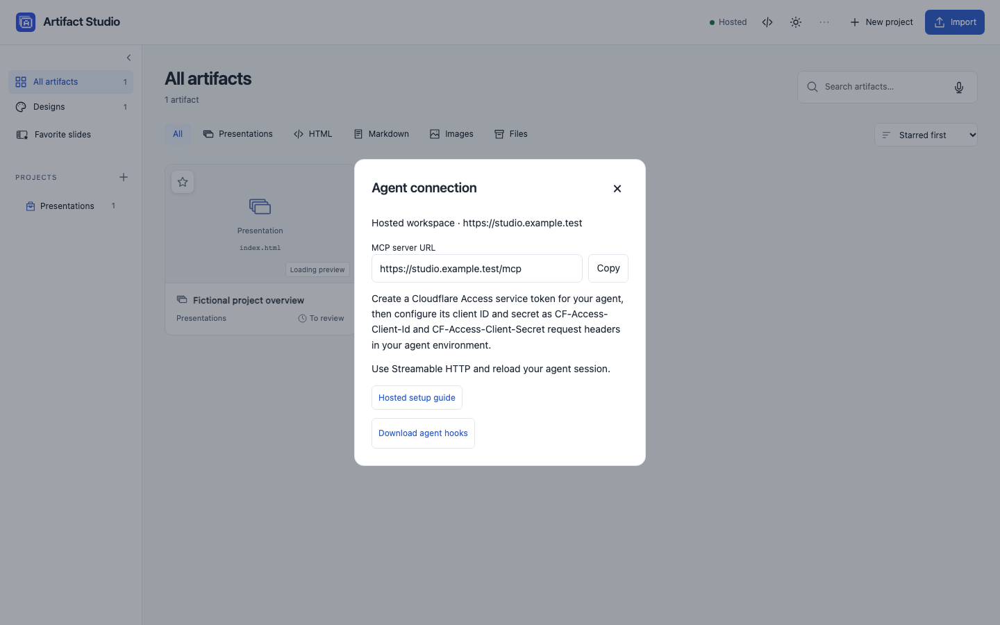
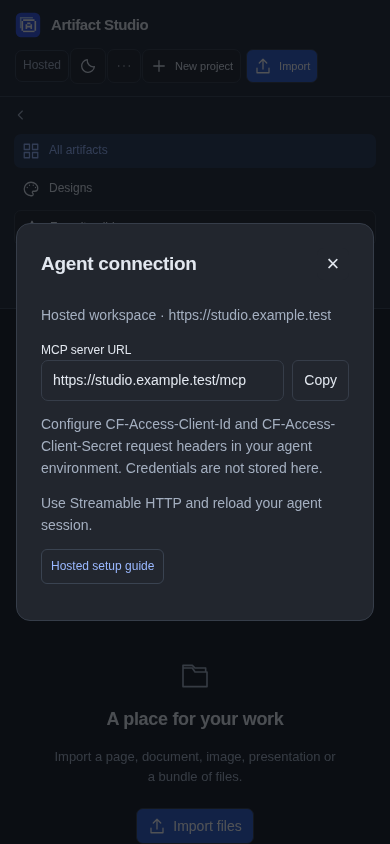
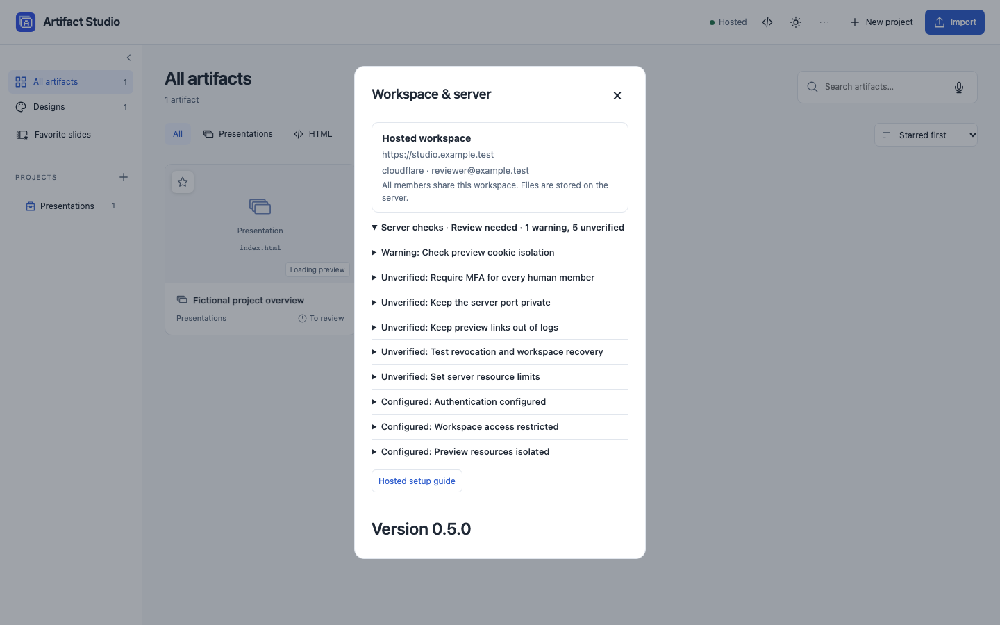
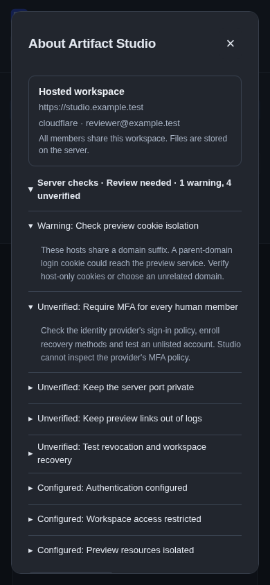
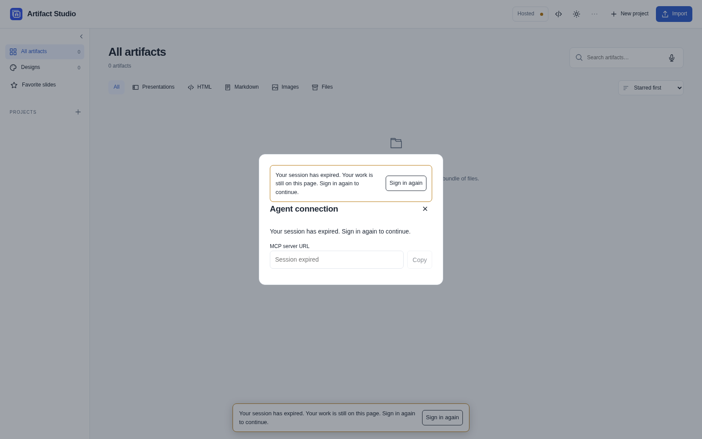

# Hosted workspace with whole-workspace membership

For the regular Studio editor with scoped invitations, private chats and
simultaneous agents, use [shared projects](MULTIPLAYER.md). See the [remote hosting
architecture](MULTIPLAYER.md#remote-hosting-architecture) and use that guide's
agent-token and Tunnel rules for shared projects.

Local mode remains the default. Open a hosted workspace at its HTTPS URL on a Mac,
iPhone or other device. The Mac controller manages the local installation.
Moving work to the hosted workspace requires an import or a verified restore.



<details>
<summary>Phone view</summary>



</details>

All configured human members share all content in this workspace, including projects, artifacts, notes and review history. Agents have a constrained MCP surface only; they do not receive the human browser session or local host administration. Browser upload, authoring, previews and review remain available. Local backup controls and the local Copilot setup are unavailable in hosted mode. Optional lightweight client hooks support automatic review in open Codex and Claude Code sessions; see [hosted agent hooks](HOSTED-AGENT-HOOKS.md).

## Configure the server

Create a private JSON configuration based on [the fictional example](../examples/hosted-config.json). Set `public_url` and `preview_url` to distinct canonical HTTPS origins, `auth_provider` to `cloudflare`, and supply your Access team domain, application audience, exact human member emails and exact service-token Client IDs. Set `ARTIFACT_STUDIO_MODE=hosted` and `ARTIFACT_STUDIO_HOSTED_CONFIG=/run/artifact-studio/hosted.json`, mounting the JSON read-only at that path. Persist the server's workspace volume and protect backups independently. Do not commit real identities or credentials.

Route both hostnames through a Cloudflare Tunnel to the same private service. Do not expose the origin port publicly. Create one Access application for the workspace hostname with two policies: an **Allow** policy for exact human emails requiring MFA, and a **Service Auth** policy for the explicitly selected agent service tokens. Studio restricts those service identities to `/mcp` and the normalized `/api/review/hooks` endpoint, even though they authenticate at the same Access application. Configure their exact Client IDs in `agent_subjects`. The origin verifies the signed Access JWT on each request and enforces its own membership and route policy.

Enable [Access Independent MFA](https://developers.cloudflare.com/cloudflare-one/access-controls/access-settings/independent-mfa/) and require it on the human Allow policy. Enroll a passkey/security key or TOTP and a recovery method before enforcing the policy. Test both permitted users and an unlisted identity in a fresh browser session. Service tokens are machine credentials; they do not perform a human MFA challenge on each tool call.

The separate preview hostname must have **no Access application**: sandboxed previews need to load without browser credentials. The server serves only short-lived, revision-scoped preview capabilities there, never workspace APIs. A preview capability is not a permanent sharing URL or workspace login. Keep the preview hostname distinct from the browser hostname.

Connect an agent using the hosted `https://studio.example.com/mcp` URL and Streamable HTTP. Configure `CF-Access-Client-Id` and `CF-Access-Client-Secret` as request headers from the agent's environment or secret manager; do not paste credentials into Studio. This first version uses service credentials, not native agent OAuth. Optional [hosted agent hooks](HOSTED-AGENT-HOOKS.md) provide lifecycle continuation without installing the server on the agent computer. Rotate or revoke the service token in Cloudflare, remove the Client ID from configuration, restart the server, and verify that the old credentials no longer work.

Before production use, validate the actual account's MFA policy, tunnel routing, origin isolation, service-token authentication and revocation, preview isolation, and backup and restore procedure. Application tests cannot establish those account-specific properties.

## Check safety before starting

Keep configuration in an owner-controlled regular file outside the collection,
readable by the server account. Group/world write permissions, symlinks, duplicate
JSON keys, oversized configuration, invalid origins and hosted configuration
accidentally used with local mode stop startup. For a Docker bind mount, make the
file readable by UID/GID 1000, for example owner-only or group-readable mode `640`.
Do not make it world-writable to fix a permission error. Symlink-based secret
projections must supply a protected regular file instead.

Run the local check without starting a server or contacting the identity provider:

```sh
ARTIFACT_STUDIO_MODE=hosted \
ARTIFACT_STUDIO_HOSTED_CONFIG=/absolute/path/to/hosted.json \
uv run python -m artifact_studio.security_check
```

Use `--json` for a redacted structured report. Exit code 2 means configuration or
provider loading is blocked; exit code 0 means the local configuration was
accepted, **not** that the deployment passed a security audit. Provider error
details and authentication options are not printed.

In the browser, open **Menu → Workspace & server → Server checks**. It distinguishes configured
protections, warnings with an action to take, and unverified account settings.
Hosts sharing a domain suffix prompt a cookie-isolation warning. Studio cannot
inspect actual cookie scope, MFA enforcement, firewall rules, tunnel logging,
backup recovery or operating-system resource limits. These remain visibly unverified rather than becoming a green
“secure” badge. There is no checkbox that bypasses validation or claims an
external setting was verified.



<details>
<summary>Server checks on a phone</summary>



</details>

If sign-in expires, the page retains its current work and offers **Sign in again**.
Connection copying is disabled until the session is re-established. Signing in
reloads the page; the editor's usual unsaved-work protection still applies.



## Docker and Tunnel example

Make the configuration readable by the container's UID 1000, then run from the checkout:

```sh
export ARTIFACT_STUDIO_HOSTED_CONFIG_FILE=/absolute/path/to/hosted.json
docker compose -f compose.yaml -f compose.hosted.yaml up -d --build --wait
docker compose -f compose.yaml -f compose.hosted.yaml logs --tail=100 studio
```

The override mounts that file read-only, retains the base Compose sandbox and loopback-only port, disables proxy-header trust, and disables application access logs. Run `cloudflared` on the host and route both public hostnames to `http://127.0.0.1:8790`. Preserve each incoming Host header: do not set `originRequest.httpHostHeader`. The browser hostname is protected by Access; the preview hostname is not. Keep the browser Access cookie host-only. The local container health check still uses loopback.

### Hosted project GitHub sync

Use the [unified collaboration deployment](MULTIPLAYER.md#use-the-regular-studio-interface)
for project sync. Give the service's GitHub CLI identity read and write access
to the approved private repositories. Use the container's GitHub CLI config directory
(`/data/config/gh`) or inject `GH_TOKEN` from your deployment secret store.
Keep credentials out of the binding file. The configured branch must exist and
accept normal direct-child pushes from this identity.

Provide an operator-owned JSON binding file, readable by container UID 1000 and
outside the collection. Each binding pairs one workspace and project with
specific registered artifact IDs and dedicated repository folders.

```json
[
  {
    "workspace": "default",
    "project": "fictional-project",
    "repository": "fictional-org/private-sources",
    "branch": "main",
    "artifacts": {"fictional-page": "source/fictional-page"}
  }
]
```

```sh
export ARTIFACT_STUDIO_PROJECT_GITHUB_SYNC_FILE=/absolute/path/to/project-github-sync.json
docker compose -f compose.yaml -f compose.hosted.yaml -f compose.shared.yaml \
  -f compose.project-github-sync.yaml up -d --build --wait
```

Open the configured project's options menu and choose **GitHub sync**. The dialog
shows the repository, branch and paired source folders. Choose **Sync now** to
check once, or enable **Automatically sync both ways** to check about once a
minute. Automatic sync is off until the workspace owner enables it.

Sync compares each registered source bundle against the last version shared by
Studio and GitHub. One-sided changes and edits to different files transfer
automatically. If both sides change the same file differently, the dialog lists
the differing files and the saved revisions.
Choose **Keep Studio** or **Keep GitHub** and confirm the replacement. The
previous Studio revision or GitHub commit remains in its respective history.
If either bundle changes again before confirmation, run **Sync now** to review
the updated conflict. A GitHub bundle with a missing entrypoint cannot replace
Studio source.

This setup syncs configured source bundles. A conflict choice applies to the
whole bundle. Legacy in-place presentations, project metadata, review chat,
and backup state are outside the configured source folders.
Grant the GitHub CLI identity access only to the configured private repositories.
Git stages the branch on a dedicated Linux tmpfs capped at 512 MiB and 32,768
inodes. The app checks those limits and permits one sync at a time per mount.
Sync requires the configured mount. Large branches can exceed the staging limit
even if the paired artifact is small. Use a smaller private source branch in
that case. Allow for staging memory and rendering memory in the container budget.
The mount is cleared when the container stops.

Keep **local mode** on a private listener too: it has no login. Docker listens on
all interfaces inside its container so port forwarding works; the Compose host
binding is deliberately `127.0.0.1`. Do not change the published binding to `0.0.0.0`
or expose port 8790 in the Hetzner firewall. Configuration checks cannot prove how
your container port or external firewall is exposed.

Copy the single Access application's audience into `auth_options.audience`. A separate Access application for `/mcp` can issue a different audience and is not compatible with this single-audience configuration. For [Cloudflare service tokens](https://developers.cloudflare.com/cloudflare-one/access-controls/applications/http-apps/authorization-cookie/application-token/), Studio matches the verified JWT's `common_name` to the exact service token **Client ID** in `agent_subjects`; the service token JWT may have an empty `sub`. The Client Secret belongs only in the agent's secret store.

Preview capability URLs contain sensitive bearer tokens and expire after one hour or a server restart. Reopen or refresh a preview to renew its resource URLs; a long-running authored page that loads new resources after expiry needs a refresh. Disable or redact URL logging in Tunnel, proxies and any other intermediaries; do not share or retain capability URLs. Container access logs are disabled by the override. Run one application process per workspace; capability signing keys are process-local.

Open authored previews through the workspace. Every workspace entry point restricts frame navigation to Studio previews, including relative pages in the signed bundle. A capability resource opened directly in a tab downloads instead of executing. Preserve browser `Sec-Fetch-Dest` headers through the proxy: authenticated preview documents require a frame destination, and resource requests without this metadata download. Browsers without Fetch Metadata support cannot open hosted authored preview documents. Nested bundle pages retain their authored behavior; selection editing is available on the entrypoint preview.

If an authored page attempts a blocked external navigation, Studio shows a
warning with **Reload preview**. Internal links remain usable. Hosted **Present**
opens a trusted viewer, with presenter notes and an audience window; audience
responses omit notes and private agent context. Presenter controls also work on
phones.

For Codex, a Streamable HTTP server can map environment variables to headers in `~/.codex/config.toml` (set the environment variables securely before starting Codex):

```toml
[mcp_servers.artifact_studio]
url = "https://studio.example.com/mcp"
env_http_headers = { "CF-Access-Client-Id" = "CF_ACCESS_CLIENT_ID", "CF-Access-Client-Secret" = "CF_ACCESS_CLIENT_SECRET" }
```

For Claude Code, a project `.mcp.json` can use environment interpolation; set the variables in the agent environment and avoid committing real secrets:

```json
{"mcpServers":{"artifact-studio":{"type":"http","url":"https://studio.example.com/mcp","headers":{"CF-Access-Client-Id":"${CF_ACCESS_CLIENT_ID}","CF-Access-Client-Secret":"${CF_ACCESS_CLIENT_SECRET}"}}}}
```

These examples use service-token headers. External OAuth and native agent OAuth are not implemented. Check the installed client version's configuration support and verify a real tool call.

Hosted request budgets protect the service before JSON parsing or mutations:
ordinary writes allow 16 MiB and four active requests; attachment/import/draft
requests allow 256 MiB and one active request (100 MiB for project archives).
Bodies must finish arriving within 120 seconds and are spooled to private temporary
storage before handlers run. Existing decoded file and model limits still apply.
The MCP limit remains 2 MiB and four active requests. Busy requests return 429 with
`Retry-After`; oversized requests return 413. An upstream proxy can impose a lower
upload limit—Cloudflare account limits are separate from Studio's budget.

Remote tools also have a four-worker execution budget. If a request times out or
disconnects, work already running keeps its slot until it finishes; repeated
retries cannot start unlimited background work. A timeout does not prove an edit
was cancelled. Read the latest revision before retrying a mutation.

Preview resources allow four active responses and up to 256 waiting requests,
with a 60-second queue deadline. Each requested artifact file is verified against
its immutable revision manifest and sent in small chunks while retaining its
request slot. Serving a small asset does not hash the whole bundle again.
Ordinary media byte ranges and HEAD requests remain supported.

Capture scripts have a 15-second driver deadline, including promises and result
serialization. A stalled script fails the capture instead of holding the renderer
indefinitely or returning an incomplete image. These deadlines and request budgets
do **not** cap process memory, CPU or disk. Configure OS or container limits for
Studio and Chromium, monitor storage, and test the largest normal imports and
captures. For Docker, review `mem_limit`, `cpus` and `pids_limit`; the example
Compose files do not choose these limits for you. An unusually expensive document
can exhaust a small VM before a script deadline expires.

## What runs where

The table describes the original shared-account hosted entry point. For
per-project access and scoped agent tokens, see [hosted presentation authoring
in shared projects](MULTIPLAYER.md#author-presentations-with-a-hosted-agent).

| Workflow | Local | Hosted |
| --- | --- | --- |
| Library, uploads, slide editing, notes, chat and review | Available | Available to every configured human member |
| Agent edits and visual checks | Full local MCP | Constrained remote MCP; discover its schemas after connecting |
| New projects and presentations | Browser or local agent | Create through the browser; agents can add/revise slides and create/revise general artifacts |
| Theme, design-pack and host-file management by an agent | Full local tools | Local administrative tools are not exposed remotely |
| Automatic continuation in an open agent session | Local hooks | Optional lightweight client hooks for Codex/Claude Code |
| Mac menu-bar server controls | Manage the local service | Open the hosted URL in your browser |
| Authentication and MFA | Loopback access | Provider login/MFA plus origin JWT and membership checks |
| Workspace and backup administration | Local UI | Server operator; remote restore and credential controls are disabled |

Hosted mode does not add simultaneous text merging, private member projects, personal
draft isolation or multi-tenant billing. Revision guards still reject stale edits.
Keep all persistent `/data` together. Use the existing verified workspace archive
mechanism for application-consistent backups, or stop the server before backing up
the complete volume; do not copy a live SQLite database alone. Restore into a
separate volume and verify it before replacing the running workspace. See
[workspace recovery](WORKSPACE-RECOVERY.md).
