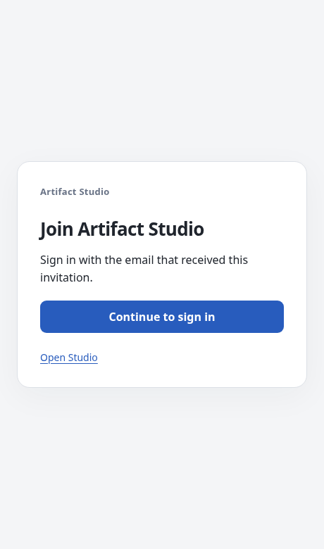
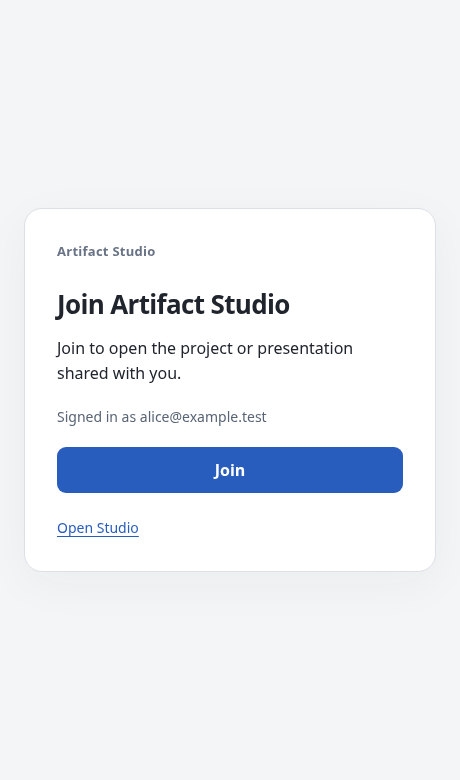
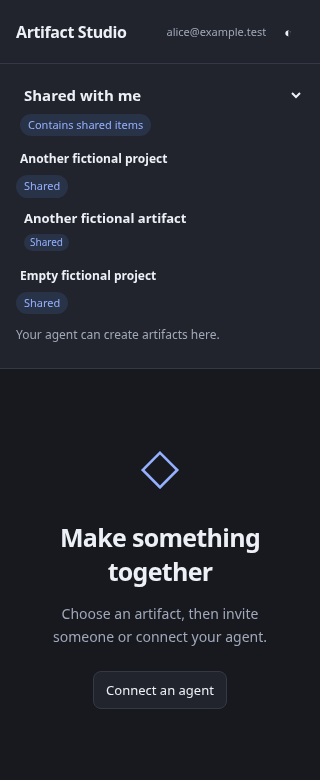

# Experimental invitation admission

The invitation provisioning backend is disabled by default. Its Cloudflare adapter
can reconcile email membership of an existing dedicated Access group. It never
changes an Access policy or sends invitations. A separate, disabled-by-default
landing flag enables the minimal pre-login handoff. Staging validation is required
before enabling either feature for real identities.

An existing Access group is simpler to operate, but still requires a separate
group-admission step unless membership is automated. Invitation-driven admission
removes that step by reconciling a dedicated group's membership from Studio's
current invitations and grants. The Access application must continue to require
verified identity and MFA. The adapter may change only the designated group's
membership; it must never broaden policies or weaken MFA. Studio grants alone
authorize access to a workspace, project or artifact.

## Adapter and configuration

The built-in `cloudflare-group` adapter uses only the fixed
`https://api.cloudflare.com/client/v4/` API. An operator first creates a dedicated
group named `Artifact Studio invitation admission`, used only by this Studio
application and managed exclusively by this deployment. Its selectors must be
email-only, with no group-level require/exclude selectors. The pinned application
policy must be an Allow policy whose include list is exactly this group and whose
require list contains `{"auth_method":{"auth_method":"mfa"}}`. Other policy
profiles fail closed rather than being rewritten.

Before changing membership the adapter checks the organization's auth domain,
application ID/audience/domain/type, pinned policy and group. It preserves the
group's other emails, uses `If-Match` when the provider supplies an ETag, and reads
back the result. Cloudflare Access groups use a whole-group update API, so this
dedicated group must have no external membership writers. The adapter cannot
provide an atomic merge against another administrator's concurrent group update
when the API supplies no conditional-update support. Do not reuse a general group
or reference it from other applications/policies.

Configure these environment variables on the server; none belongs in a browser:

| Variable | Value |
| --- | --- |
| `ARTIFACT_STUDIO_EXPERIMENTAL_INVITATIONS` | `1`, only after staging validation |
| `ARTIFACT_STUDIO_INVITATION_PROVISIONER` | `cloudflare-group` |
| `ARTIFACT_STUDIO_CLOUDFLARE_ADMISSION_ACCOUNT` | Pinned Cloudflare account ID |
| `ARTIFACT_STUDIO_CLOUDFLARE_ADMISSION_APPLICATION` | Pinned Access application ID |
| `ARTIFACT_STUDIO_CLOUDFLARE_ADMISSION_POLICY` | Pinned MFA-protected Allow policy ID |
| `ARTIFACT_STUDIO_CLOUDFLARE_ADMISSION_GROUP` | Pinned dedicated group ID |
| `ARTIFACT_STUDIO_CLOUDFLARE_ADMISSION_TOKEN` | Dedicated API token from the server secret store |

Use the smallest available account-scoped token permissions for organization,
application, policy and group reads plus group updates. Do not use a Global API
Key. Confirm the provider's actual permission scope in staging; application/policy
administration permission may be broader than the adapter's group-only write path.
Neither token permissions nor MFA enforcement are established by mock tests.

An alternative operator-installed package may register one factory in the
`artifact_studio.admission` entry-point group. The factory receives an
`AdmissionContext` containing the exact Cloudflare issuer, audience and Studio
origin, and returns an `AdmissionAdapter` with:

- `namespace`: a stable, nonsecret identifier for the dedicated admission group.
- `reconcile(email, eligible, operation_id, *, timeout)`: confirm the recipient's
  desired group membership. Calls must be idempotent even when a provider accepted
  a request but its response was lost. Honor the supplied timeout, preserve other
  members, and do not write application policies or MFA settings. Coordinate with
  any external writers; do not overwrite a concurrently changed group wholesale.

Provider credentials stay in the adapter's operator secret store. They are not
factory arguments, browser values, invitation URLs or outbox records. The adapter
must verify its configured account/application/group against the supplied context
before changing membership. An exception means the result is uncertain and will
be retried; exception bodies are never recorded or returned to the browser.

For a reviewed alternative staging adapter, set
`ARTIFACT_STUDIO_INVITATION_PROVISIONER` to its entry-point name. Enabling without
the required configuration or installed adapter fails startup. Other identity
providers are rejected. Changing
the issuer, audience, origin or adapter namespace after initialization also fails
startup: reconcile the old admission group and registry explicitly before changing
that binding. Use the same configuration for every process serving the registry.

## Persistence and authorization

Invitations and recipient outbox changes commit in the same sharing-database
transaction. Each recipient has a desired eligibility, generation, and
`pending`, `active`, `inactive` or `error` state. Retries reuse the generation's
operation ID. A worker reconciles expiration and retries uncertain provider
responses with bounded backoff. A process restart does not lose pending work.

Eligibility is the union of unexpired pending invitations, existing grants and
workspace ownership across the registry; configured member and personal-workspace
addresses are protected. Removing one overlapping grant never removes admission
needed by another. The sharing lock remains held during each adapter operation
(up to its ten-second timeout) so a new invitation cannot race admission removal.
This can briefly delay unrelated sharing operations.

Provider eligibility is not a resource grant. When the experiment is enabled,
Studio also rejects an uninvited human identity even if the provider has not yet
expired its session. Acceptance still requires the exact verified recipient and a
current, one-use invitation; subject/email collision checks remain in force.

Workspace owners can inspect only their own known recipients at
`GET /api/workspaces/{workspace}/invitation-provisioning` and request a retry with
`POST .../invitation-provisioning/retry` and an `email` JSON field. Guests and
agents cannot inspect or retry admission. Provider errors are shown only as an
`error` state. Disabling the experiment stops reconciliation; it does not silently
delete external group membership. Review the dedicated group when rolling back.

## Destination and redirect staging

Accepted invitations return a local `destination` derived from their stored scope,
never from a caller's redirect URL. Existing invitation tokens remain in URL
fragments, outside HTTP access logs. The authenticated acceptance endpoint does
not expose invitation details to an unverified recipient.

The landing page is separately gated by `ARTIFACT_STUDIO_INVITATION_LANDING=1`,
which requires an enabled admission provisioner. With that flag, newly created
links use `https://studio.example.test/_invitation#invite=...`. Only an exact
GET/HEAD of `/_invitation`, without a query string, is public at the origin. It
serves self-contained static HTML with hash-based script/style CSP, no external
assets, no identity or invitation metadata, and no-store/no-referrer headers.
Preview hosts, encoded aliases, descendants, other methods and all API routes
retain their existing protections.

The page immediately removes the fragment from browser history and retains the
token only in this tab's session storage for up to 30 minutes. **Continue to sign
in** navigates to the fixed, protected `/invitation` path. After Access login, the
continuation verifies the current session, shows its email, and requires an
explicit **Join** action. It sends the token only in the authenticated
acceptance POST body, consumes the handoff after acceptance or terminal denial,
and navigates to the server-derived local destination. Interrupted connectivity
can be retried; reopening the original link restarts an expired local handoff.
Reloading the public landing retains a valid handoff without extending its
original lifetime. A project invitation selects an artifact within that project;
an empty project remains selected instead of opening unrelated existing work.
Disabled session storage fails closed. No token is put in a query string, login
redirect, referrer, landing HTML or application log. The owner still receives the
invitation link from the existing authenticated invitation-creation endpoint.

The operator must separately configure and verify the edge in a staging Access
application. The only new public-path policy is for the workspace hostname's
`/_invitation` landing path. Keep `/invitation` and all browser APIs under the
original authenticated, MFA-protected application and audience. These paths are
deliberately separate so a provider's prefix-based landing match cannot encompass
the continuation. Do not broaden the bypass to `/`, `/api/*` or wildcard paths.
The origin still rejects public-path descendants even if the edge matches them.
No code here creates or changes a Cloudflare bypass policy.

Test anonymous GET/HEAD of the exact landing, denial of alternate hosts/paths and
API writes, the actual provider redirect back to `/invitation`, verified-recipient
acceptance, expiry/revocation/replay and destination arrival before enabling the
flag outside staging. Mock edge tests demonstrate the browser storage contract;
they do not establish Cloudflare's deployed matching, cookie or MFA behavior.

The following screenshots use fictional identities. The first step retains the
invitation in the current tab; the second shows the verified account before joining.

On narrow screens the project catalog stacks vertically, keeping an invited empty
project readable alongside existing shared work.

## Required staging acceptance

Use a separate Access application/audience, dedicated group and fictional users.
Compare ordinary group membership with invitation-driven provisioning. Verify the
selected adapter's permissions and unchanged MFA requirements before activation.
Exercise fresh invited and uninvited identities, wrong verified recipient, replay,
overlapping project/deck/workspace grants, final revocation, invitation expiration,
interrupted provider writes and process restart, repeated login, destination
retention, and passkey/TOTP recovery through the real provider. Preserve recoverable
drafts when access ends, but reject new server writes. Local tests do not establish
provider policy, MFA or recovery behavior.
