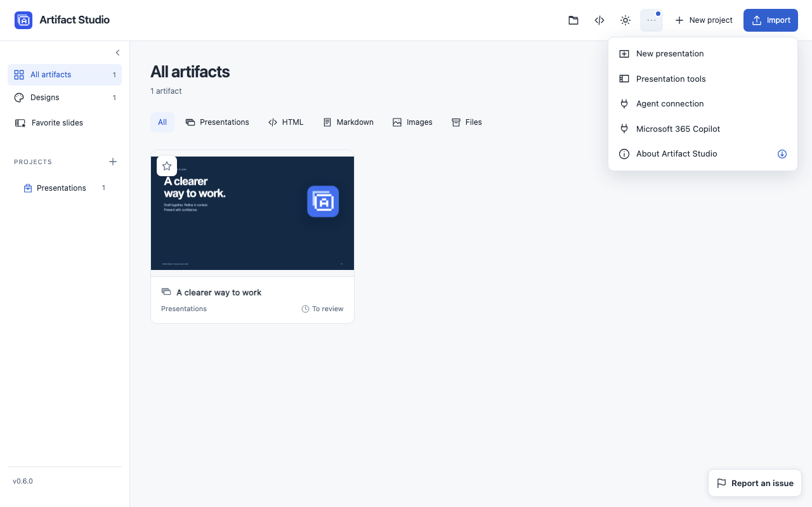
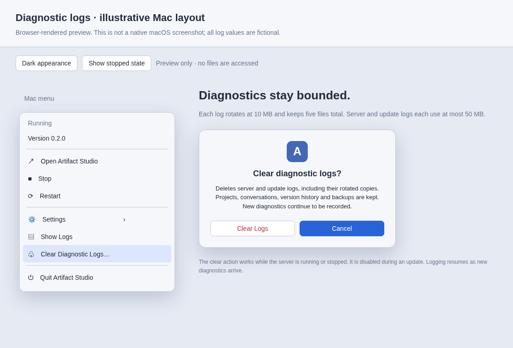

# Mac menu-bar app

Artifact Studio can live in the menu bar, start at login and run without a Terminal window. The native controller starts your existing Python server; it keeps the same collection, database and MCP URL. No npm or Node installation is needed.

## Install from this checkout

Building the controller requires macOS 13 or later and Apple's Command Line Tools. Prepare the source checkout and its dependencies, then run the installer from that checkout. [Install on Mac](../README.md#install-on-mac)

```sh
uv run --no-sync python scripts/install_macos.py --launch-at-login
```

If a Terminal server is running, stop it with **Ctrl+C** before opening the app. Open `~/Applications/Artifact Studio.app` in Finder. An artifact icon appears beside the clock. Launch at Login is enabled on the first run when requested by the installer; its checkmark reports the macOS registration. If macOS requires approval, **Allow in System Settings…** opens Login Items. You can turn automatic launch off from the same menu.

| Control | Behavior |
| --- | --- |
| Pixel status square | Filled: responding. Small: starting/stopping. Outline: stopped or failed; open the menu for the exact status. The icon follows the menu bar's light/dark appearance. |
| Connected | Green-dot entries open the artifact where a Codex or Claude Code review connection is currently active. |
| Recent Projects → | Hover to open your last five projects. A green plug identifies connected projects. The same recent list appears in the app's Menu. |
| Open Artifact Studio | Opens the workspace in your default browser. |
| Start / Stop / Restart | Controls the server started by this menu-bar app. Stop waits for a graceful shutdown. |
| Version / Update… | Shows the installed version. The Update action and download icon appear only when a newer eligible release is available. A running server requires confirmation before it stops and restarts. A stopped server stays stopped. |
| Settings → Include Nightly Builds | Opts into preview releases from main. Off by default; shared with the web About dialog and saved across restarts. |
| Settings → Launch at Login | Toggles automatic startup; a checkmark means enabled. If macOS needs approval, the same submenu opens Login Items. |
| Settings → GitHub Backup | Repository delivery status, last successful backup, Automatic Backup, Sync Now/Retry, and Open Backup Settings. Uses the server’s shared settings. |
| Show Logs | Reveals the local server and update logs in Finder. |
| Clear Diagnostic Logs… | Confirms removal of server/update logs and rotated copies. Works while running or stopped; disabled during an update. |
| Quit Artifact Studio | Gracefully stops its server and closes the menu-bar app. Launch at Login remains configured. |

The controller checks `/api/health` every two seconds. Compact navigation metadata refreshes every ten seconds and when the menu opens; backup settings/status load on opening. It does not read artifact bodies, feedback or private notes. Connected entries require an unexpired review connection; merely configuring an MCP server does not create one. Opening a project or artifact records its project in the shared recent list. Agent tool calls do not change Recents, and the list survives restarts in the workspace database.

If another Artifact Studio already uses the configured port, it displays **Running · started elsewhere** and disables Stop/Restart. Stop that instance from its original Terminal or controller, then use **Start** here. It never kills an unrelated process using the same port.

Closing a browser tab does not stop the server. Stopping or restarting the server interrupts active agent connections; unsent attachments stay in the tab, while submitted feedback and saved decks remain on disk. A crashed server shows a failed state; Start retries deliberately rather than looping indefinitely.

## Existing workspaces and updates

The Mac menu keeps the installed app's **Version** visible, including while the
server is stopped. **Update…**, its download icon and the available tag appear
only when a newer eligible release is found. The version row is otherwise plain,
noninteractive information. In the web library or slide editor, select the
version at the bottom of the left sidebar to open **About Artifact Studio** and
see release notes. A blue dot on Menu indicates an available update. The menu-bar
controller reads its installed bundle version. The web app reads the running server
version. They normally match after updating the server and controller together.



The [narrow About dialog](screenshots/app-version-mobile.png) also fits the editor.
These captures use a fictional newer release to demonstrate the available-update state.

Release checks refresh private Git refs and are cached for an hour; they never
move the checked-out branch or change source files or local tags. Offline checks leave the
installed version visible without claiming that the app is up to date. Set
`ARTIFACT_STUDIO_UPDATE_CHECKS=0` on the server to disable automatic release checks.

The defaults are `~/Documents/Artifacts`, this checkout's `.state/review.sqlite3`, and port 8790. Override them at installation with `--collection`, `--database` and `--port`. App configuration lives in `Contents/Resources/configuration.json`; logs live in `~/Library/Logs/labs.kaiketsu.artifact-studio/server.log`.

Keep this checkout and its `.venv` in place. When **Update…** appears in the Mac menu,
it updates the server, browser interface and native controller together. Stable
`vMAJOR.MINOR.PATCH` tags are the default. Enable **Include Nightly Builds** in Mac
Settings or **Menu → About Artifact Studio** to also consider
`nightly-YYYYMMDD.RUN` prereleases. Other prerelease formats and untagged changes
are excluded. The confirmation names the selected tag. No new GitHub API login
is needed: the updater reuses the checkout's Git connection.

Nightlies are preview builds and may be less stable. The newest eligible source
commit wins; a stable tag wins when both channels identify the same source. The
installed nightly is identified by its tag, so unchanged project version numbers
do not cause repeated update offers. Turning the option off waits for a stable
release that can advance the installation; it never downgrades a newer nightly.
With the server stopped, a previously discovered update remains usable; start the
server to refresh discovery or change the shared channel preference.

The checkout must be clean and on `main`, and the release must be part of `origin/main`. Updates fast-forward to the selected tag's commit; a checkout already newer than the latest release is left unchanged. With no stable tag, the check reports that no release is available. If the tag changes, disappears or is replaced by a newer release before installation, check again. The updater preserves local tags, does not auto-commit, discard edits or reconcile divergent branches, and retains your collection/database paths. Active server and agent connections are interrupted only after you confirm **Update and Restart**. Refresh browser tabs and resume agent review afterward.

The updater preserves the previous environment while installing locked dependencies and Chromium, and builds the new controller before replacing the app. Installation failures restore the previous source and environment; a concurrent source edit is preserved and requires manual recovery instead of being reset. **Show Logs** reveals server and update logs. Updating a server started elsewhere is refused; stop it in its original controller first.

The controller relaunches after a successful update and restores the prior running/stopped state. It remains a local source installation requiring `uv` and Apple's Command Line Tools, rather than a self-contained, notarized distribution. To rebuild a controller manually, quit it, move the old `.app` aside, and rerun the installer. Removing the app does not delete artifacts; turn Launch at Login off before removal.

## Diagnostic log retention

The Mac controller bounds `server.log` and `update.log` automatically. Each file holds at most **10 MB** (10,000,000 bytes); each stream retains **five files total**, including the active file and `.1` through `.4`. `.1` is the newest rotated copy. The limit is **50 MB per stream**, or **100 MB combined**. Rotation continues during long-running server sessions and update commands. When logging opens, existing oversized managed files keep only their newest 10 MB.

Choose **Clear Diagnostic Logs…** beside **Show Logs** to reclaim that space. **Cancel** keeps the logs. **Clear Logs** removes only these two streams and their four rotated copies each. Projects, conversations, version history, backups and unrelated files remain available. The server keeps running, and the next diagnostic output creates a new active log. New output can appear immediately after clearing. Linked files or directories at a managed log path produce an error instead of being followed or removed.



This is a browser-rendered layout preview, not a native macOS screenshot. [Preview and verification limits](prototypes/diagnostic-logs/README.md). Terminal runs write to the terminal and follow its output settings.

Run the real Foundation-only storage and subprocess-pipe tests on macOS or Linux with Swift 6:

```sh
uv run --no-sync python scripts/test_macos_logs.py
```

The macOS controller workflow runs these tests and builds/signs a disposable controller when native sources, their tests or build dependencies change. Desktop interaction checks require macOS.

## Parallel decks

Use one browser tab and one agent chat per deck, all on the same instance and MCP endpoint. Feedback, slides, notes, approvals, visibility and revisions are scoped by deck. Each agent must use the intended `deck_id`; a live reviewer chat binds to one deck at a time. Distinct browser drafts are stored separately, so one tab does not replace another deck's recovery data.

Workspace rules, learned preferences, designs, library connections and the global design inbox are shared. Concurrent changes to the same saved slide or rule document use revision checks and may require reconciliation. Separate instances are useful for different workspaces, not required for separate decks.
