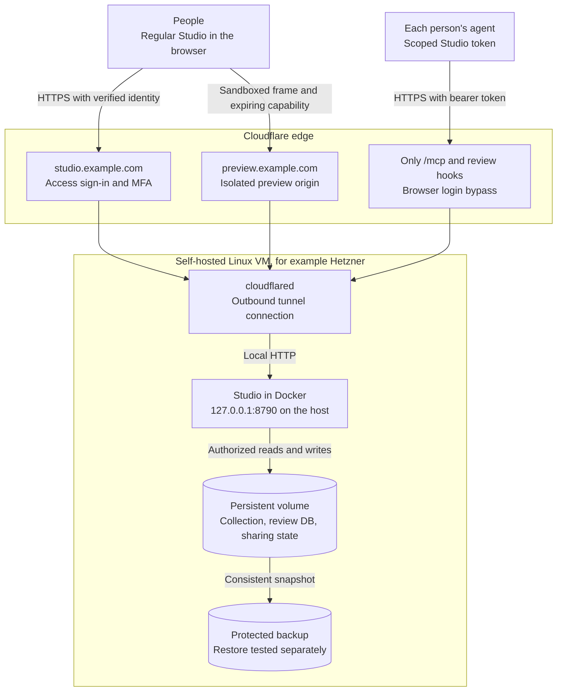
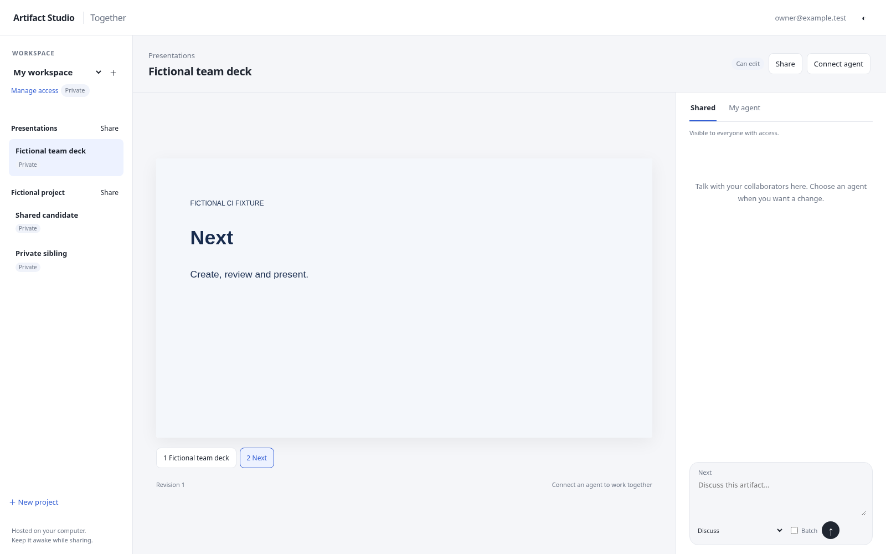

# Share projects from a self-hosted Studio

## Use the regular Studio interface

To use the regular Artifact Studio library and editor when you sign in as the
owner, start the unified server instead of the standalone collaboration server.
It uses the same collection, review database, multiplayer state, and Cloudflare
policies. Keep only the owner in `member_emails` and leave `agent_subjects` empty.
Invited users sign in through Cloudflare Access and need a Studio invitation to
see specific items.

```sh
uv run uvicorn artifact_studio.unified:create_app --factory \
  --host 127.0.0.1 --port 8790 --no-proxy-headers --no-access-log
```

Set the same environment variables documented below and stop any other Studio
process using the workspace before starting. On a Docker host, set the path to
your private configuration and use the three Compose files from the same checkout:

```sh
export ARTIFACT_STUDIO_HOSTED_CONFIG_FILE=/absolute/private/hosted.json
export ARTIFACT_STUDIO_MULTIPLAYER_OWNER=owner@example.com
docker compose -f compose.yaml -f compose.hosted.yaml -f compose.shared.yaml up -d --build --wait
```

Use the only address in `member_emails` as `ARTIFACT_STUDIO_MULTIPLAYER_OWNER`.
The container keeps sharing state in `/data/state/multiplayer` and publishes its
port on host loopback. Keep the configuration file readable by the container and
mounted read-only. [Hosted configuration checks](HOSTED.md#check-safety-before-starting).

Invitations open the regular Studio library and editor in the invited workspace.
Guests see only granted projects and artifacts. View, Comment and Edit grants
control the same editor. Edit grants support speaker notes, slide organization,
approval of the current slide or artifact version, and edits through a scoped agent.
Update markers clear for each person as they open a revised slide or artifact.
When a shared presentation stays unchanged, the editor checks the current grant
and revisions without downloading the slide contents again. Chat and agent
availability continue refreshing.
**Agent connection** in the regular
menu connects your own agent to the selected artifact or project. Shared and
My agent conversations appear in the regular sidebar. Your messages appear on
the right, incoming messages on the left, and date separators mark each day in
your browser's time zone. The owner can switch
between **Collaborate** and **Local review**; older local messages remain private
to the owner. Open **Menu → Workspace & server → Workspaces** in the
library or editor to switch workspaces. The
server owner can also create a separate workspace there. Open **New project**
in that workspace to create a project and use its **Share link…** menu to invite
a collaborator. Host administration stays on the server.

### Give a second user a private workspace

Allow the account through the sign-in provider with MFA, then add its verified
email to the optional `personal_workspace_emails` list in the private hosted
configuration. For example, set `"personal_workspace_emails": ["teammate@example.com"]`.
Keep `member_emails` limited to the primary owner. The two lists must be disjoint.

The first authenticated visit provisions an empty workspace for an account that
needs one. The Studio home opens the personal library until the user has an
invitation they have accepted in the primary workspace. Their personal projects
use the same Studio library, editor, sharing menu and agent connection. Owners
can use **Import** to add files or folders to projects they own. Open a project
and choose **Menu → New presentation** to start a deck with its brief and
attachments. The picker uses designs saved in that workspace and starts with
a blank cover when there are none. Project guests continue to use their
invitation roles. Find personal and shared workspaces under
**Menu → Workspace & server**. Sharing a project leaves the rest of either
user's workspace private.

Workspace owners can create nested sidebar folders, reorder projects and drag
artifacts between projects from the regular library. Sidebar folders are private
organization. Moving an artifact between projects may change inherited access.
Studio asks for confirmation when either project has current grants, pending
invitations or active agent connections.

Use the star on an artifact or slide to bookmark it. **Favorite slides** in
the sidebar opens your own gallery, including any descriptions you add. The
gallery uses the slide's static preview with bundled styles, fonts, and images.
Open the slide to play interactive content. Stars and descriptions are private
to your account and workspace. When your access to a shared artifact ends,
Studio stops showing its bookmarks and previews.

Owners can open **Version history** on an artifact to inspect retained files and
restore them as a new version. The timeline and its old previews are private to
the workspace owner. Collaborators with current access can see files once the
owner restores them to the current version.

Use **Share files** to save an artifact or project ZIP. Presentation exports
offer HTML or PDF and omit speaker notes and review chats. The share panel can
open the browser's file-sharing sheet when available. A prepared download is
private to the account that requested it and requires current access to its
contents.

Use **Designs** in a personal workspace to manage reference files and set a
default slide pack. The owner can open example slides in presentation view.
For private designs, connect your agent from the Designs page so the connection
is scoped to your workspace. Use `get_design_context` and `read_design_reference`
to inspect source material, or `create_design_pack` to scaffold a reusable
theme. Design references remain private when you share a workspace or project.

### Author presentations with a hosted agent

Connect from the same presentation or project you want the agent to edit. Existing
connections can use the new tools after refreshing the MCP tool list or reconnecting
the agent session. Keep the same token and its current scope.

- Start with `get_working_context` and `get_presentation_outline`. An owner can use
  `create_presentation` with a workspace or project connection. For a shared
  presentation, collaborators with edit access can use their own deck connection
  to add, revise, reorder, group and remove slides. A deck connection applies to
  that deck.
- Use `publish_slide_designs` to propose alternate designs on one slide, or
  `publish_element_alternatives` for a static element with a unique HTML ID. Use
  the matching `get_*` and `capture_*` tools to read and render the proposals.
  Viewers can compare in the regular slide editor. Editors can choose, keep or
  undo a design. Comments written while previewing an option keep its identity
  in the shared conversation, which agents can read with `read_chat`.
- Read a fresh `expected_hash` before using `remove_slide` and reuse the request
  ID if a response is lost. Editors can recover from **Deleted slides** in the
  browser or with `get_deleted_slides` and `restore_slides`.
- Use the presentation context and theme tools to edit the brief and CSS.
  `list_presentation_assets` lists paths and hashes. Upload supported assets up
  to 1 MiB inline with `upload_presentation_asset`, then use
  `prepare_interactive_html` to embed dependencies from the selected deck.
  Larger reference files can be shared through the browser.

The brief text is authoring context available to agents with access to that
deck. Brief attachments are visible in **Agent notes** for the workspace owner.
Their scoped agent can read them with `read_presentation_brief_file` using the
indexes from `get_presentation_outline`. To share a file with collaborators,
attach it in the **Shared** conversation.

Workspace ownership persists when you edit the provisioning list. The sign-in
provider controls browser access. Revoke Studio agent connections and remove
the account from the sign-in policy when ending access. Keep its collection and
sharing state in the server backup.

The standalone collaboration server remains available for existing deployments.

## Remote hosting architecture



Studio checks access to the selected project or artifact for every browser or
agent operation. Preview files are scoped to a revision and checked against the
recipient's current grant. Keep the Access cookie host-only, preserve the incoming
`Host` header through the tunnel, and keep port 8790 private. [Cloudflare Tunnel
firewall model](https://developers.cloudflare.com/cloudflare-one/networks/connectors/cloudflare-tunnel/configure-tunnels/tunnel-with-firewall/).

Use a CI-verified release or commit. Test a new host on separate Studio and preview
hostnames with fictional data first. Check the real MFA prompt, rejection of an
uninvited account, a scoped agent connection and revocation, and preview isolation.
Keep the production routes on the current host during this test.

For a move, stop writes at the source and take a consistent backup of the
collection, review database and whole sharing directory together. Restore into
separate storage, verify the restored projects and grants, and switch both public
hostnames to the new origin after the checks pass. Keep one writer for the real
workspace and retain the source backup for rollback. [Workspace recovery](WORKSPACE-RECOVERY.md).

## Standalone collaboration

Multiplayer is an opt-in server for working on the same artifacts with other people
and their agents. Your computer stores the work and must stay awake and connected.
The local app remains the default. This collaboration UI provides workspace/project
navigation, previews, invitations, agent connections and chat. Agents edit the
existing source through guarded MCP tools. The local app's full manual editor,
import, export and backup controls are not yet available in this UI.



## Share and collaborate

The version at the bottom of the left sidebar opens **Workspace & server**.
It shows the running release and the build revision when configured.

The presentation rail marks the slides other people are viewing. The people
button lists their names and slide numbers. A background tab remains visible
for up to 45 seconds after its last heartbeat. Closing a tab or leaving the
presentation clears its presence when the server receives the departure.

In Shared chat, type `@` and choose a collaborator with access to the
presentation. Studio highlights the message for that person. Their unread
mention badge opens the referenced slide and message.

Open a presentation and use **Shared** to discuss it with collaborators or
**Agent** for a private conversation. A dot marks new messages in a tab.
Switching tabs keeps each unsent draft with its own conversation. If you have a
connected agent with edit access, select **Ask my agent** in Shared to send a
request whose reply stays in Shared. Messages in Agent go to the same connection
and its replies stay private. If you have comments saved by the earlier batch
workflow, a **Send queued comments** button is shown in that conversation.

1. Open the Studio HTTPS URL, sign in with the email allowed by Cloudflare
   Access, and complete MFA. The regular library opens at **All artifacts**.
   Select a project in the sidebar to see its work.
2. Select **New project**, enter a project name and an optional shared brief,
   then select **Create project**. Open the project and use **Import** to add
   existing files. A new project is private unless someone already has
   workspace-wide access or you share it.
3. Right-click the project in the sidebar and select **Share link…**. Enter the
   recipient's exact sign-in email and choose **Can view**, **Can comment** or
   **Can edit**. Choose whether the link expires in seven days or stays valid
   until accepted or cancelled. **Create link** copies it where the browser
   permits it. Use **Copy link** if the browser requires a separate click. Send
   the link to that person. It can be used once by that account, which also needs
   permission to sign in through Cloudflare Access.
4. The recipient selects **Join** and opens the project in their regular Studio
   library. A project grant applies to its existing and future artifacts. To
   share only one presentation or artifact, use **Share link…** on its card.
   Use **Manage access** to cancel a pending link or revoke access.

In the standalone interface, sharing and agent connections use these controls:

1. Select **Share** on an artifact, **Share** beside a project, or **Manage access**
   under the workspace selector. Enter an email and choose **Can view**, **Can
   comment**, or **Can edit**. Send the generated link to that person. Studio does
   not send email. They sign in with that exact email and select **Join**.
2. Each person selects **Connect agent**, chooses a scope, and creates their own
   connection. Copy its private token once and set `ARTIFACT_STUDIO_AGENT_TOKEN`
   in the agent environment. Follow the displayed command and ask the agent to
   read `get_working_context`.
3. **Shared** is visible to collaborators. **Discuss** sends a message without
   waking an agent; explicitly choose an agent to request a change. **My agent**
   is private to you and your agents with access to this artifact. Replacing an
   agent retains your conversation. Artifact edits remain shared.
4. Use the attachment button in the regular editor to add files to either
   conversation. Files follow the message's visibility, including unreleased
   batches, and require current access on every download. Each message supports
   up to five files, 25 MB per file and 50 MB combined. Shared attachments have
   a 1 GiB budget per workspace and a 4 GiB budget per server.
5. **Batch** saves messages visible only to their author. **Send batch** releases
   only your drafts in the selected chat. Text drafts are separate for each person,
   workspace, artifact, slide and chat. `Ctrl/Cmd+Enter` sends a message.

Projects inherit workspace grants; artifacts inherit workspace and project grants.
Broader permissions win: direct View cannot reduce inherited Edit. **Manage access**
names each source and lets the owner manage the parent. Removing direct access
leaves inherited access intact. Invitations expire after seven days and can be used
once. New invitations replace older links for the same person/scope; revocation
also cancels outstanding invitations for that grant.

**Shared** indicates direct or inherited access. **Contains shared items** means only
descendants have grants. Artifact-only guests cannot see siblings or the private
parent project's title and brief. Sharing includes the artifact source, brief and
speaker notes. Existing local review history and unreleased feedback stay in the
local app; multiplayer starts new conversations.

Guests see current thumbnails in the regular library. Studio checks the grant
on each cover request and keeps older thumbnail revisions out of the shared view.
Right-click a shared card to view, comment where permitted, or present. **Copy link**
opens the item for people who already have access. Use **Share link…** to invite
someone when you own the workspace.

In an open shared presentation, initials in the editor header show other people
viewing the deck. Select the initials to see their names and slide numbers. The
same initials appear beside each slide they are viewing. The indicators update
every few seconds and expire after a short disconnect. In Shared chat, ordinary
slide discussion can continue while the slide is being revised. Comments on
selected objects and agent edit requests still refer to the revision you reviewed.

In standalone collaboration, the server owner creates isolated workspaces with
**＋** beside the selector. Invited
people can join several; this version reserves workspace creation and access
management to the server/workspace owner. Switching the browser workspace never
retargets an existing agent connection.

## Configure the server and authenticated tunnel

Use two DNS names you control, for example `studio.example.com` and
`preview.example.com`. Both tunnel to the same loopback server. Do not port-forward
the origin. Create a private configuration outside the collection using
[the example](../examples/hosted-config.json) and [provider guide](AUTH-PROVIDERS.md).
Set the two URLs, Cloudflare team domain and browser application audience, put the
owner's email in `member_emails`, and use an empty `agent_subjects` list. This mode
uses its own per-agent tokens. Protect the file with mode `600` or owner-controlled
group-readable `640`.

```sh
export ARTIFACT_STUDIO_MODE=hosted
export ARTIFACT_STUDIO_HOSTED_CONFIG=/absolute/private/hosted.json
export ARTIFACT_STUDIO_MULTIPLAYER_OWNER=owner@example.com
export ARTIFACT_STUDIO_COLLECTION=/absolute/path/to/collection
export ARTIFACT_STUDIO_DATABASE=/absolute/private/review.sqlite3
export ARTIFACT_STUDIO_MULTIPLAYER_STATE=/absolute/private/multiplayer
uv run uvicorn artifact_studio.multiplayer:create_app --factory \
  --host 127.0.0.1 --port 8790 --no-proxy-headers
```

Stop another Studio server using this collection first. The default workspace uses
the selected collection/database in place. Additional workspaces live under the
multiplayer state directory. Preserve the original collection, original database
**and the entire multiplayer state directory** in private backups. The local GitHub
artifact sync does not back up this registry or credentials. Server operators and
backup readers can read private chats: this is application privacy, not end-to-end
encryption.

Cloudflare configuration differs from the older [whole-workspace hosted mode](HOSTED.md):

| Application/path | Cloudflare policy | Studio enforcement |
| --- | --- | --- |
| `studio.example.com` | Allow intended human emails/group; require MFA | Signed identity, invitations and per-object roles |
| `studio.example.com/mcp` and its subpaths | Specific **Bypass** application | Per-agent bearer token and current scoped permissions |
| `studio.example.com/api/review/hooks` | Specific **Bypass** application | The same per-agent token and scope |
| `preview.example.com` | No Access login | Expiring revision capabilities, checked against current recipient access |

Only these agent paths bypass browser login. They still require Studio authentication.
Do not bypass the whole workspace or `/api/*`. Confirm the specific applications
take precedence; otherwise agents receive a Cloudflare login page instead of MCP.
The human policy must allow invitees to authenticate; an invitation cannot change
Cloudflare policy. Human login alone grants no artifact access.

Route both hostnames through a named Cloudflare Tunnel to `http://127.0.0.1:8790`,
with a final `http_status:404` ingress rule. A temporary public URL without these
identity and path policies is not equivalent. Keep the tunnel and computer running.
When offline, collaborators cannot connect; their unsent text drafts remain in their
own browser.

If users report **Server busy**, check the Studio server logs for
`Multiplayer admission busy`. The entry names the request pool and rejection reason,
with at most one warning per pool and reason every 30 seconds. Rejected requests
include a `Retry-After` header. The warnings omit identities and request URLs so
application access logs can stay disabled and preview capability URLs stay private.

Each scoped presentation asset request checks the recipient's current grants and
validates the presentation in the same read before serving the passive file.

## Agent setup and delivery

### Review slide structure

An agent with edit access can call `publish_structure_proposal` with the current slide IDs and sections hash from the outline, the proposed IDs, and a short summary. Provide titles for proposed IDs that are absent from Studio. The proposal appears in the presentation conversation under **Review slide structure** for people with edit access.

Compare the two orders and the slides listed on only one side. Choose **Keep current order**, **Request changes**, or **Accept proposal**, and optionally add a message. Studio records the decision and delivers it to the proposing agent in Shared. The agent can then reread the outline and use the existing guarded slide operations to carry out the decision.

Other editors can continue working while the comparison is open. Studio checks the reviewed slide IDs and section structure when sending a decision. If the proposal's base has changed, request an updated proposal before accepting. A second reviewer sees the recorded decision after reopening the comparison.

On a presentation, open **Agent connection** to let a connected agent read
**Full Shared history**. The permission applies to the selected connection and
presentation. Turn it off in the same dialog to revoke future history reads.
Assigned requests from either chat remain available through the agent's work queue.

Set the token using your environment or secret manager. Never put its value in chat,
source files, screenshots or shared configuration.

```sh
codex mcp add artifact-studio --url https://studio.example.com/mcp \
  --bearer-token-env-var ARTIFACT_STUDIO_AGENT_TOKEN

claude mcp add --transport http artifact-studio https://studio.example.com/mcp \
  --header 'Authorization: Bearer ${ARTIFACT_STUDIO_AGENT_TOKEN}'
```

Single quotes retain the variable reference for Claude's environment interpolation,
avoiding a literal secret in configuration. Choose a unique MCP server name when
connecting several workspaces. Tokens expire after 30 days, are stored hashed and
can be disconnected independently. Revoking a person's access removes their agent's
effective permissions on subsequent operations.

For simultaneous workspaces, use separate agent processes with their own token
environment. The supplied hook client reads one token per process; switching a
browser workspace or reusing a server name does not change that token's scope.

Use `read_chat_attachment` with an event ID and file index from chat history or
released feedback to read an attachment in pages. Use `encoding="base64"` for
binary files.

Agents can poll `read_feedback` or install `get_agent_hook_client` with normal native
hook approval. Read `get_authoring_guide(topic="live_review")` for setup. The client
accepts the multiplayer token and retains Cloudflare service-header support for old
hosted installations. **Connected** means recent MCP activity; **Listening** means a
live host-hook lease. `start_live_review` alone returns `awaiting_host_hook`.

Multiple agents can listen to one artifact. Only the assigned agent receives a task.
It calls `claim_feedback` with a unique stable session ID, then uses hash/revision
guards for edits. Claims last ten minutes and can be renewed. `reply_to_feedback`
with the claim replies in the original channel and acknowledges the request.
Use `include_message=false` on `claim_feedback` after reading the request.
Live review renews its lease silently while tools run and wakes on assigned
feedback through the Stop hook. Load `get_authoring_guide(topic="slide_designs")`
for whole-slide proposals, headline alternatives and their decision history.
Lost responses can be retried with the same request ID; unacknowledged work remains
pending. This is retryable delivery, not exactly-once network delivery. Ending one
native session does not stop another. A stopped session requires explicit resume.

For explicitly shareable work on a specific slide, the hosted MCP tool
`set_slide_activity(deck_id, slide_id, active)` shows a small robot marker to
current deck readers. Send `active=true` when starting, refresh during long
edits, and send `active=false` when done. Unrefreshed markers expire after
90 seconds. Reading slides or handling private feedback never starts a marker.

Stale concurrent edits are rejected; agents must re-read and reconcile. There is no
silent source merge. Access checks, writes and revocation share a cross-process lock.
A write committed before revocation remains in history; subsequent writes are denied.
Previously downloaded content cannot be recalled from another computer.

## Validation and first-version limits

Tests use real loopback HTTP/MCP, native hook-client requests and independent
Chromium contexts with fictional identities. Separate Terra reviewers exercise owner,
collaborator, keyboard and mobile journeys, and fixes receive regression tests.
The fixture simulates TLS routing and identity. It does **not** validate a live
Cloudflare account, MFA, tunnel uptime, native host trust prompts or backup restore.
Check those with two real accounts before sharing real work: wrong-email invitations
fail, uninvited users see no artifacts, missing/expired tokens fail, preview resources
cannot reach the origin, and revocation blocks both browser and agent access.

Upload attachments from the regular editor. The standalone Together interface has no
attachment controls. Private-history export is unavailable. Remote tools exclude host
files and server administration. Ordinary request bodies are limited to 2 MiB. Chat
uploads have their own larger request limit and stricter admission controls. Browser,
MCP, hook and preview capacity is separate so idle agent long polls do not consume
browser capacity. Initial agent context contains the selected scope and artifact.
Detailed authoring guides load on demand.
