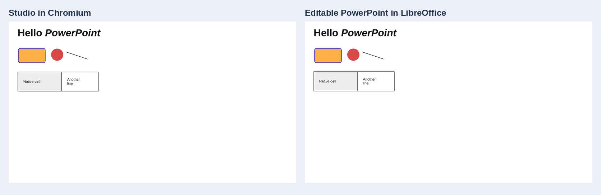

# Editable PowerPoint export

Open a presentation, choose **Menu → Export presentation… → PowerPoint**, and open the downloaded .pptx in PowerPoint. The file contains the visible slides in their Studio order. Text, shapes, table cells and supported charts remain editable. PowerPoint’s **Edit Data** opens a chart’s embedded Excel workbook. Speaker notes, feedback, design references and hidden slides stay out of this audience file. Use **Download editable copy** to transfer private Studio review work.

A viewer with current access to a shared presentation can download the audience file. Connected agents can call `export_powerpoint(deck_id)` and download the returned URL using their existing connection credentials. Refer to the [agent guide](../agent/README.md) for connection details.

## Slides imported from PowerPoint

New imports retain the source package privately in the workspace database. On export, Studio uses the original slide drawing, master, layout and theme. It writes supported Studio edits into the corresponding native PowerPoint objects. Supported edits include changes to text runs, table cells, chart categories and data values, and supported position and rotation changes. The exporter rebuilds embedded chart workbooks from the referenced data and removes unrelated package content. Moving or hiding slides changes their inclusion and order. Duplicated slides can carry independent text and chart edits. You can add newly authored slides to an imported deck. They use the presentation's physical canvas dimensions.

The original source is part of full workspace recovery. Source-only Git sync and portable Studio projects can lack this database record. An import made before source retention also lacks the original. In those cases, the error asks you to reimport the source .pptx into a new presentation. If editing the imported HTML changes its structure or references beyond the supported mapping, Studio reports the affected slide. Changing the imported theme or replacing original image assets can also require a new import.

## Slides authored in Studio

The server's sandboxed Chromium measures the actual slide after applying its theme, fonts, layout and CSS. The exporter translates the supported objects into DrawingML. It can write formatted text, editable rectangles and ellipses, lines, supported SVG paths as native freeforms, pictures with their crops, groups, linear gradients, HTML tables, and charts with editable data. Line wrapping uses the measured lines. Text may span several editable boxes. A recipient needs the same fonts for comparable line and glyph placement.

A chart produced with HTML or SVG needs categories, series and values for **Edit Data** to work. A chart author can supply these on the chart container through `data-pptx-export-chart`, for example:

```html
<div data-pptx-export-chart='{"chartType":"clustered-column","categories":["Spring","Summer"],"series":[{"name":"Visits","values":[12,18],"color":"#14665c"}],"minimum":0,"maximum":20,"majorUnit":5}'>
  <!-- The chart's visible HTML or SVG goes here. -->
</div>
```

Keep the chart description in sync with the visible chart. Supported chart types are clustered columns, clustered horizontal bars, lines and pies. Supported SVG artwork outside a semantic chart can export as individual drawing objects. Exporting a native chart requires its data.

Interactive slide documents, unsupported animation or clipping, unsupported SVG effects, and some compositing or CSS transformations cannot be translated faithfully. The dialog reports the offending slide or object. Use the HTML export to keep interactive behavior. Slides that require browser conversion need a host with the Studio Chromium sandbox available. Source-only PowerPoint round trips can run without Chromium.

## Verification

The fictional Garden and 4:3 Layers fixtures were exported, reopened and rendered in LibreOffice. All three unchanged exported slides had identical pixels to the same original slides rendered by that application. In an edited Garden deck the title changed and the table and chart remained native objects. A separate three-slide deck supplied with PowerPoint for Mac reference PNGs retained its original LibreOffice appearance across all three slides. Editing one chart value changed the corresponding bar and workbook value. Pixel comparisons using the same renderer establish round-trip behavior for these fixtures. The new exports still require direct PowerPoint for Mac and Windows acceptance for cross-application fidelity.

A fictional Studio-authored slide containing styled text, vector shapes and a table was compared with its editable export rendered by LibreOffice at 1600 × 900. The mean absolute RGB difference was 0.83 on the 0–255 scale. Some text baselines and table borders still differ.



The repository tests exercise native XML and workbook contents, cropped pictures, 16:9 and 4:3 slides, mixed-source slide order, unsupported content, private data exclusion, the browser download flow, and agent authorization. Browser rendering tests run with the CI Chromium sandbox.
