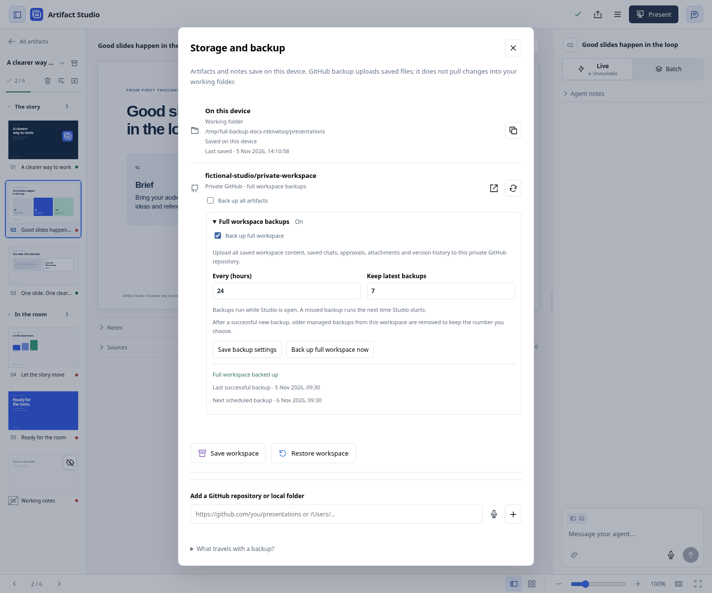
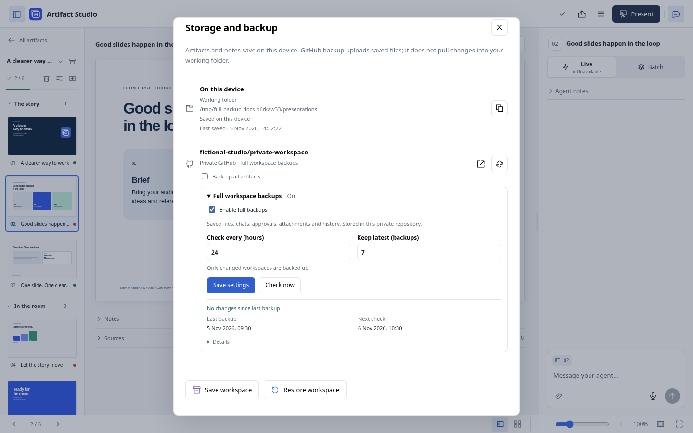

# Local saving, reference libraries and GitHub backup

The **storage icon in the library or beside Menu in the slide editor** opens **Storage and backup**; **Menu → Storage and backup** opens the same dialog. It shows the actual working-folder path, a copy-path control, local save status, connected references and GitHub backup outcomes. Connections default to **reference only**. Agents can inspect earlier decks, brand masters, assets and writing tone without uploading your workspace. Public repositories may be references; uploads require a private repository. Local reference folders remain read-only and their latest files are read directly.

Hover or focus an icon for its explanation. The circular arrow **Refresh references** downloads the latest reference copies from GitHub; the upload arrow **Back up now** sends current saved source files to the private repository. A failed source backup keeps the upload icon for **Retry GitHub backup**. Full workspace archives have separate settings and a **Check now** action. **Esc** dismisses a tooltip, then closes the dialog on a second press.

## Local saving and handoff

**On this device → Last saved** shows the newest saved workspace file time, with seconds in your local timezone. It includes current slides, artifact files, notes and workspace instructions; it excludes caches, revision history and connected references. The observation refreshes within about 15 seconds and survives reopening the app. It is based on existing file modification times, so deleting a file or copying one while preserving its timestamp does not create a new save event. An unavailable timestamp displays **—**; GitHub's backup time is separate.

Slides live in the working folder. Speaker notes save automatically after about 700 ms without typing, on leaving the field/slide, and before project save or presentation startup. **Saved** confirms the canonical file write; **Saving…** means it is pending. Failed requests retain a browser draft. Retry after reconnecting; a restored draft also resumes saving when its baseline is still valid. A concurrent edit opens **Review changes**, with both texts and an explicit choice. Revision checks protect older requests, including when text was changed and then reverted. Notes do not change slide approval.

The storage icon remains visible while the dialog is closed. A pending or failed note save takes priority over an earlier successful backup. GitHub's last successful backup and timestamp describe confirmed delivery; subsequent remote edits are checked at the next delivery, rather than continuously merged into local files.

To transfer one presentation, use **Save a copy…** and **Import presentation** on the other device. For the whole workspace, use **Save workspace** or explicitly enable full GitHub backups below; both include saved private review state and retained revisions. Current-source Git backup carries current artifact/project and presentation files, without private review history. Unsaved browser-only edits are separate from full workspace archives. Refreshing a GitHub reference updates its cache; applying remote content to the working collection remains an explicit action. Neither backup mode provides bidirectional workspace sync.

**Two computers:** current-source uploads use a baseline stored on each computer to stop stale replacements and preserve remote projects absent locally. Update every uploading computer; older versions retain the overwrite defect. This is conflict protection, not live synchronization: remote files are not merged into open projects. Use one shared Studio server, separate current-source destinations, or full archive backups with explicit handoff. [Verified scenarios and safe workflows](MULTI-COMPUTER.md).

Library operations and automatic sync keep their process locks beside the workspace database, outside the removable reference cache. A missing cache directory can be recreated without replacing an active lock; missing workspace state is not silently recreated.

## Scheduled full workspace backups

**Full workspace backups** is a separate, off-by-default setting for each connected private GitHub repository. It uploads the same full ZIP as **Save workspace**: collection sources, saved review chats and drafts, approvals, retained revisions, navigation and app-owned attachments. This includes private material that current-source Git backup excludes. Host credentials, connected agent sessions, reference checkouts and upload permissions are excluded. Use a repository whose collaborators may access that private material.

Connect the repository as a reference, expand **Full workspace backups**, and choose **Enable full backups**. Set **Check every (hours)** to **1–720** (default **24**) and **Keep latest (backups)** to **1–100** (default **7**), then choose **Save settings**. GitHub CLI must already be authenticated with `gh auth login`. Enabling starts the first check; **Check now** runs one on demand. Only changes since the last verified backup create a new archive. The card shows **Last backup**, **Next check** and any error or cleanup warning; **Details** explains the schedule and retention.

**No changes since last backup** skips ZIP creation, upload and retention cleanup, preserves the last backup's timestamp and link, and advances **Next check**. Saved sources, notes, chats, approvals, retained history, attachments, directories and file modes count as changes. Status polling, delivery bookkeeping, file modification times alone and SQLite's physical layout do not. **Save workspace** always creates the requested local download.

Checks run while the Studio server is running, including with the browser tab closed. The next check survives a restart; reopening catches up one missed check without creating duplicate archives. Failed uploads retain earlier backups and retry with increasing delays; **Check now** also retries. Only a verified upload advances the saved-content checkpoint. Save unfinished browser edits and pause direct filesystem edits before backing up: export serializes application writes, but external edits do not share that transaction.

### Where GitHub stores the archives

Full archives are timestamped ZIP **release assets**, under the stable tag and release **`artifact-studio-workspace-backups` in the selected backup repository**. A branch holds a changing source history; a tag names a source commit; a GitHub release can attach downloadable files to a tag. Here the fixed tag identifies the backup container, while each asset is an independent archive. There is no new branch or tag per backup, and archive bytes are not committed into Git history. This release is separate from Artifact Studio's application-version releases and `v*` tags.

Asset names include the workspace identity, timestamp, a unique ID and SHA-256. Each archive must be below **2,000,000,000 bytes** to fit the recovery limit. After a new upload is verified, retention removes only older managed assets for that workspace's backup series in that repository. The newest backup is protected; unrelated assets and other workspaces' backups are left alone. A failed upload never triggers retention. A cleanup failure reports a warning and can leave more than the configured count until a later cleanup succeeds.

To recover on another computer, authenticate GitHub CLI, connect the private backup repository as **reference only**, and open **Restore workspace → Full GitHub backup**. Load backups, select an archive and preview it before restoring to a new folder. Restoring does not enable uploads. [Recovery steps and guarantees](WORKSPACE-RECOVERY.md).

## Automatic current-source Git backup

Check **Back up automatically** when connecting a GitHub repository, or **Back up all artifacts** beside an existing connection. This explicitly includes **all saved artifacts in this workspace**, including the initial saved collection, notes and design references. Existing connections are never opted in automatically. The repository must already exist, and GitHub CLI must be authenticated with `gh auth login` and `gh auth setup-git`.

While the local server runs, it checks saved files and groups changes after eight quiet seconds. Closing a browser tab does not stop delivery; stopping Artifact Studio does. The next launch resumes from durable local checkpoints. Unsaved editor text is not a file change. Turning this setting off stops current-source uploads; the full workspace backup setting is independent. If a library operation is already running, wait for it to finish before changing the setting; orderly shutdown waits for that operation too.

The destination shows waiting, backing up, backed up or an actionable error. The header icon also reports pending delivery and failures. A delivery failure pauses that destination until you use **Retry GitHub backup**. Further edits do not silently dismiss the error. Normal file replacements/removals are re-observed and retried after the quiet interval. Reverted edits clear a pending marker when the saved tree matches the confirmed backup. There is no browser-tab or active-agent requirement.

Automatic sync removes absent files only when this computer previously acknowledged them and their remote hash still matches its local baseline. Files added by another computer remain untouched when absent locally. A changed or deleted remote file conflicts with a stale local copy before the snapshot is written. Git history retains earlier versions; unrelated repository files and retained revision folders are preserved. This is one-way backup, never a remote overwrite of local working files. [Local backup baselines](MULTI-COMPUTER.md#local-backup-baselines).

## Current-source included files

Current-source snapshots include current owned artifact bundles of any file type, project briefs, current artifact/project manifests, existing HTML decks, supplied PPTX masters, design packs, documents and asset folders. Legacy collection references use the extension allowlist in `artifact_studio/libraries.py`. Current owned bundle files are not restricted to those extensions. Files at or above 100 MB require smaller media; Git LFS is not managed here. Symbolic links, dotfiles, review databases, dependency/reference caches and known credential files are excluded. Slides’ embedded notes and source/context documents are included. Review chats, approval state, private delivery cursors and immutable artifact revision directories are not uploaded by this mode. Previously delivered revision folders remain in the remote repository. The current snapshot also includes `workspace-recovery.json` with legacy memberships and archive visibility. **Storage and backup → Restore workspace** rebuilds the registry and navigation in a separate new folder. Older snapshots without that metadata cannot recover legacy project assignments. Chats, approvals and retained history require a full archive, downloaded with **Save workspace** or uploaded through the separate **Full workspace backups** setting. See [Workspace recovery](WORKSPACE-RECOVERY.md).

Saving rules or learned preferences in the frontend writes the collection's `INSTRUCTIONS.md` and `LEARNED-PREFERENCES.md`. Automatic whole-workspace sync includes both files after the quiet interval. Without auto-sync, the edits stay on the filesystem until an explicit manual whole-workspace sync; a single-deck sync does not include workspace rules. External edits to these Markdown files appear when you reopen or reload the editor.

A `.artifact-studio-manifest.json` in the destination records hashes of managed files. It is inventory, not permission to replace those files. Each computer separately stores its acknowledged hashes and commit in its private database, bound to the collection and branch. Content hashes detect replacements even if size and modification time stay unchanged. Every delivery verifies that the repository is still private and compares remote files with that local baseline. Reserved current-source metadata omits host-specific paths and rebuildable project view fields, so identical restored content can be acknowledged on another computer. Legacy metadata migrates only when its portable content matches exactly; authored files and genuine conflicts retain the same protections. There is no continuous remote-change detection. No force push is used.

The Mac menu-bar app’s **GitHub Backup** submenu reads the same server settings. It shows each repository’s delivery state and last successful time, an **Automatic Backup** checkmark, **Sync Now** or **Retry Backup**, and **Open Backup Settings…**. It does not maintain a separate native preference.

## Manual sync and recovery

Existing manual destinations retain their upload controls. Agents can explicitly register `sync_enabled=true`, then call `sync_presentations(library_id, deck_id)` for one dated folder, or omit `deck_id` for the collection. Manual snapshots preserve files removed locally. `auto_sync_enabled=true` is separate permission for the continuous whole-workspace behavior above.

After a network error, use retry. Studio records an exact prepared commit before pushing. That committed but unpushed snapshot, or a push whose acknowledgement was lost, can be reconciled without a duplicate commit when remote history permits it. Later local edits are checked against the confirmed baseline. A server restart rechecks an interrupted delivery before declaring it complete. Uncommitted cache changes, unexplained unpublished commits and divergent history require inspection; the tool refuses to discard them. Reconcile remote divergence deliberately rather than force-pushing.

Existing automatic-backup receipts migrate from the exact last confirmed commit, limited to paths present in the first requested snapshot. Old locally removed files are preserved during that migration because deletion ownership cannot be proved. Legacy manual connections without a confirmed receipt may need review before uploading changed existing files. A matching file can be acknowledged without replacement. Full archives exclude these host checkpoints, so a restored workspace does not inherit upload ownership. [Upgrade and conflict handling](MULTI-COMPUTER.md#local-backup-baselines).

Refresh only fast-forwards a clean cached reference checkout under `.state/libraries/`. To adopt remote content into the working collection, inspect and apply the intended changes explicitly, preserving local notes and concurrency checks. Imported README files never grant upload permission.

Keep the application repository separate from the content repository. Neither sync nor repository creation enables GitHub Pages or external website hosting. Testing this feature uses fictional decks and a disposable local Git remote; it does not opt any real repository in.
