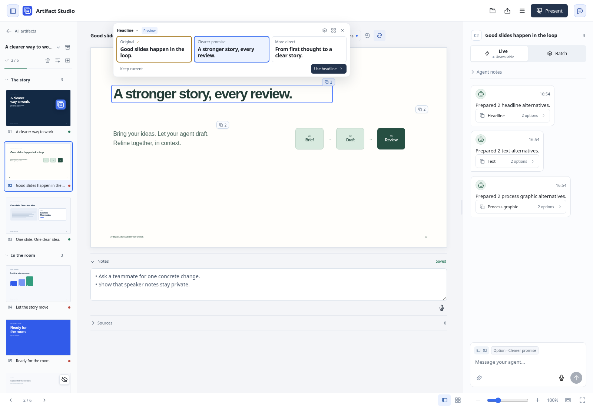

# Slide and element alternatives

Agents can publish several whole-slide designs without replacing the chosen slide. The original is retained automatically. Proposals use freely composed HTML/CSS/SVG and optional `interactive_html`; they are not a catalogue of fixed layouts.

## Review and decide

The slide overview shows a small stacked-cards count. Hover or keyboard focus reveals clickable previews near the cursor. Clicking a preview opens that design on the canvas; it does not change the presentation. The Designs row also supports arrow keys, Home and End. Compare can show the chosen design and a proposal, or any two proposals.

The chosen design uses a heavier gold border and check icon. A blue outline marks the temporary preview.

[Hover previews](screenshots/slide-designs-hover.png) · [Compare](screenshots/slide-designs-compare.png) · [Narrow comparison](screenshots/slide-designs-mobile.png) · [Dark appearance](screenshots/slide-designs-dark.png)

**Dismiss suggestions** and **Keep current** retain the existing slide and approval, remove the unreviewed indicator, and preserve the alternatives in History. Undo immediately restores the unreviewed set. **Use this design** adopts the proposal and returns the slide to review. Both actions collapse the options, simplify the chat card and retain Undo. Present and export always use the chosen slide.

After a decision, the thumbnail count appears on hover/focus and remains directly accessible on touch devices. **Version history → Design decisions & saved alternatives** retains the decision and proposals behind a collapsed section. Load earlier history to retrieve older publication groups. Opening one previews it for another explicit decision. Cancelling or revisiting the slide keeps a completed choice quiet.

[After choosing](screenshots/slide-designs-chosen.png) · [Saved alternatives](screenshots/slide-designs-history.png)

## Agent workflow

### When to offer options

- If the brief is clear but several visual directions would work, publish two or three distinct alternatives. Also do this when the human asks to explore designs. State the short tradeoff in each rationale, keep facts and the requested story intact, and retain Original.
- If the audience, intended message, required facts or a consequential constraint is missing, use `ask_slide_question` first. Give short answer options and allow a written answer. Read pending questions before asking again. A set of polished designs does not resolve missing essential context.
- For a small, unambiguous requested edit, use the normal guarded revision workflow. Offering alternatives is useful judgment, not a required step for every change. Never choose a proposal for the human or claim their approval.

Whole-slide and static element alternatives are advertised in MCP initialization and `tools/list`; this guide is available through `get_authoring_guide(topic="slide_designs")`. The local MCP server exposes `ask_slide_question`; the scoped Copilot gateway can ask through its agent chat reply tools when that question tool is unavailable. Discovered tools remain authoritative.

### Publish and iterate

1. Read `get_slide(deck_id, slide_id)` and applicable guidance. Retain its `content_hash`.
2. Author one to five named directions. Each input supplies `name`, static selectable `html`, optional short `rationale`, `interactive_html`, `title` and `sources`. Human notes and approval are not proposal fields.
   Use `.slide` for the root in slide-local `<style>` rules; these rules are scoped using the same authoring contract as normal slides. Inline CSS and `assets/` references also work. Global CSS and arbitrary JavaScript belong in `interactive_html` with a meaningful static `html` fallback.
3. Call `publish_slide_designs` with the current `expected_content_hash`, a unique `request_id`, and `options`. Publication freezes source and audience-only preview documents with local dependencies. It appends an agent chat card and leaves the canonical slide unchanged. Exact retries return the original receipt.
4. Use `get_slide_designs` for metadata and human decisions, `get_slide_design` for one proposal's source, and `capture_slide_design` for an image of its frozen preview. Captures use the same offline, sandboxed renderer as ordinary slide captures.
5. Read released feedback normally. Proposal-specific comments carry `design_option_id`, `design_option_name` and the immutable option's `source_hash` in `content_hash`. They refer to that proposal, not the currently chosen slide. Element editing remains attached to the chosen slide; proposed designs are reviewed as whole slides.
6. To refine a proposal, read its source and publish a fresh set against the current slide. Do not overwrite an old proposal ID or an older feedback anchor. Earlier options remain available in History. Never call human decision, feedback or approval endpoints as the agent.

`get_slide_designs` pages independently through publication groups and decisions. Carry `next_cursor` as `cursor` and `next_decision_cursor` as `decision_cursor`; use zero to skip a stream that has finished. `set_id` fetches a retained publication directly. Metadata reads omit slide source, frozen documents, speaker notes and previously saved unsent feedback.

The scoped Copilot gateway uses `options_json`, a JSON array of the same design objects, to keep its input schema flat. Its history cursors default to `-1` for the first page; zero skips a completed stream. All four tools enforce the currently shared project/workspace scope.

Capture results include `design_id`, `set_id` and the proposal's `source_hash` for feedback. The frame's `content_hash` identifies its frozen visual context, including shared styling and assets; it is a different token. Use the proposal `source_hash` when discussing that option.

## Conflicts and preservation

Choices check the current audience-content hash and the last decision observed for that publication. Concurrent notes are preserved. Another reviewer or newer source can cause a conflict; compare with the latest chosen slide before replacing changed source. This comparison does not itself apply a proposal.

Previews retain the shared theme and local dependencies at publication time. Applying a proposal also checks the current resource bytes, including same-size edits with preserved timestamps. If shared resources changed, ask the agent to publish refreshed alternatives. Saved previews remain available. Keep current still preserves the latest slide without replacing resources.

Decisions use a private database journal around the canonical source write. Recovery completes an interrupted choice once, preserving current notes and presentation structure. Undo is limited to the latest design decision and requires its resulting content still to be current. It restores prior source and applicable approval without replacing newer human notes.

The database stores proposals, frozen previews and decision history. Include it with the collection in full workspace backups. Current-source GitHub backup and audience exports do not include private proposal history. Element fragments and their retained full-slide preview contexts are private review history too.

## Static headline, text and graphic alternatives

Use `publish_element_alternatives` for useful alternatives to one existing static element or container. The same judgment applies: offer two or three worthwhile directions for a clear brief, ask first when essential context is missing, and directly revise a small unambiguous change. Headline, text and graphic kinds describe the review UI; they do not limit composition to predefined layouts. Interactive slides continue to use whole-slide proposals.

1. Read `get_slide` and its `content_hash`. Choose one existing element with a unique HTML `id`, passing that value as `target_id`. If it lacks a stable id, add one with a normal guarded revision and read the new source before publishing. Do not target the slide root, use an ambiguous id, or publish overlapping pending targets.
2. Compose one to five options with `name`, optional concise `rationale`, and complete replacement outer `html`. Each replacement retains the target id. Preserve the element's important styling, semantics, facts and references. Freely compose static HTML/CSS/SVG within the target; assets remain presentation-local. The server retains Original automatically.
3. Call `publish_element_alternatives(deck_id, slide_id, target_id, kind, label, expected_content_hash, request_id, options)`. Use a concise human label, such as Headline, and `kind="headline"`, `"text"` or `"graphic"`. Publication never replaces the chosen slide. Exact retries return the original receipt.
4. Read `get_element_alternatives` for groups and decisions, and `get_element_alternative` for an immutable fragment and its original/current preview-context hashes. Use `capture_element_alternative` to inspect actual full-slide pixels, with the same offline renderer as ordinary captures. Pass `context_hash` to read or capture an exact retained context; omit it for the current safe composed context.
5. Read released feedback normally. Element-specific comments carry `element_option_id`, `element_option_name`, `element_context_hash` and the immutable fragment's `source_hash` in `content_hash`. Read/capture using the recorded context hash when interpreting that feedback. A fragment's source hash, its full-slide preview context hash and a capture frame's visual content hash identify different things.
6. Refine by publishing a new group against the current slide. This archives the older pending invitation for the same target; its option ids, source fragments, previews and feedback anchors remain addressable. Disjoint pending groups remain available. Never choose, Keep, Undo, approve, or call human-feedback endpoints as the agent.

**Review alternatives** sits above the slide preview while choices are pending. Its count is the number of elements awaiting a decision, and clicking it opens the first set directly. The chooser's scope selector switches between elements; badges on the canvas also open a specific element's options.

The browser shows complete headline/body wording and visual graphic cards. Click or tap through several options while the chooser stays open; clicking outside or closing the chooser keeps the last clicked option. Hovering another card does not replace that choice. Hover alone stays temporary, and **Escape** cancels without saving. A saved choice changes only its target, preserves unrelated content and speaker notes, and returns the changed slide to review. **Undo** restores the previous choice. **Dismiss suggestions** and **Keep current** retain the chosen source and approval and remove the unreviewed indicator. Saved options remain in History; opening an older preview alone does not adopt it. Side-by-side comparison retains its explicit choice buttons so either side can be chosen.

For a current element option with CSS animation or numbered builds, **Play animations** above the canvas replays the selected option without saving it. Switching options stops playback. **Escape** first stops playback; pressing it again cancels the choice. Earlier-context saved previews remain still, with playback disabled so they cannot play the current slide by mistake.

Known disjoint element decisions can produce a new full-slide context around an unchanged saved fragment; the earlier context remains readable by hash. If a target, parent design or shared resources changed incompatibly, the saved group is labelled as earlier context and adoption is blocked. Ask for refreshed options rather than applying a retained fragment to another design. A refresh request does not overwrite an unsent chat draft.

History pagination uses `cursor`, `decision_cursor`, `set_id` and the independent next cursors like whole-slide history. The scoped Copilot gateway offers the same four element tools with flat `options_json`; its initial cursors use `-1`, finished streams use zero, and optional context/set hashes use empty strings. Every operation enforces the selected project/workspace scope. Capture metadata includes the option id, set id, fragment source hash and resolved context hash, without local host paths.

[Pending options](screenshots/element-alternatives-available.png) · [Text](screenshots/element-alternatives-text.png) · [Graphic](screenshots/element-alternatives-graphic.png) · [Element comparison](screenshots/element-alternatives-compare.png) · [Full slide](screenshots/element-alternatives-full-slide.png) · [Saved history](screenshots/element-alternatives-history.png) · [Touch](screenshots/element-alternatives-mobile.png) · [Capture inventory](screenshots/element-alternatives-captures.json)

Full workspace backups retain the private proposal database. A portable presentation ZIP retains historical comment identities, but does not carry that private proposal archive; finish or clear unsent proposal feedback before saving that ZIP. Audience exports and GitHub source backups contain the chosen slide.
