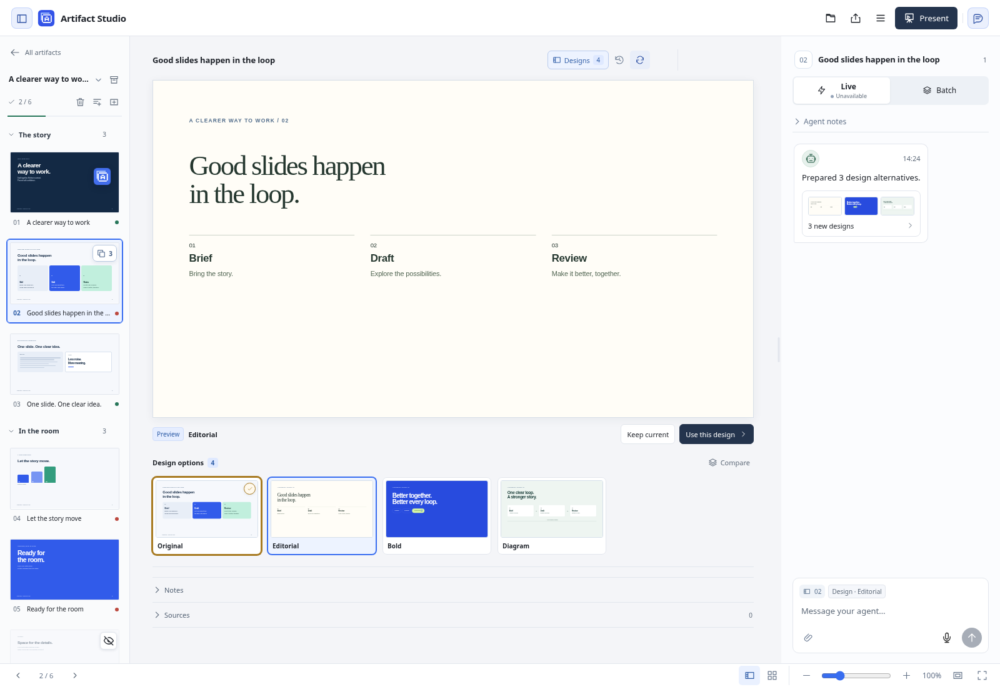

# Slide design alternatives

Agents can publish several whole-slide designs without replacing the chosen slide. The original is retained automatically. Proposals use freely composed HTML/CSS/SVG and optional `interactive_html`; they are not a catalogue of fixed layouts.

## Review and decide

The slide overview shows a small stacked-cards count. Hover or keyboard focus reveals clickable previews near the cursor. Clicking a preview opens that design on the canvas; it does not change the presentation. The Designs row also supports arrow keys, Home and End. Compare can show the chosen design and a proposal, or any two proposals.

The chosen design uses a heavier gold border and check icon. A blue outline marks the temporary preview.

[Hover previews](screenshots/slide-designs-hover.png) · [Compare](screenshots/slide-designs-compare.png) · [Narrow comparison](screenshots/slide-designs-mobile.png) · [Dark appearance](screenshots/slide-designs-dark.png)

**Keep current** explicitly keeps the existing slide and approval. **Use this design** adopts the proposal and returns the slide to review. Both actions collapse the options, simplify the chat card and retain Undo. Present and export always use the chosen slide.

After a decision, the thumbnail count appears on hover/focus and remains directly accessible on touch devices. **Version history → Design decisions & saved alternatives** retains the decision and proposals behind a collapsed section. Load earlier history to retrieve older publication groups. Opening one previews it for another explicit decision. Cancelling or revisiting the slide keeps a completed choice quiet.

[After choosing](screenshots/slide-designs-chosen.png) · [Saved alternatives](screenshots/slide-designs-history.png)

## Agent workflow

### When to offer options

- If the brief is clear but several visual directions would work, publish two or three distinct alternatives. Also do this when the human asks to explore designs. State the short tradeoff in each rationale, keep facts and the requested story intact, and retain Original.
- If the audience, intended message, required facts or a consequential constraint is missing, use `ask_slide_question` first. Give short answer options and allow a written answer. Read pending questions before asking again. A set of polished designs does not resolve missing essential context.
- For a small, unambiguous requested edit, use the normal guarded revision workflow. Offering alternatives is useful judgment, not a required step for every change. Never choose a proposal for the human or claim their approval.

The capability is advertised in MCP initialization and `tools/list`; this guide is available through `get_authoring_guide(topic="slide_designs")`. Element-level alternatives are not implemented by these tools. Until that capability exists, use a targeted question or normal revision for individual text, headline and object changes.

### Publish and iterate

1. Read `get_slide(deck_id, slide_id)` and applicable guidance. Retain its `content_hash`.
2. Author one to five named directions. Each input supplies `name`, static selectable `html`, optional short `rationale`, `interactive_html`, `title` and `sources`. Human notes and approval are not proposal fields.
   Use `.slide` for the root in slide-local `<style>` rules; these rules are scoped using the same authoring contract as normal slides. Inline CSS and `assets/` references also work. Global CSS and arbitrary JavaScript belong in `interactive_html` with a meaningful static `html` fallback.
3. Call `publish_slide_designs` with the current `expected_content_hash`, a unique `request_id`, and `options`. Publication freezes source and audience-only preview documents with local dependencies. It appends an agent chat card and leaves the canonical slide unchanged. Exact retries return the original receipt.
4. Use `get_slide_designs` for metadata and human decisions, `get_slide_design` for one proposal's source, and `capture_slide_design` for an image of its frozen preview. Captures use the same offline, sandboxed renderer as ordinary slide captures.
5. Read released feedback normally. Proposal-specific comments carry `design_option_id`, `design_option_name` and the immutable option's `source_hash` in `content_hash`. They refer to that proposal, not the currently chosen slide. Element editing remains attached to the chosen slide; proposed designs are reviewed as whole slides.
6. To refine a proposal, read its source and publish a fresh set against the current slide. Do not overwrite an old proposal ID or an older feedback anchor. Earlier options remain available in History. Never call human decision, feedback or approval endpoints as the agent.

`get_slide_designs` pages independently through publication groups and decisions. Carry `next_cursor` as `cursor` and `next_decision_cursor` as `decision_cursor`; use zero to skip a stream that has finished. `set_id` fetches a retained publication directly. Metadata reads omit slide source, frozen documents, speaker notes and unreleased Batch feedback.

The scoped Copilot gateway uses `options_json`, a JSON array of the same design objects, to keep its input schema flat. Its history cursors default to `-1` for the first page; zero skips a completed stream. All four tools enforce the currently shared project/workspace scope.

Capture results include `design_id`, `set_id` and the proposal's `source_hash` for feedback. The frame's `content_hash` identifies its frozen visual context, including shared styling and assets; it is a different token. Use the proposal `source_hash` when discussing that option.

## Conflicts and preservation

Choices check the current audience-content hash and the last decision observed for that publication. Concurrent notes are preserved. Another reviewer or newer source can cause a conflict; compare with the latest chosen slide before replacing changed source. This comparison does not itself apply a proposal.

Previews retain the shared theme and local dependencies at publication time. Applying a proposal also checks the current resource bytes, including same-size edits with preserved timestamps. If shared resources changed, ask the agent to publish refreshed alternatives. Saved previews remain available. Keep current still preserves the latest slide without replacing resources.

Decisions use a private database journal around the canonical source write. Recovery completes an interrupted choice once, preserving current notes and presentation structure. Undo is limited to the latest design decision and requires its resulting content still to be current. It restores prior source and applicable approval without replacing newer human notes.

The database stores proposals, frozen previews and decision history. Include it with the collection in full workspace backups. Current-source GitHub backup and audience exports do not include private proposal history. Component alternatives are a separate follow-up.
