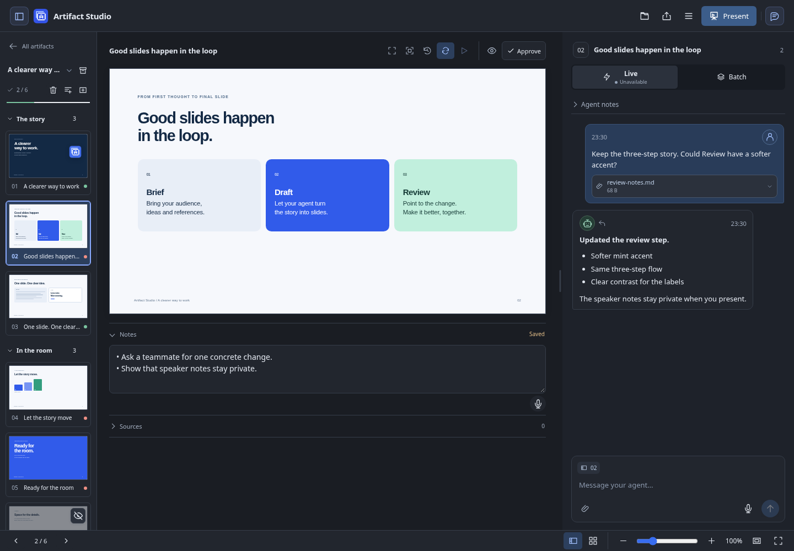

# UI, contrast and reliability review — 3 November 2026

Five focused agents reviewed contrast, interaction, persistence, performance and accessible names. Two fresh reviewers then checked the integrated result independently. Findings were reproduced before changes. The scope was the application's controls and workflows, using fictional data; authored slides and artifacts retain their own styling.

## Confirmed fixes

| Area | Problem | Result |
| --- | --- | --- |
| Feedback delivery | A second window could switch Batch to Live while the first still showed Batch. A delayed element send could also resume after dictation under a different mode. | Polling updates delivery controls without replacing drafts. First publication checks the mode shown for the action, including voice/preview waits. A conflict keeps the text/files for explicit resubmission. |
| Retry safety | A delivery guard must not turn an uncertain retry into a second event. | The mode is a precondition, separate from message identity. Exact retries return the original receipt and never release an earlier Batch event. Older clients retain their existing behavior. |
| Draft recovery | A completed save in one tab could erase another tab's newer local draft. | Cleanup removes only the value that the saving tab previously persisted. Two-tab notes and feedback recovery are covered. |
| Narrow layouts | Editor controls, artifact toolbars and the history Restore action could overflow at 320px. | Controls reflow; phone history stacks its list and preview so the full action remains reachable. |
| Keyboard focus | Compact drawers left covered canvas controls tabbable; history dismissal and a disabled Batch button could lose focus. | Covered canvas controls become inert while a drawer is open. Closing, resizing, confirmation cancellation and polling restore visible focus. |
| Accessible controls | Resizable separators lacked range values; Live's name differed from its visible label; design card status/description were omitted. | Widths and bounds are announced, Home/End work, and meaningful names/descriptions are exposed without adding visible text. |
| Artifact reads | The selected artifact was fully validated twice to build one HTTP response. | The response reuses its validated view. An 8 MiB example dropped from four tree reads/32 MiB to two reads/16 MiB. External-edit and immutable-snapshot checks remain in place. |
| CI coverage | Four opt-in browser modules were absent from CI. | Downloads, project navigation, sharing/focus and PDF export journeys now run, alongside new contrast, keyboard and delivery-race regressions. |

## Measured contrast

The color audit sampled 42 light/dark desktop/mobile states: 1,055 text samples and 39 meaningful control/focus samples. It found no remaining failures in those samples after the fixes. Normal text uses a 4.5:1 threshold; meaningful non-text controls and focus states use 3:1. Measurements composite transparent foregrounds and backgrounds. Disabled controls, decoration and screen-reader-only content are excluded.

| Sample | Before | After |
| --- | ---: | ---: |
| Chat placeholder, light | 2.93:1 | 5.43:1 |
| Attachment metadata, light | 3.06:1 | 5.19:1 |
| Slide number, dark | 3.78:1 | 6.84:1 |
| Keyboard focus outline, light | 1.59:1 | 4.18:1 |
| Unchecked sharing radio, light | 1.25:1 | 5.43:1 |

The independent visual pass exercised 78 settled states, including 320px/390px windows, both themes, keyboard drawers, history confirmations, questions, design cards and sharing. Automatic accessibility findings were checked against actual names and keyboard behavior; concatenated metadata counts and zero-padded slide numbers were not treated as defects solely to satisfy a text-matching heuristic. This is sampled verification, not a claim of complete WCAG conformance.

## Reproducing the checks

```sh
ARTIFACT_STUDIO_BROWSER_TESTS=1 uv run pytest \
  tests/integration/test_ui_contrast.py \
  tests/integration/test_accessible_labels.py \
  tests/integration/test_editor_layout.py \
  tests/integration/test_feedback_mode_sync.py \
  tests/integration/test_element_mode_guard.py
uv run pytest tests/test_feedback_mode_guard.py tests/test_artifact_api.py
node --test tests/*.cjs
```

[Screenshot sources and inventories](screenshots/README.md) use isolated fictional collections. The audit also used axe-core 4.14.0 as a development-only check; the app does not load it or require it at runtime.



## Verification limits

Native OS sheets, physical screens and authenticated model sessions require their own application checks. The managed container cannot run the production sandbox-required capture renderer; it remains enabled and covered on the Ubuntu CI runners. Layout/contrast tests that supply a fictional thumbnail test the surrounding controls, not renderer isolation.

Registry polling still reads current sources to detect out-of-band changes, including edits that preserve size and modification time. The optimization removes duplicate validation within a request rather than adding a cache that could hide those edits.
