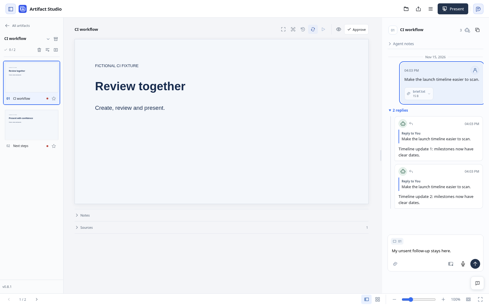
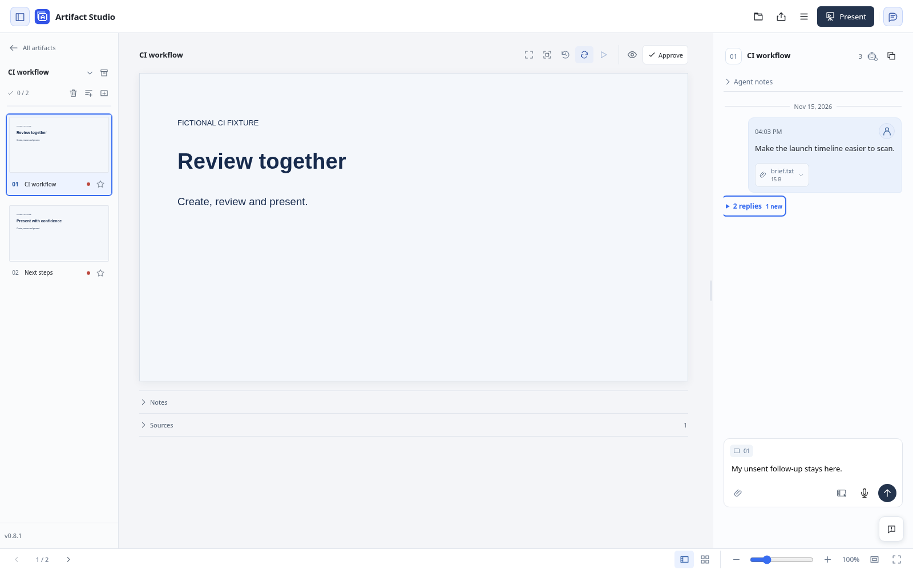
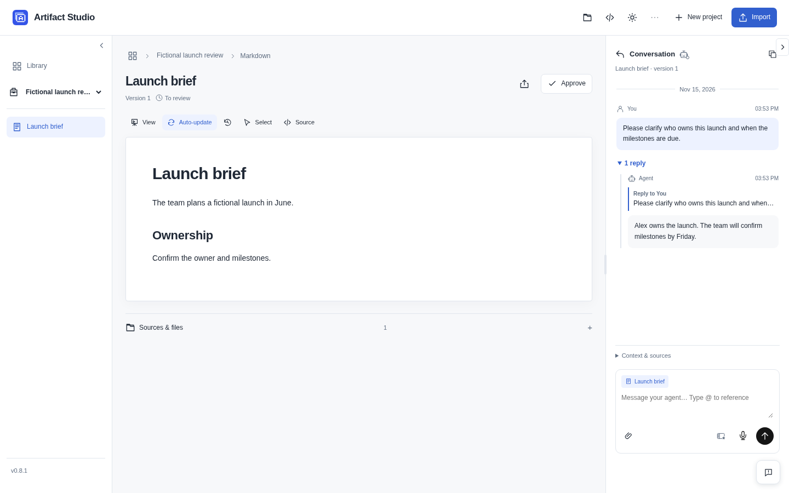

# Agent reply threads

Agent replies now sit beneath their original message, expanded initially. The
reply count collapses the thread and preserves that choice through polling and
conversation tab changes. New replies are counted while collapsed. Each quote
jumps to its exact parent, and Copy conversation includes collapsed replies.

Grouping uses only stored reply IDs among already visible messages. Local and
scoped IDs remain separate; unavailable parents and malformed cycles cannot hide
replies. No ancestor lookup or additional message request is made. UI state holds
only IDs, disclosure choices and read counts, bounded to 40 contexts and 2,000
entries per context.

## Verification on 2026-11-15

- Six new real HTTP/MCP/browser journeys passed in 86.90 seconds. They cover
  local presentation and artifact feedback, two humans and an agent in hosted
  presentation/artifact/standalone conversations, shared/private channel switches,
  collapsed incoming replies, keyboard focus, attachments, copy and unsent drafts.
- Twenty existing chat, question, design and element-control browser journeys
  passed. These retain Markdown safety, answer controls, approval and source
  behavior. The broader run identified a tab-switch preference reset; the final
  six-journey pass verifies its correction.
- All 315 Node behavior tests passed, along with Ruff and strict basedpyright.
- Independent security review found no issue. An additional 500 randomized reply
  graphs preserved every visible row once without channel/scope crossing.
- Fresh Terra reviewers exercised desktop light artifact chat and narrow dark
  presentation chat with actual mouse/keyboard interactions and MCP replies.
  The narrow review identified a focused question moving below the chat viewport
  after its height shrank. A regression reproduced that before the resize fix;
  the final browser test keeps the answer controls, draft and attachment intact.
  The same reviewer then confirmed the fix with real keyboard navigation,
  viewport resize and answer submission.

The local browser was headless Chromium 155 using the environment's compatibility
path; CI uses the pinned Playwright browser. Native file choosers, physical
displays, screen readers and real mobile software keyboards were not tested.

## Grouping cost

One local Node 24 run measured seven samples after one warm-up, using a chain of
stored replies. These numbers cover the pure grouping function, without DOM,
network or model calls; they are not end-to-end latency or token savings.

| Messages | Median | Maximum |
| --- | --- | --- |
| 100 | 0.331 ms | 2.894 ms |
| 1,000 | 2.372 ms | 5.058 ms |
| 20,000 | 46.441 ms | 77.574 ms |

The 20,000-message chain is also a regression test for stack-safe grouping.

## Fictional screenshots

