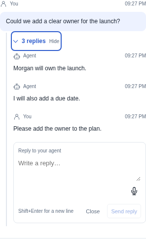
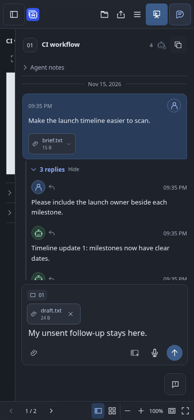
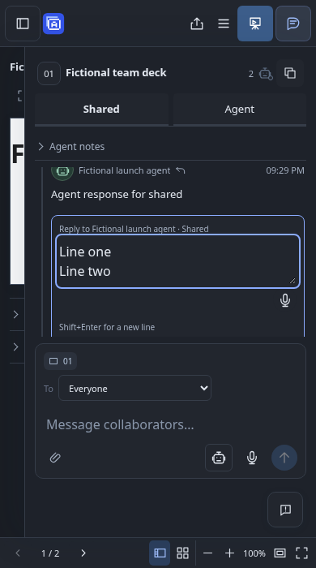
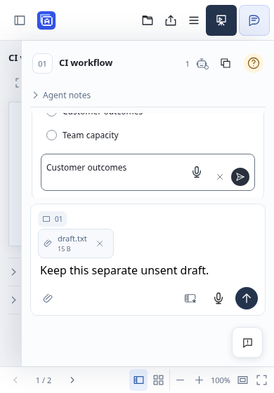

# Conversation threads

Replies sit beneath their original message on a shared visual branch, expanded
initially. The reply count collapses the thread and preserves that choice through
polling and conversation tab changes. New replies are counted while collapsed.
The original text is not quoted again; nested replies retain a compact link to
the message they answer. Copy conversation includes collapsed replies.

**Reply in thread** opens a compact composer below the replies, including on a
message with no replies yet. Its draft is separate from the main composer and
survives polling, collapse, and navigation during the session. Enter sends,
Shift+Enter adds a line, and composition input does not submit prematurely. The
audience hint identifies a shared discussion or the permitted agent recipient.
The server inherits the original revision and target and validates the parent
against the current channel and access; replying never releases saved messages.

Grouping uses only stored reply IDs among already visible messages. Local and
scoped IDs remain separate; unavailable parents and malformed cycles cannot hide
replies. No ancestor lookup or additional message request is made. UI state holds
only IDs, disclosure choices, read counts and the user's unsent thread drafts,
bounded to 40 contexts and 2,000 entries per context; it does not cache parent text.

## Verification on 2026-11-15

- Backend regression coverage verifies human authorship, original revision and
  target inheritance, released ancestors, question lifecycle, retry IDs,
  permission changes, and shared/private audience boundaries: 96 passed.
- All 317 Node behavior tests pass, along with repository-wide Ruff, format
  checks, and strict basedpyright.
- All 24 browser journeys pass, covering the new threads plus existing chat and
  structured-question controls. Real HTTP/MCP flows cover local feedback and two
  humans with an agent in hosted presentation, artifact and standalone views.
  They check the first-load reply action, inline sending, retained main and
  thread drafts, cursor selection, collapse counts, keyboard focus, attachment
  preservation, copy, retries, and shared/private isolation.
- Two fresh Terra reviewers independently exercised desktop light and narrow
  dark conversations using actual mouse and keyboard interactions. Their journeys
  included a failed send followed by retry, multiline composition, polling,
  channel changes, and private reply delivery. The desktop review found a clipped
  send error; placing it above the input kept it visible, and the reviewer
  repeated the failed-send/retry journey successfully.
- An independent Astra security review found a local reply path that accepted
  conflicting revision/target metadata. The fix inherits original targets and
  rejects conflicting hashes and unreleased parents; regression tests and the
  repeated security review verified it. No remaining confirmed findings.

The local browser was headless Chromium 155 using the environment's compatibility
path; CI uses the pinned Playwright browser. Native file choosers, physical
displays, screen readers and real mobile software keyboards were not tested.

## Grouping cost

One local Node 24 run measured seven samples after one warm-up, using a chain of
stored replies. These numbers cover the pure grouping function, without DOM,
network or model calls; they are not end-to-end latency or token savings.

| Messages | Median | Maximum |
| --- | --- | --- |
| 100 | 0.331 ms | 2.894 ms |
| 1,000 | 2.372 ms | 5.058 ms |
| 20,000 | 46.441 ms | 77.574 ms |

The 20,000-message chain is also a regression test for stack-safe grouping.

## Fictional screenshots

