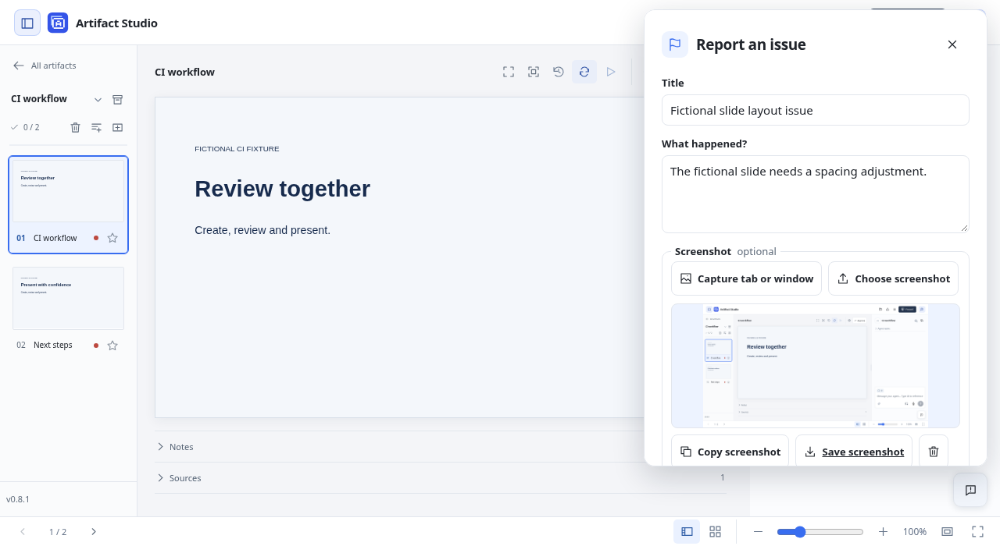
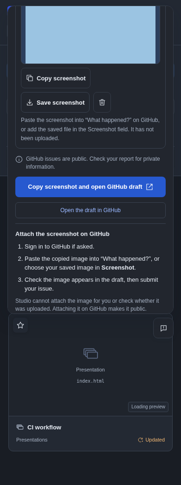

# Screenshot handoff review

Issue [#188](https://github.com/kaiketsu-labs/artifact-studio/issues/188): keep the
reviewed image recoverable while the reporter completes attachment in GitHub.

The issue form remains the authenticated upload step. The reporter explicitly
pastes or selects the image in GitHub after reviewing it in Studio. A prefilled
issue URL carries text, not an uploaded attachment. Studio does not request a
GitHub credential or use an undocumented upload endpoint, and cannot verify
attachment completion. The form now states those remaining steps and scrolls them
into view. Dismissing the panel preserves the in-memory draft; **Discard draft**
clears it. Reloading or leaving the page still clears it, as the UI explains.

Two fresh Terra reviewers exercised real mouse and keyboard flows with fictional
images: 1280px light, and 360px/390px dark. Checks included closing and reopening,
copy denial, saving the exact image, blocked-popup fallback, removing the image,
discard, and focus restoration. No horizontal overflow was observed. The panel
scrolls vertically on small screens; instructions remain reachable. The final
auto-scroll change was reviewed again at 390px.





All nine browser cases passed across the suite and focused reruns. One case twice
failed to start its fixture within ten seconds under concurrent test load, then
passed alone; these startup failures are not reported as product regressions or
hidden by a longer timeout. Local browser verification used system Chromium 155;
CI uses the pinned Playwright browser. Clipboard failure and GitHub navigation
were simulated: no public issue or image was uploaded, and live sign-in was not
verified. Existing tests assert the draft URL contains only the expected text
fields and no referrer; screenshot bytes remain local until the reporter attaches
them in GitHub.

The change adds no network request, dependency, background poll, or model call.
The [asset measurement](report-handoff.json) compares `2141f0f` with the change:
JavaScript grows by 1,393 bytes (400 bytes with gzip), CSS by 440 bytes (82 with
gzip). These are byte counts, not a measured page-load or provider-token claim.

```sh
ARTIFACT_STUDIO_BROWSER_TESTS=1 uv run pytest tests/integration/test_report_issue.py
```
