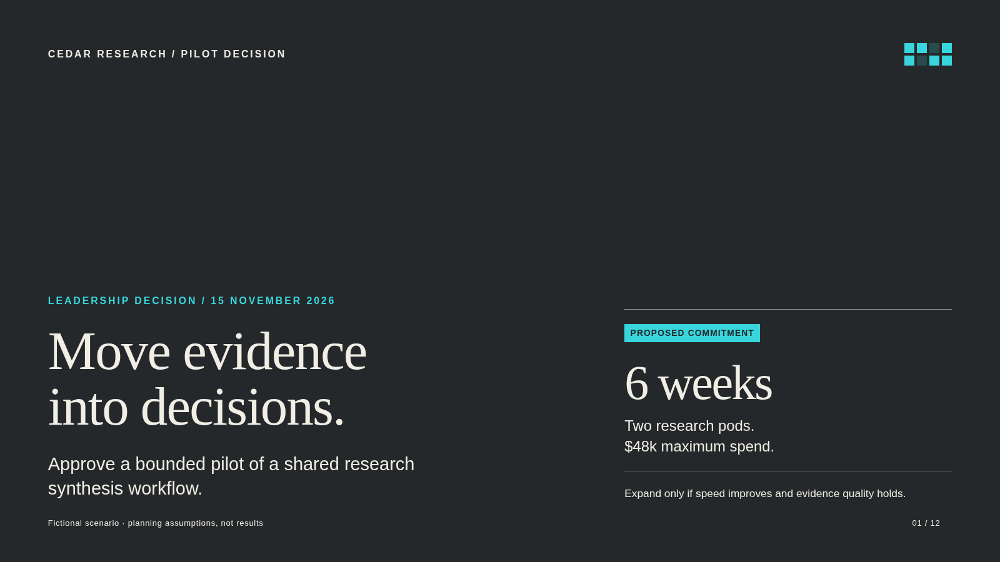
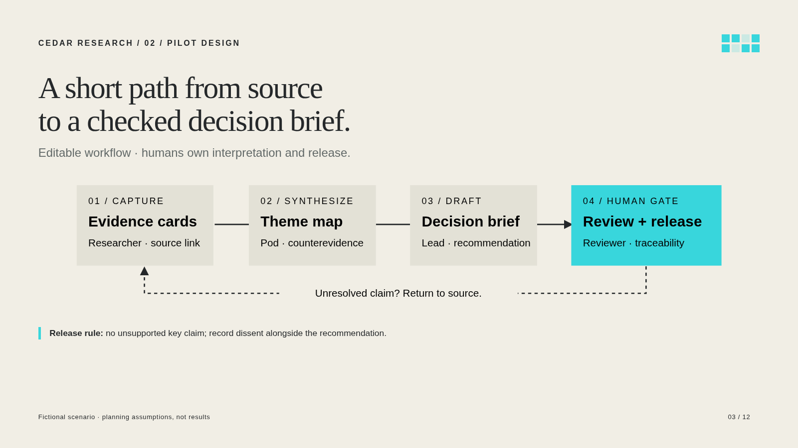
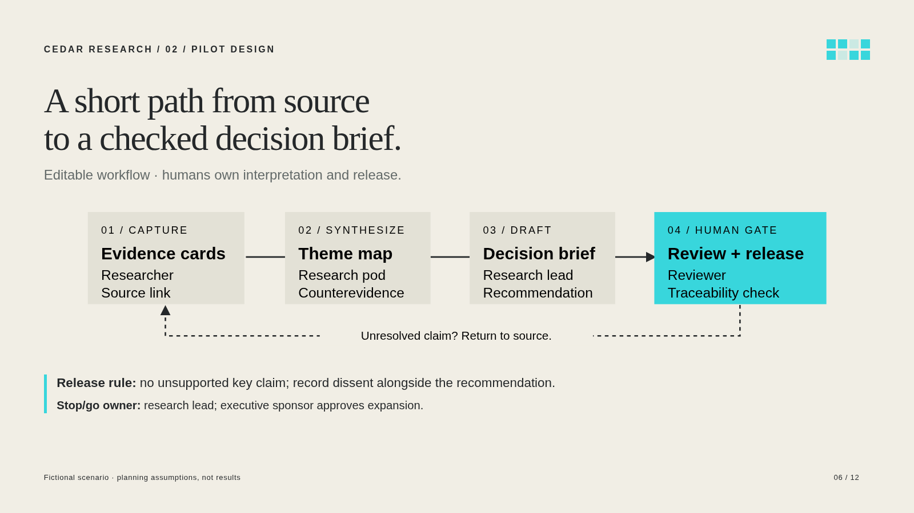
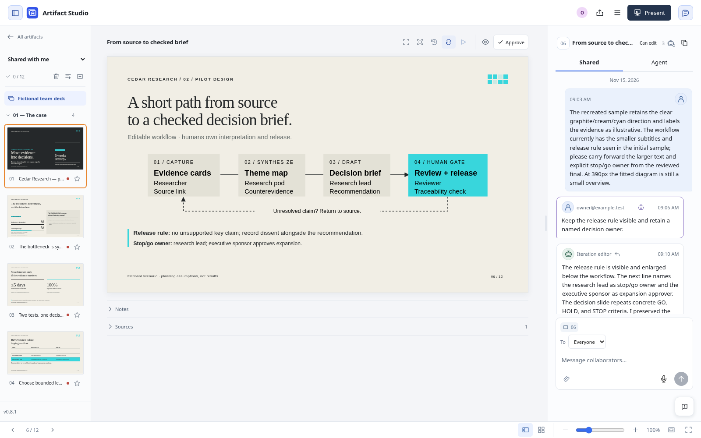

# Tool consolidation, skill usage and the file client

The local MCP catalogue now advertises 66 tools instead of 72. Existing callers
can still invoke all six old names. The smaller interface preserves arbitrary
HTML, CSS, SVG and JavaScript authoring; it does not introduce a layout catalogue
or require templates. See the [migration table](../../agent/README.md).

This review separates an autonomous three-person simulation, a matched source
benchmark, a small CLI experiment and a static skill inventory. They answer
different questions. None supplies provider billing or hidden agent reasoning.
The [aggregate evidence](tool-surface-review.json) retains their scopes separately.

## What changed

- Presentation/design discovery uses kind filters on the broader lists.
- Feedback and design-inbox reads support optional bounded waiting.
- One local reply tool supports slide and presentation conversations.
- Context editing supports replace/append modes with the original conflict and
  exact-retry behavior.
- Compatibility names remain registered but are omitted from `tools/list`.
- Agent replies to withheld local feedback IDs are rejected. The security review
  reproduced this inherited bug in both the old and consolidated reply paths.
- Capture schemas now advertise their actual limits: local contact sheets accept
  1–24 frames per page; hosted/Copilot accepts 1–8. Selection and offset bounds
  also match the existing renderer contract.

Outline/source reads and the different capture targets remain separate. They
serve different review needs and preserve frozen proposal identities. Hosted and
Copilot authorization remain independent of local tool discovery. A fresh local
agent found the canonical operations from live schemas without a compatibility
list or tool-name hints, and authored custom static and interactive source.

## What the skill actually did

Two independent `gpt-6.1-terra` browser personas acted as owner and reviewer; an
independent editing agent used a scoped hosted MCP connection. The fixture was a
fictional Cedar Research leadership presentation, isolated from personal work.
The editor reused one initialized client and one discovered catalogue.

The owner sent an assigned brief through the UI. The editor read context and
relevant schemas, claimed the brief, authored three samples and inspected actual
captures. The owner checked Present and Enter/build behavior. The reviewer left
ordinary Shared feedback; the owner assigned the requested changes. The editor
completed twelve slides, three sections, speaker notes and a hidden appendix,
including custom compositions, an editable SVG workflow and an animated chart.

At a coordinated checkpoint, the owner saved a speaker note after the editor
read its old revision. The old guarded edit failed; the editor reread and made a
focused change, preserving the complete note. A second checkpoint held an owner
draft with automatic updates off. Sending it after the workflow changed produced
a conflict. Review current slide, Use this version and explicit Send retained the
draft and recipient without sending automatically.

The owner inspected and approved all twelve baseline slide versions. The PDF
preview offered hidden pages by default; after clearing Include hidden slides,
the browser-generated print PDF had eleven pages and excluded the appendix and
speaker-note text. This checks the actual export preview and browser print
output, not a native operating-system print dialog.

The editor's baseline trace contained **70 tool calls**, one initialization and
one catalogue read: 73 JSON-RPC exchanges including the initialized notification.
It returned 139,229 text bytes and 1,251,372 decoded image bytes. The complete MCP
JSON was 1,981,924 bytes and already includes the encoded images and text; these
figures must not be added together. Three tool errors were a denied design
reference, the deliberate stale-write conflict and an oversized contact sheet.
There were no MCP transport or JSON-RPC errors in the editor's trace.
These bytes were recorded at the client boundary. The agent often saved complete
results and printed selected fields, so the trace does not establish how much
text or image content the model actually received.

| Actual baseline activity | Tool calls |
| --- | ---: |
| Add / revise slides | 10 / 7 |
| Capture individual slides / contact sheets | 10 / 3 |
| Read outlines / individual source slides | 11 / 6 |
| Read feedback / claim / reply | 5 / 4 / 4 |
| Context, guide, theme, assets, activity and section operations | 10 |

These are observable actions, not the agent's private chain-of-thought. Initial
drafting, review corrections and race probes are part of this autonomous run.
A rerun using already-reviewed source is a correctness check, not an equivalent
first-draft workload from which to claim token savings.

These are real 1600×900 audience captures of the fictional authored content, not
mockups or a new built-in template. The workflow comparison shows an agent's
response to human feedback, not a change to Studio's application chrome.



| Before the independent review | After the requested readability and ownership changes |
| --- | --- |
|  |  |

## Hurdles and improvements

| Observation | Classification and response |
| --- | --- |
| Hosted schema accepted an unconstrained integer, but `limit=12` failed at capture time | Confirmed schema gap. Advertise the existing limit of eight; test validation before rendering. |
| Selected design pointer was inaccessible to the artifact-scoped editor | Fixture/scope limitation. The editor honored the denial and used the owner's style brief. Skill preflight now verifies reference access. |
| Repeated participant readiness messages while waiting | Coordination overhead. Skill now ends a participant turn at a barrier and resumes it explicitly while retaining its session. |
| Browser forwarding buffered event streams; idle synchronous Playwright paused routing | Test infrastructure. Record reloads and missing live-update coverage; do not label these as product performance defects. |
| A fresh local agent accidentally closed its first initialized process | Harness startup overhead. Skill now verifies persistent stdin before MCP initialization; the second client reused the saved catalogue. |
| Context-learning guidance requested a whole presentation | Avoidable source loading. Learning now reads `get_presentation_outline(include_context=True)` for the brief/hash. |
| Workflow details were too small | Actual authoring feedback. The editor enlarged subtitles/release rule and clarified decision ownership through normal revisions. Phone-width fitted slides remain an overview. |

The fixture's existing library title could not be renamed through the scoped MCP
surface; the authored cover and brief carried the requested title. That remains
a separate capability gap. This change does not broaden the token's scope or
silently bypass it through browser endpoints.

## Candidate user rerun

The same personas repeated the workflow in a fresh candidate fixture. The editor
discovered the 51-tool hosted catalogue once, used canonical append mode and
retried the identical append against its original hash: existing context survived
and the new block appeared exactly once. The corrected capture schema advertised
eight frames per page, so the editor requested pages of eight and four without
the baseline's invalid-limit attempt.

The old cover guard again failed after an actual owner note; rereading and a
focused edit retained the complete note. The held workflow draft also survived
navigation. This time the UI detected its stale target and disabled Send before
submission; reviewing and selecting the current version preserved the text and
recipient, and only explicit Send delivered it. This is an observed valid recovery
path, not a claim that the candidate reproduced the baseline's HTTP 409 sequence.

The independent reviewer found the final desktop workflow, risk and decision
slides consistent with the corrected baseline. The owner inspected and approved
all twelve candidate versions and repeated the eleven-page PDF check with the
hidden appendix excluded. The editor verified all twelve slides' source and
complete notes, the three sections, hidden state and an empty pending feedback
feed. Custom SVG, typography, layouts and the chart build remained freely authored.

The candidate editor made 79 tool calls, one initialization and one catalogue
read, returning 174,220 text bytes. Its only tool error was the expected stale
cover conflict; capture-limit, transport and JSON-RPC errors were zero. These
totals are **higher** than the baseline's because this rerun additionally reads
every slide's source/notes and tests append retry, while reusing authored content.
It establishes corrected behavior, not lower total model usage. The separate
matched-source benchmark below is the comparable payload experiment.



## Static cost and behavior by skill

The counts below include each `SKILL.md`'s frontmatter and body. Optional references,
tool schemas, source files, images and delegated prompts are additional. Links in
a skill are not proof that a host loaded those files. UTF-8 bytes are not tokens.

| Skill | Body bytes after changes | What an agent does | Executed here? |
| --- | ---: | --- | --- |
| `setup` | 3,718 | Inspect the chosen installation/connection, load relevant platform instructions, configure missing pieces and verify MCP access | No; existing installations were not changed |
| `artifact-studio-learn` | 7,257 | Read authorized human evidence and released feedback after saved cursors, deduplicate scoped preferences, merge guarded updates and checkpoint inspected material | No full learning pass; its context-read choice was measured |
| `multi-person-workflow-review` | 8,246 | Provision an isolated fixture, delegate owner/reviewer/editor, coordinate real review/races, record evidence, fix and rerun | Yes, with separate actual agent contexts |

The review skill grew by 625 bytes and learning by 162 bytes to make these
boundaries explicit. Shorter instructions alone are not the objective: avoiding a
failed capture, duplicate setup or unnecessary full-source read can matter more.
No provider input, cache, output, reasoning or image-token totals were available
through the supported harness. No tokenizer estimate is fabricated from bytes.

## Matched source measurement

The baseline is commit `68af28d`; the candidate's loaded-source fingerprint is in
the aggregate JSON. One warmup per source precedes three alternating measured
pairs. Both versions use identical fictional fixtures, operations and checks over
real local HTTP MCP. Synthetic human feedback injection belongs to setup and is
separate from the actual browser personas described above.

| Measured bytes | Baseline | Candidate |
| --- | ---: | ---: |
| Full compact catalogue JSON | 147,956 | 135,270 |
| Input schemas only, included in the catalogue | 31,325 | 30,300 |
| Operation request HTTP bodies | 3,091 | 3,151 |
| Operation response text | 22,421 | 22,768 |
| Total response HTTP bodies, including initialization, discovery and learning reads | 221,729 | 209,748 |

Catalogue bytes fell **8.57%**. Operation responses grew by 347 bytes because the
canonical discovery responses contain richer metadata. Every trial made 19 HTTP
exchanges: initialization, initialized notification, one catalogue and 16 tool
calls, including two separate learning probes. Both expected stale writes failed;
all discovery, privacy, retry, notes, hidden-state and final-state checks passed.
Fixture and final-state fingerprints match across versions; loaded-source
fingerprints distinguish the implementations used in the trials.

Timing is descriptive: baseline median 295.017 ms (285.666–541.843), candidate
322.583 ms (312.328–396.429). This tiny shared-machine sample does not establish a
speed improvement. Initial/schema caching and actual model tokenization are host
dependent; catalogue-byte savings are not billed-token savings.

The separate read-policy probe returned the identical brief/hash in 5,256 text
bytes through the outline, versus 7,469 through a full presentation: **29.63%
less** for that fixture. Both APIs already existed on both sources. This is a
better skill instruction, not a server-performance claim or permission to edit a
slide without reading its current source.

Reproduce the matched benchmark from the candidate checkout:

```sh
uv run python -m scripts.benchmark_tool_surface \
  --baseline /path/to/frozen-baseline \
  --output test-results/workflow-review/tool-surface-matched
```

## Should there be a CLI?

There already is one: the [file-input client](../FILE-CLIENT.md). Use it for
already-authored source on disk and independent, reviewed write batches. Keep MCP
for exploratory reads, scoped hosted work and visual review. A CLI should carry
free authored source through the same revision checks; design-specific commands
or fixed templates are unnecessary.

An actual local CLI run submitted 7,204 bytes of HTML/CSS/SVG, 156 bytes of custom
interactive source and 57 bytes of notes. All survived, verified receipt hashes
matched, and a deliberate stale request failed without overwriting notes.

| CLI action | Cold rules: stdout bytes | Retained rules: stdout bytes |
| --- | ---: | ---: |
| Describe file | 253 | 253 |
| Prepare guarded call | 3,793 | 569 |
| Execute and verify | 3,850 | 621 |

The identical prepared inline write arguments occupy 9,121 bytes and the decoded
receipt 302 bytes. That comparator excludes the equivalent read/verification
responses, so it is not a complete-workflow savings percentage. Initial source
authoring/review still costs context; the CLI merely avoids echoing the source in
subsequent model-visible arguments. MCP still transmits the complete file.
Cold guidance can outweigh this benefit for a tiny edit.

Prepare and execute each initialize once; the verified write uses three tool
calls in total (outline, revision, outline). Those protocol initializations do not
automatically become model prompt text. The CLI does not fetch the full catalogue
each time. A fresh agent chose its already-open MCP client for a small edit and
used the same safe operations without a design restriction.

The immediate improvement is discoverability and correct use of this client,
including retained-rule hashes only while the rules remain in context. A new
CLI, automatic stale-hash refresh or a restricted authoring vocabulary is not
needed. Hosted authentication and saved image handling would be distinct future
client features with their own security and usability tests.

## Coverage limits

The browser personas used separate contexts and fixture identities, not two tabs
of one signed-in person. The hosted renderer used an explicit system-Chromium
executable adapter while retaining its sandbox. The supplementary fresh local
agent's renderer probe reported a missing bundled browser; that role did not
claim visual verification. Real hosted captures and the owner/reviewer browser
checks supply the separate visual evidence.

The forwarding fixture's buffered event stream prevented claims about reliable
live refresh. Native-app chrome and physical-display behavior were not tested.
At phone width, the fitted workflow is still a small overview; the earlier zoom
clipping concern remains outside this tool-surface change. Access revocation and
withheld-feedback boundaries were exercised by scoped regression tests/security
review, not an exhaustive browser account-management study.

The candidate owner briefly edited the wrong slide's notes while leaving
Present, then reverted that addition and saved on the intended cover. This was
recorded as an operator/navigation mistake, not an invisible server workaround.
The skill now requires checking the selected slide after view transitions. Its
extra note revisions make that autonomous rerun unsuitable as a matched timing
or token comparison; the fixed-source benchmark uses its own equivalent fixture.
