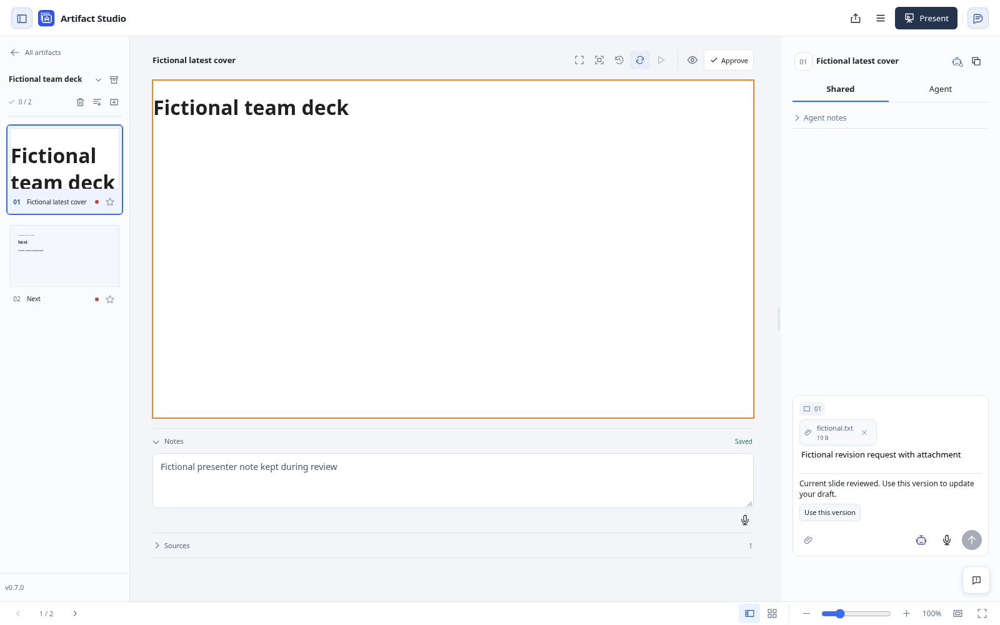
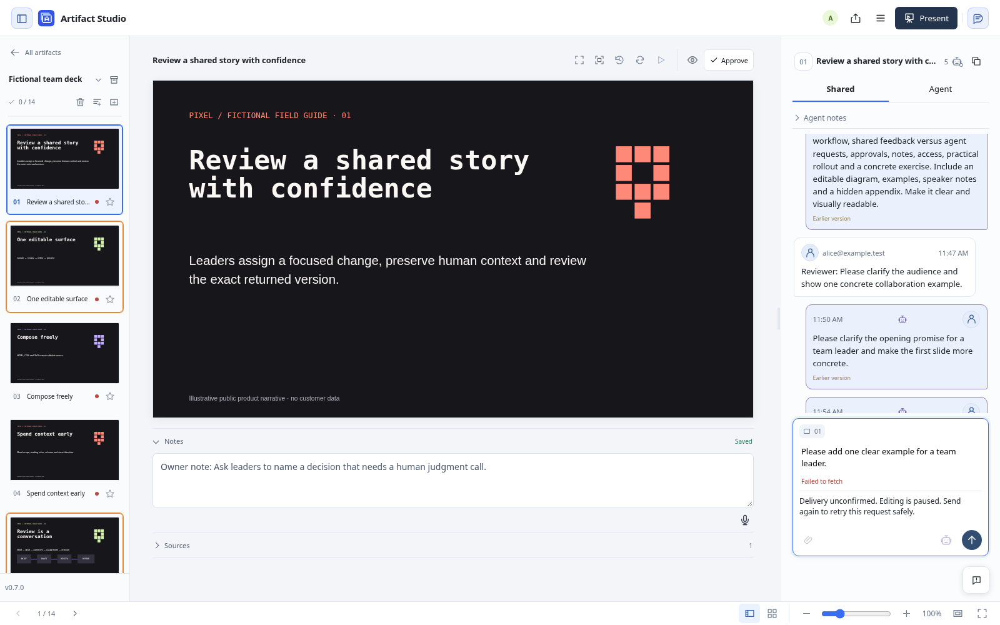
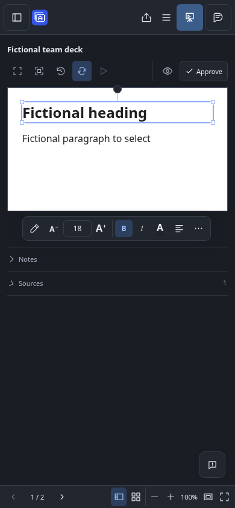

# Presentation workflow iteration

The fixes improve review recovery and implement hosted guide-body reuse. The final matched source comparison made 50 JSON-RPC requests per version and reduced candidate response text by 750 UTF-8 bytes (0.71%). This is a small measured transport reduction; actual provider token usage and any billed-token saving remain unknown.

The [machine-readable results](workflow-iteration.json) contain source fingerprints, per-phase RPC timings, initialization/catalog costs, separate image sizes, method counts and observable decision summaries. Public artifacts contain fictional aggregate evidence, not original presentation source, notes, bearer tokens or raw private conversations.

## Three separate experiments

1. **Autonomous editor and two fresh personas.** A real scoped MCP editor worked with owner and independent reviewer personas in an isolated hosted fixture. The owner requested a 14-slide leadership guide; the reviewer identified repetitive, sparse compositions and missing practical content. The editor added an editable SVG review loop, backup comparison and concrete sixty-second exercise through guarded MCP revisions. This exploratory run includes discovery, interruptions, review corrections and repeated race probes.
2. **Fixed workload, original source versus candidate.** The identical script ran against archived revision `49f2376` and the frozen dirty candidate, each with a fresh hosted fixture, same interpreter and same system-browser adapter. It authored 14 fictional slides, retained a hidden appendix and speaker cues, checked source, captured three rendered samples, claimed/replied to an assigned brief, reread its workflow guide at an explicit review/resume checkpoint, rejected a stale revision after a simulated human note, preserved that note after rereading, and exercised stale human-chat rejection plus explicit current-version recovery. This is a controlled source comparison, with one final observation per version.
3. **Historical policy comparison.** The existing [12-slide policy benchmark](PRESENTATION-WORKFLOW.md) compares broad/repeated reads with retained context, cursor polling and compact receipts. Its recorded response-text totals are 166,296 versus 57,442 compact UTF-8 bytes. It measures a different workload and policies; those results are not new source-level savings, provider tokens, or quantities to add to either experiment above. The earlier [117-call study](presentation-workflow-study.md) is another observational trace, not the paired baseline here.

## Matched source results

| Recorded unit | Original `49f2376` | Frozen candidate |
| --- | ---: | ---: |
| JSON-RPC requests, including initialization notification | 50 | 50 |
| Tool calls | 47 | 47 |
| Initialize / schema discovery | 1 / 1 | 1 / 1 |
| Expected stale-write tool errors | 1 | 1 |
| Transport / JSON-RPC errors | 0 / 0 | 0 / 0 |
| Request HTTP JSON body bytes | 34,673 | 34,737 |
| Response HTTP JSON body bytes | 458,243 | 456,737 |
| Response text UTF-8 bytes | 105,079 | 104,329 |
| Compact response MCP JSON bytes | 456,538 | 455,032 |
| Image base64 bytes, already included in response JSON | 215,228 | 215,228 |
| Decoded image payload bytes | 161,418 | 161,418 |
| Model/provider tokens | unavailable | unavailable |

Response HTTP JSON decreased by 1,506 bytes (0.33%); response text decreased by 750 bytes (0.71%). Requests grew by 64 bytes for the retained guide hash. Per-call text changes were: working context +379 bytes, first workflow guide +457, resumed workflow guide −1,587, and generated feedback metadata +1. These are actual serialized measurements, including generated identities/timestamps; they are not normalized message sizes. The candidate bootstrap is 2,502 bytes versus the original baseline's 2,308 bytes; its hash and size are recorded separately because it was not sent in these MCP requests.

Each run negotiated once, fetched the connected tool schema once, retained its workflow guide locally, and reread it at the same review/resume checkpoint. Inspection of earlier validation showed that hosted workflow/live-review guides advertised `known_hash` while ignoring it. That product defect was fixed, then both versions repeated the new identical checkpoint workload. The candidate's second response has the same guide hash, `guide_included: false` and an empty guide string; the script asserts all three. The original returns the full guide again. The candidate still returns schemas and other metadata, so its repeated response remains 9,111 text bytes. No entire-response cache saving is claimed.

Artifact grants intentionally omit workspace-wide rules; this run does not exercise a workspace-rule cache. Both runs used a delivery cursor on the final feedback poll, but hosted feedback is a pending-request view, so the cursor is not asserted to suppress an uncompleted request. Both versions already return compact slide receipts; the comparison does not manufacture a saving by enabling that behavior only for the candidate.

The final matched pair ran in fresh fixtures after the guide-hash fix, with the same two-guide-read workload and matching measurement-script fingerprints. Earlier 49-call runs are retained separately as validation observations of a different workload, with no fastest-run selection. The final original run took 8.72 seconds and candidate 9.57 seconds. These are single observations on a shared machine, heavily influenced by Chromium capture startup and concurrent review load. They establish neither a speedup nor a regression. Phase entries in the JSON are summed RPC elapsed times, not model inference or complete phase wall time. The workflow timer starts after initialization/catalog discovery, whose separate costs remain included in traffic totals.

## Review and recovery evidence

The owner sent an agent-addressed brief through the actual Shared conversation. An ordinary reviewer comment remained unassigned; it could be included as context with a later assigned request. The owner's fictional private marker was absent from the reviewer's Shared and Agent channels. All editor source changes used scoped MCP tools; the editor did not directly mutate canonical source to evade guards.

The owner approved the cover, saved a human speaker note after the editor held its old hash, and observed the subsequent revision retain the exact note while approval changed from 1/14 to 0/14. The old-hash MCP revision returned a conflict; a fresh source read and focused revision succeeded. The paired script injects the simulated **human** note using the fixture Store API to make that race deterministic; that is a labeled test-only action, not an editing-agent capability or bypass. The autonomous owner used the actual UI.

With automatic preview updates off, a held owner draft produced an actual chat HTTP 409. The draft and agent address survived. Review current slide, Use this version and Send were distinct actions; review/confirmation sent nothing, and explicit Send produced one successful POST with a new request ID and current anchor. Another unseen revision with automatic updates off can still occur after review: confirmation does not prove that no newer server version exists, and the next Send can return another guarded 409. Recovery therefore preserves work without replacing server concurrency checks.

The independent reviewer exercised a multi-object draft through an initial conflict, review, and another concurrent revision. The updated path retained draft text and required current target selection; the final successful request carried two current targets. The owner also tested uncertain delivery by forwarding a successful request and deliberately dropping its response. The composer paused editing and routing changes; retry reused the identical request ID/payload, produced one delivered message and then cleared the draft. The interceptor is test-only fault injection, not a production workaround.

At 390 pixels, the reviewer initially had to widen the window because the heading formatting toolbar intercepted two Shift-click attempts to select the paragraph. The follow-up fix docks the toolbar outside the slide and reserves its measured height so it also leaves Notes and Sources accessible. The independent reviewer repeated ordinary heading selection, formatting, note entry/save and Shift-click paragraph selection at 390×844 without resizing. A browser regression also verifies that the reserved space clears when selection ends. This resolved the observed workaround. Slide body text at phone width remains small; full-size viewing is needed for detail. These checks used browser rendering, not a native app or physical display.

### Captured fixes

These are actual fictional test workspaces, separate from the original Pixel Studio presentation used in the README.

| Explicit draft recovery | Safe retry after an unconfirmed delivery |
| --- | --- |
|  |  |



Unconfirmed-delivery tracking belongs to the open page; it does not survive a reload. After reloading, inspect the conversation before recreating an uncertain message. The recovery checks cover current-slide requests; proposal and voice edits keep their original anchors and are not silently rebased.

## Observable decisions and workarounds

These are concise visible action summaries, not hidden reasoning or private chain-of-thought.

| Goal and evidence | Decision / alternative considered | Workaround and classification | Outcome |
| --- | --- | --- | --- |
| Establish connected scope and schema | Read working context and workflow guide; retain one peer and reuse the guide body at resume | Authorized loopback server startup is fixture infrastructure | One init and catalog per paired run; no schema-validation failures |
| Inspect a representative composition | Stop after cover capture failure rather than expand without a visual check | Explicit test-only `BrowserType.launch(executable_path='/usr/bin/chromium')` adapter, sandbox retained | Three actual rendered samples per paired run |
| Preserve ordering and sections | Reuse scoped context's first outline; refresh after writes rather than invent guard values | None; production MCP guards and receipts | Safe 14-slide authoring; round trips remain measurable |
| Respond to substantive reviewer findings | Add editable diagram/table/exercise rather than treat source validity as a complete review | Ordinary guarded authoring; initial title-only race probes were later repeated with visible HTML changes | Richer fictional guide; small mobile text remains a limitation |
| Preserve concurrent notes | Reject old hash, reread complete source, revise a focused field rather than overwrite | Deterministic paired human-note injection is test-only | One intentional MCP conflict per paired run; exact note retained |
| Preserve stale and uncertain drafts | Explicit review, confirmation and Send; exact-payload retry after missing acknowledgment | Browser lost-response interceptor and coordinated race barriers are test-only | Owner/reviewer recovery verified; server remains the final revision guard |
| Attribute costs honestly | Compare identical script across actual source revisions; keep historical policy data separate | Existing interpreter reused for isolated archived source | Small response reduction established; token saving unknown |

The exploratory editor's recorded snapshot contains 100 JSON-RPC requests, 85 tool calls, five logical-session initializations and five catalog reads. It includes three tool errors: two renderer lookup failures and the intentional stale revision. It recorded zero MCP transport/JSON-RPC errors. Its 53,042 request-body bytes and 732,624 response-body bytes include interruptions and correction work, so they are not comparable to the matched 50-request workloads. Browser refused connections and delayed routed callbacks during fixture restarts are harness failures outside this MCP count, not evidence of product latency.

The installed cached browser revision did not match the current Playwright runtime. An official matching-browser download returned HTTP 403; no mirror or access-control bypass was attempted. The installer removed an unused old cache directory before failing, an avoidable harness setup mistake. The fixture then selected the already installed system Chromium explicitly; both source versions used the same adapter, and real renderer startup/readiness checks ran against that browser. No production browser-selection change is claimed.

## Remaining measurable optimization opportunities

- **Repeated outlines:** the workload makes 14 outline reads after mutations because add receipts omit server-produced ordering/sections guards. A future guarded receipt containing fresh ordering metadata could remove round trips. Do not compute or guess those guards client-side.
- **Schema exposure:** the catalog was fetched once and cached locally. Its bytes are recorded separately. A model host can expose the required subset of cached schemas without repeating discovery, while retaining authoritative schemas for every invoked tool.
- **Guidance reuse:** the implemented hosted guide-body hash suppression saves 1,587 text bytes on the resume response, while fresh guidance/hash metadata add cost. The repeated response still contains schemas/metadata, totaling 9,111 text bytes. Future reuse could cover those stable dependencies with explicit hashes; this run does not suppress them. Artifact-scoped context still returns its metadata/outline; retained rules do not shrink content that this scope never receives.
- **Renderer setup:** check actual browser availability before starting personas. This prevents harness restarts and repeated discovery; it does not justify skipping source or rendered-sample review.
- **Content quality:** review a substantive representative sample before expanding the full set. The exploratory reviewer still found sparse content, causing additional source revisions even after layout fit was correct.

No legitimate cached tokenizer vocabulary was established, and the previously attempted official tokenizer-rank download was forbidden. Token estimates were therefore left null. Provider prompt, cache, reasoning, output/billed tokens and image tokens are unknown. UTF-8 bytes are not converted to invented token counts.

## Reproduction and checks

Start the fixture in one terminal, then run the workload in another, from the
same source checkout. The optional `--system-browser` flag selects the installed
`/usr/bin/chromium` for this Linux test environment; omit it to use the normal
Playwright browser installation.

```sh
UV_CACHE_DIR=/tmp/uv-cache uv run python -m scripts.workflow_iteration serve \
  --root /tmp/my-isolated-fixture --system-browser
UV_CACHE_DIR=/tmp/uv-cache uv run python -m scripts.benchmark_hosted_iteration \
  --root /tmp/my-isolated-fixture --scripted-human
```

For the original baseline, archive `49f2376` into a separate directory, copy the two fingerprinted measurement scripts into it, use the same existing interpreter and launch with that archive as both working directory and `PYTHONPATH`. Use a fresh fixture root for each run. `--barriers` instead coordinates actual owner/reviewer browser personas through named `.ready`/`.continue` files. Credentials and raw fictional argument/text logs stay under the local fixture root; publish only reviewed aggregate summaries.

The recorder appends and flushes one JSONL record for every completed call, transport exception, HTTP failure and non-JSON response. It records parameters, response text, serialized sizes, `isError`, JSON-RPC errors, elapsed time and separate image sizes; it never records credential headers. A MockTransport regression verifies one initialization/catalog, multibyte text accounting, image separation and retention of tool, refused-connection and non-JSON HTTP failures. The measured interpreter was `/workspace/artifact-studio/.venv/bin/python` (Python 3.14.8, MCP 2.3.0, Playwright 1.65.0); archived and candidate module paths are recorded in the JSON. Ruff, targeted strict basedpyright and that regression passed. Broader product validation is recorded with the implementation change.

Final product checks passed full Ruff/format and strict basedpyright, targeted
agent-context and multiplayer tests, both benchmark regressions, frontend
behavior tests, and three real-browser regressions for stale drafts, lost
acknowledgments and narrow selection. One fixture-startup timeout under concurrent
load passed on isolated retry. Independent Terra owner/reviewer journeys and an
Astra source review found the additional recovery and toolbar issues fixed above.
The new browser regressions run in the existing CI runtime-3 job.
