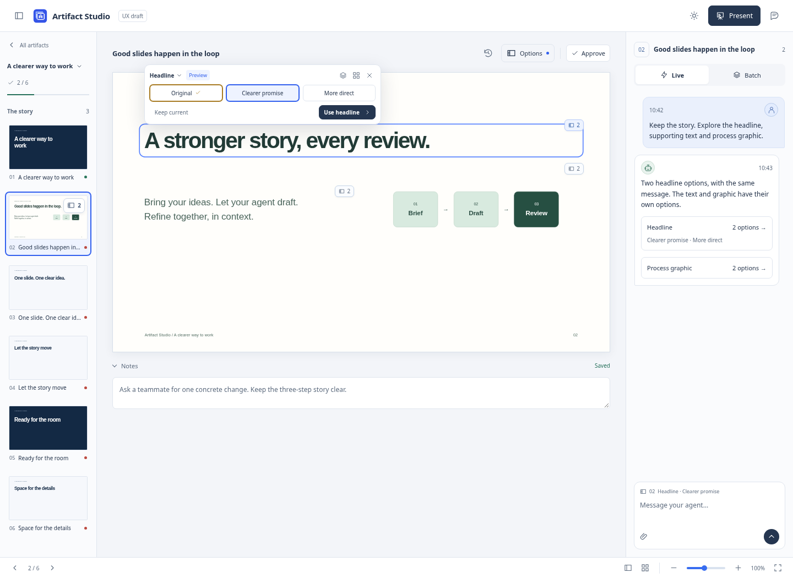

# Element alternatives — UX draft

This is an interactive, fictional draft for extending whole-slide alternatives to individual headlines, text and static graphics. It calls no production API and implements no agent tool. The existing whole-slide feature is [PR #33](https://github.com/kaiketsu-labs/artifact-studio/pull/33). There is no separate slide-story/ideas feature in this proposal.



## Recommended interaction

Keep one options surface with a scope selector. **Options** lists **This slide → Slide designs** and **Elements → Headline / Text / Process graphic**. Each number counts proposals within that group; the original is retained separately. The existing slide-thumbnail count continues to describe whole-slide designs. The global control uses a dot rather than an ambiguous total mixing objects and proposals.

An element with published options has a small stack/count badge on the canvas. Hover or click the badge, select the element, or open its chat card to reveal a compact popover above the actual element. On a narrow window it moves below when that keeps the element visible. Ordinary elements gain no extra controls merely because the agent could change them. Hover an option to preview its wording or graphic live in the slide. Leaving the popover restores the chosen option, unless you clicked to pin a preview. Dismissing the popover returns to the chosen slide. Hovering and pinning do not save or approve anything. The popover has explicit **Use headline** and **Keep current** actions. Touch users tap and keyboard users use arrows; neither requires hover. **Show all options** expands readable text cards or visual graphic cards below the canvas. The names in this example are fictional suggestions, not a fixed layout catalogue.

Gold and a check identify the chosen option; blue identifies a temporary preview. Only that element changes during an element preview. **Compare** offers a legible **Element** view and a **Full slide** view to check composition and text fit. Slide renders use a fixed 1600 × 900 canvas scaled into every viewport, so comparison does not reflow the content.

**Keep current** or **Use headline / Use text / Use graphic** settles that group and closes its popover or expanded tray. Other valid unreviewed groups remain available through their badges and Options. Choosing a whole-slide design archives its earlier element groups in History, so outdated suggestions do not stay prominent. Clicking a settled element returns to ordinary selection; it does not reopen the proposals. **History → Saved element options** retains them, including visual graphic previews, with Undo for a just-completed choice. There is no automatic jump to the next decision.

[Scope navigation](screenshots/02-navigation.png) · [Element comparison](screenshots/03-compare-element.png) · [Full-slide comparison](screenshots/04-compare-context.png) · [Quiet after choosing](screenshots/05-chosen.png) · [History](screenshots/06-history.png) · [Graphic options](screenshots/07-graphic.png) · [Text options](screenshots/08-text.png) · [Dark](screenshots/09-dark.png) · [Narrow](screenshots/10-mobile.png) · [Narrow comparison](screenshots/11-mobile-compare.png) · [Earlier context](screenshots/13-earlier-context.png) · [Visual graphic History](screenshots/14-graphic-history.png)

## Agent judgment and discoverability

The same decision rule applies to the earlier whole-slide feature and this future extension:

| Situation | Agent behavior |
| --- | --- |
| A clear brief permits several worthwhile visual or wording directions | Offer two or three distinct proposals, explain the short tradeoff, preserve facts and retain the original. |
| Essential goals, facts, audience or constraints are missing | Ask a concise slide question first, with suggestions and a free answer. Do not substitute polished alternatives for missing context. |
| The requested change is small and unambiguous | Make the normal guarded revision. Options should not become a compulsory wizard. |
| The target or its parent design changed | Read the new source and refresh affected proposals; do not choose an old fragment or silently apply it to another element. |

The production bootstrap now advertises whole-slide proposals and the question boundary. Its on-demand [slide_designs guide](../../SLIDE-DESIGNS.md) contains the detailed rule and explicitly says element alternatives are not yet implemented. A Terra agent verified that actual MCP initialization, guide delivery and tool discovery agree.

When element tools exist, add one short capability sentence to initialization and the quickstart, extend the on-demand guide, and register descriptive tool schemas. `tools/list` remains authoritative. Do not advertise an unimplemented tool or rely on a skill body being loaded automatically. [Question-first example](screenshots/12-question-first.png) illustrates the existing question pattern. Answers and subsequent proposals in this prototype are scripted, not model output.

## Implementation draft after UX review

1. Preserve `publish_slide_designs` and its existing contract. Add a separate element-publication tool, provisionally `publish_element_alternatives`, plus source/preview reads. Scope it by slide, a unique existing target and the current content hash. Do not introduce a layout enum.
2. Store an immutable target snapshot, original subtree hash, parent-design identity, named candidate fragments, resource hashes and full-slide preview documents. Reuse the existing offline snapshot/render boundary. Start with a single static HTML element or explicit container; custom interactive documents remain whole-slide proposals until their authoring/selection model supports this safely.
3. Keep choices human-only. Apply one verified replacement to current source, preserving unrelated elements, notes, order, approval rules and earlier feedback. Expected current hash, unique target and unchanged original subtree must all match. Use the existing durable decision/recovery pattern and exact request retries.
4. Pin text, voice and attachments to an explicit proposal reference and its preview context. Generalize the existing whole-slide reference compatibly rather than reinterpreting a target from the chosen slide as a target in another proposal. Old proposal source and feedback remain addressable.
5. Treat context changes deliberately. If another element changed, compose a fresh full-slide preview around the retained fragment and require review of the new context before applying. If the whole design or target changed, retain the earlier preview in History and request refreshed proposals. The older canvas must be labelled **Earlier design · saved preview**, and Use stays disabled. Never replay fragment selectors into an unrelated design.

The prototype demonstrates the stricter whole-design boundary: choose a slide design, then reopen a saved element option. Its earlier context is labelled, adoption is disabled, and **Ask to refresh** prepares a chat message without sending it.

## Iteration and verification

The first independent Terra review found three material issues: stale previews could resemble the current canvas, responsive comparison could reflow a headline, and History reduced graphics to text. This iteration adds the persistent earlier-context label, fixed-canvas scaling and visual History cards. Following the next user refinement, element options now sit above the actual element and preview live on hover, with click-to-pin and explicit decisions. It also makes pending element badges directly visible and keeps settled element selection quiet.

The capture script exercises real mouse/keyboard flows in the prototype: scoped previews, arrow-key choices, both comparison views, source preservation outside the selected element, Keep, choose, History reopening, notes, and narrow layouts at 390 and 320 pixels. These checks validate this draft, not production persistence, MCP mutations or real agent reasoning. Axe 4.14 reported no violations in 14 sampled prototype states; this is not a complete accessibility audit. Fresh Terra users also exercised desktop, narrow and touch flows. [Capture inventory](captures.json).

Run from the repository root:

```sh
uv run python -m http.server 8792 --bind 127.0.0.1
# Open http://127.0.0.1:8792/docs/prototypes/element-alternatives/
# In another terminal:
uv run python docs/prototypes/element-alternatives/capture.py
# Optional offline review copy:
uv run python docs/prototypes/element-alternatives/capture.py --standalone /tmp/element-options.html
```

Use `?scenario=question` for the question-first example. Styling reuses the earlier isolated prototype shell; neither controller is loaded by the product.
