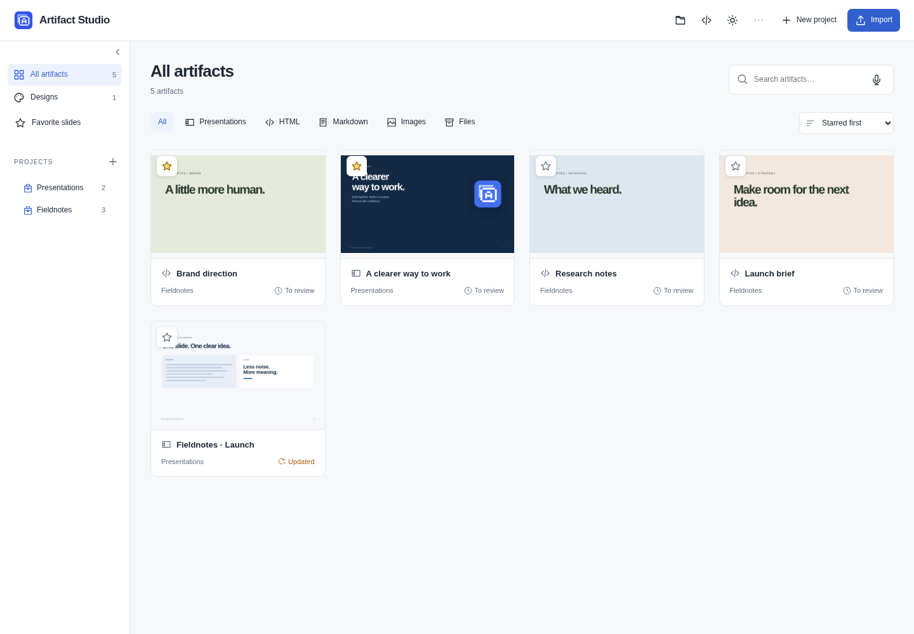
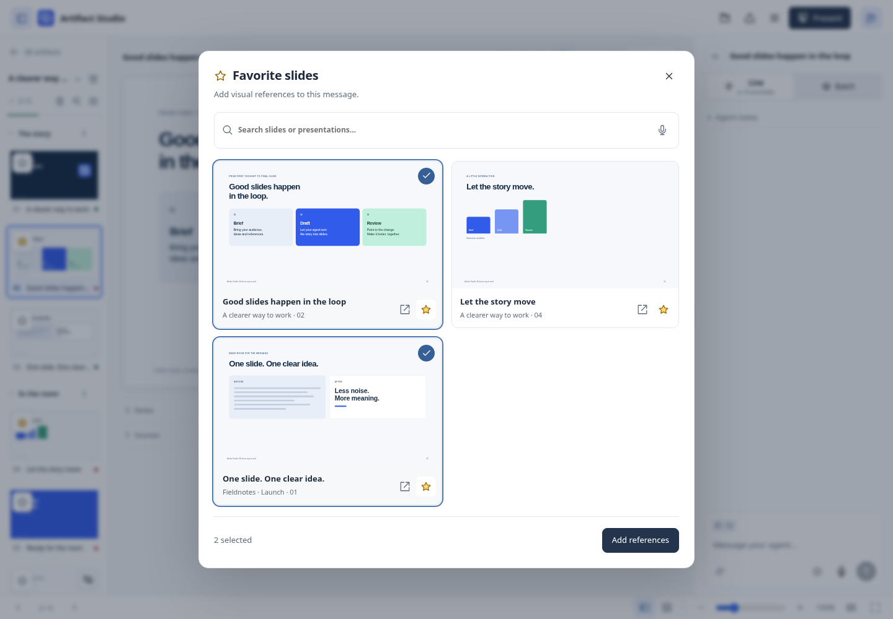
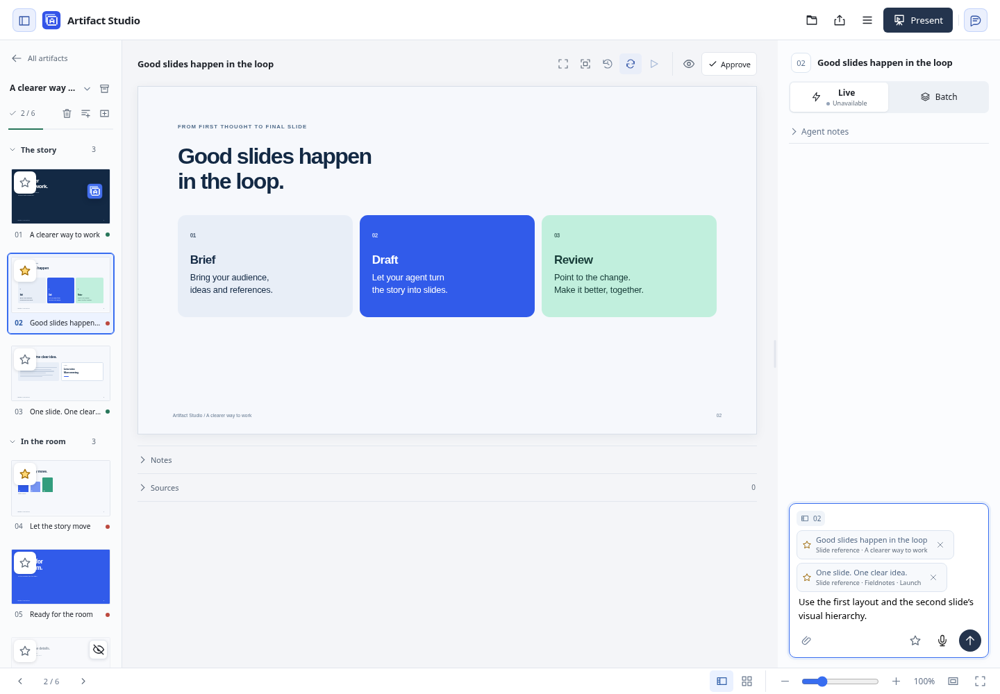

# Stars and favorite slides — working draft

This prototype uses the real application, persistence and local MCP feedback path.
It is ready for UX review; it is not a release.

```sh
uv run python -m scripts.preview_favorites
```

Open the printed URL. The command creates a temporary fictional workspace with
five artifacts and three favorite slides. Stop it with Ctrl+C to remove that workspace.

## Proposed experience

| Area | Behavior |
| --- | --- |
| Artifact library | Click a star on a card. **Starred first** is the new default; each group keeps the existing last-changed order. Explicit saved sort choices still apply. |
| Presentation | Star a slide in its thumbnail, in edit view or the sorter. This does not reorder slides or change approval or history. |
| Favorite slides | One searchable library across presentations, with previews, source links and unstar controls. |
| Chat | Click the star beside the attachment button, select up to five slides and choose **Add references**. Review the chips, then send normally. |

Artifact and slide stars are independent. Slide favorites bookmark the current
source by stable deck and slide IDs. Missing or archived sources are hidden until
they return; a duplicate slide starts unstarred.

Attaching freezes an audience-only copy of the selected slide, including its
theme and local assets. A reference token checks the rendered bytes, including
embedded interactive scripts and styles, so a changed source requires reopening
the picker. The saved file includes its original deck, slide and version identity.
Private speaker notes and discussion are excluded. Unstarring or changing the
original later leaves sent references intact.

## Agent handoff and scope

References reuse feedback attachments, including their limits, retries, Batch
privacy and per-slide drafts. Local MCP agents receive the saved file path in
`read_feedback` or `read_artifact_feedback`; the file identifies itself as a
read-only visual reference. Reading it gives context, not permission to edit the
source presentation. Favorites add **no agent startup context**. Slide source is
prepared only when the human opens the picker and delivered only when selected.

The hosted cloud agent currently receives attachment metadata without access to
file bodies. This draft does not claim hosted reference support; that requires a
scoped attachment-read tool before a production rollout. Existing attachment
limits apply: five files per message, 25 MB each, 50 MB combined. References with
unavailable dependencies show an error rather than silently losing their assets.

Stars live in the private workspace database and travel with full workspace
backups. They are not written into authored slides or single-presentation exports.

## Review evidence

The automated browser journeys exercise star sorting and persistence, keyboard
focus, searchable live previews, mobile dark layout, empty states, multi-reference
drafts, native artifact chat and the actual MCP handoff after Batch release. They
verify a reference still contains the original source after that source changes
and is unstarred. Backend tests cover approval preservation, unavailable sources,
concurrent edits and changed interactive dependencies.

Three Terra reviewers checked backend correctness and distinct browser journeys.
Confirmed findings fixed: overlapping star clicks, keyboard focus after sorting,
blocked hub previews and stale interactive dependencies.

Screens are generated by `uv run python -m scripts.capture_favorites`. The
fictional cover images use a diagnostic browser to fill the disposable cache,
because this managed host cannot launch the production renderer's OS sandbox.
Application routes and the production sandbox are unchanged. Capture hashes,
viewports and accessibility audits are in [captures.json](captures.json).




