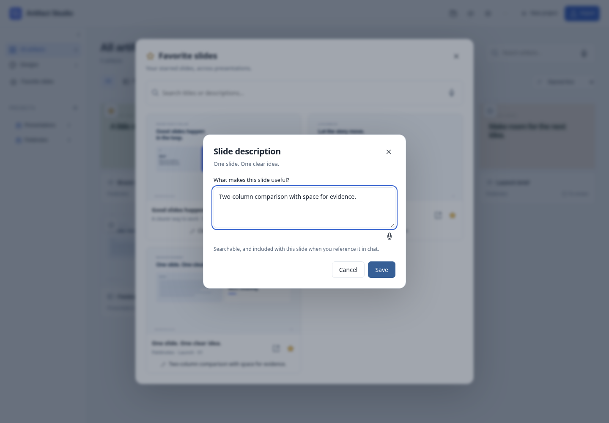

# Stars, favorite slides and chat references

Stars and chat references use the real application, persistence and feedback path.
Try the feature with a disposable fictional workspace:

```sh
uv run python -m scripts.preview_favorites
```

Open the printed URL. The command creates a temporary fictional workspace with
five artifacts and three favorite slides. Stop it with Ctrl+C to remove that workspace.

## Using favorites

| Area | Behavior |
| --- | --- |
| Artifact library | Click a star on a card. **Starred first** is the new default; each group keeps the existing last-changed order. Explicit saved sort choices still apply. |
| Presentation | A translucent star sits directly on the thumbnail, without a background box. It becomes clear on hover or keyboard focus and stays visible on touch screens. Starring does not reorder slides or change approval or history. |
| Favorite slides | One searchable library across presentations, with previews, source links and unstar controls. |
| Descriptions | **Add description** optionally saves up to 300 characters explaining why a slide is useful. Search matches this text as well as slide and presentation titles. |
| Chat | Click the star beside the attachment button, select up to five slides from any presentation and choose **Add references**. Review the chips, then send normally. |

To reference a slide from another presentation:

1. Open that presentation and star the slide's thumbnail.
2. Return to the chat where you want to use it and click **Reference favorite slides** (the star beside the paperclip).
3. Search by slide title, presentation title or description, select the slide, and choose **Add references**.
4. Write what the agent should use from it and send your message.

You can select slides from several presentations in one message. These references
preserve the chosen version; later edits to the original do not update them.

Descriptions belong to favorites, separately from slide content and speaker notes.
Click the description to edit it; save an empty field to remove it. **Cancel** or
Escape discards an unsaved edit. Selected reference chips show the description,
and the attached copy preserves it even after the original description changes.
Unstarring removes the favorite's description; attached copies keep theirs.

Artifact and slide stars are independent. Slide favorites bookmark the current
source by stable deck and slide IDs. Missing or archived sources are hidden until
they return; a duplicate slide starts unstarred.

Attaching freezes an audience-only copy of the selected slide, including its
theme and local assets. A reference token checks the rendered bytes, including
embedded interactive scripts and styles, so a changed source requires reopening
the picker. The saved file includes its original deck, slide and version identity.
Private speaker notes and discussion are excluded. Unstarring or changing the
original later leaves sent references intact.

## Agent handoff and scope

References reuse feedback attachments, including their limits, retries, Batch
privacy and per-slide drafts. Local MCP agents receive the saved file path in
`read_feedback` or `read_artifact_feedback`; the file identifies itself as a
read-only visual reference. Its description and source identity appear at the
start of the HTML as structured reference metadata, before styles and assets.
The local agent reads that attachment source to use this context. Reading it
gives context, not permission to edit the source presentation. Favorite contents
are **never preloaded into agent startup context**. Slide source is
prepared only when the human opens the picker and delivered only when selected.

Hosted agents use `read_feedback_attachment` with the destination artifact or
presentation ID, released event ID and zero-based file index. It returns bounded
pages from the verified saved attachment. Section offsets let the agent jump to
slide markup without reading through embedded fonts or images. Reading a reference from another
presentation does not grant access to that presentation's other content. Batch
drafts remain private until released. Existing attachment limits apply: five
files per message, 25 MB each, 50 MB combined. References with
unavailable dependencies show an error rather than silently losing their assets.

Stars live in the private workspace database and travel with full workspace
backups. They are not written into authored slides or single-presentation exports.

## Review evidence

The automated browser journeys exercise star sorting and persistence, keyboard
focus, searchable live previews, mobile dark layout, empty states, multi-reference
drafts, native artifact chat and the actual MCP handoff after Batch release. They
verify a reference still contains the original source after that source changes
and is unstarred. Backend tests cover approval preservation, unavailable sources,
concurrent edits and changed interactive dependencies.
Description checks cover schema upgrades, search, cancellation, conflicting
edits, clearing, selection retention and frozen descriptions in released references.
Hosted attachment checks use the authenticated MCP transport, covering both chat
types, project boundaries, Batch release, Unicode pagination and altered files.
The external Microsoft Copilot tenant connection is not part of this local test.

Fresh-context Terra reviewers checked backend correctness and distinct desktop
and mobile journeys, including description editing, search and chat handoff.
Confirmed findings fixed: overlapping star clicks, keyboard focus after sorting,
blocked hub previews, stale interactive dependencies and low-contrast stars.

Screens are generated by `uv run python -m scripts.capture_favorites`. The
fictional cover images use a diagnostic browser to fill the disposable cache,
because this managed host cannot launch the production renderer's OS sandbox.
Application routes and the production sandbox are unchanged. Capture hashes,
viewports and accessibility audits are in [captures.json](captures.json).




