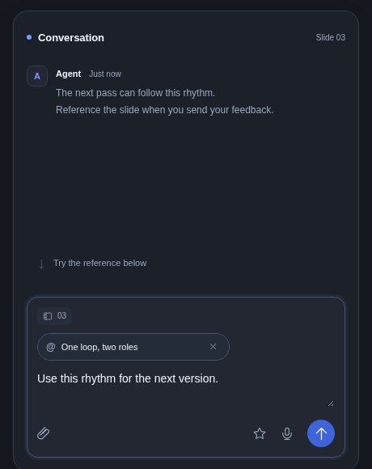
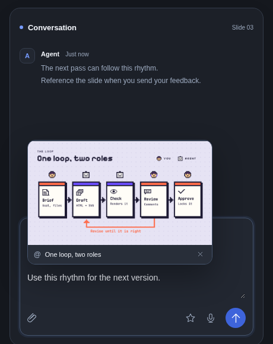

# Reference pill — unfold motion prototype

The reference is one continuous surface. Its bottom edge and title stay anchored
while the pill widens and unfolds upward to reveal the saved slide. Leaving it
folds the image downward into the title again. The composer and typed message
keep their positions.

Opening uses a quiet 280 ms ease-out, with the slide lifting and fading in.
Closing reverses the geometry with a short exit grace period. Moving the pointer
from the title into the slide keeps it open; quick reversals continue smoothly.
Keyboard focus also opens it, Escape folds it, and touch users tap to toggle.
Reduced-motion preferences remove the transitions.

The demo includes appearance switching, Replay, remove/Undo and an in-memory
Send flow with the same motion on the sent reference. It makes no application
API calls and changes no presentations or feedback. Both production chat
composers now use this motion; this standalone study remains independent.
The slide image is the existing, permitted product
illustration from the documentation.

Serve the repository and open the prototype:

```sh
python3 -m http.server 8794 --bind 127.0.0.1
# /docs/prototypes/reference-pill-motion/
```

Create a self-contained, offline HTML file and capture actual browser motion:

```sh
uv run python docs/prototypes/reference-pill-motion/capture.py \
  --export /tmp/reference-pill-motion.html \
  --url http://127.0.0.1:8794/docs/prototypes/reference-pill-motion/ \
  --output /tmp/pill-motion-captures
```

`--browser-executable` optionally selects an installed Chromium. The recording is
browser-produced WebM and requires Playwright's FFmpeg recorder. `ffmpeg` can
convert it to MP4 or an animated GIF.

Actual browser captures:

| Compact pill | Unfolded slide |
| --- | --- |
|  |  |

[Light appearance](screenshots/light.png)

Two fresh Terra reviews exercised the actual mouse, keyboard and touch flows in
light/dark views, desktop and 320/390 px layouts, including rapid reversal,
thumbnail entry, Replay, remove/Undo, sent references and reduced motion. Text
and Send-button bounds stayed fixed and narrow views had no horizontal overflow.
These are browser prototype checks, not native-app or physical-device tests.
The standalone export was also served independently: it made only the document
request, loaded its embedded image, opened/closed correctly and preserved the
composer position without script errors.
