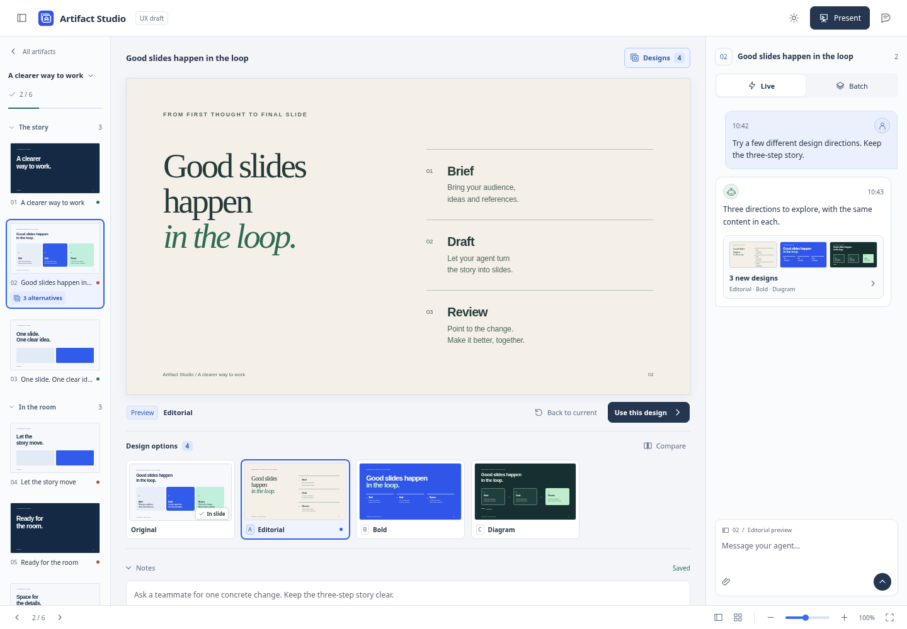
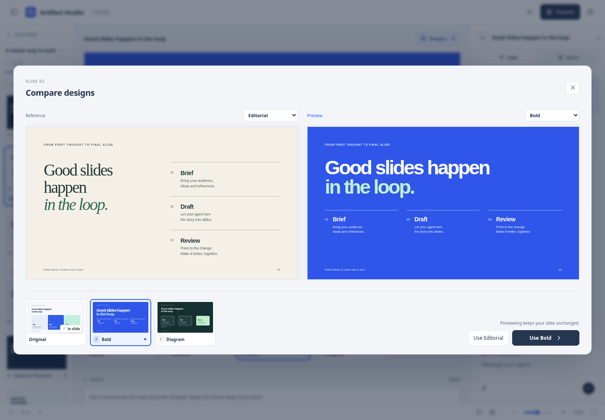
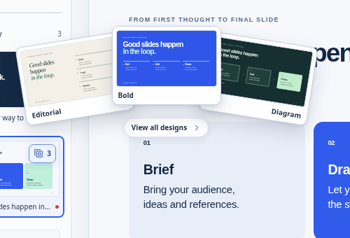
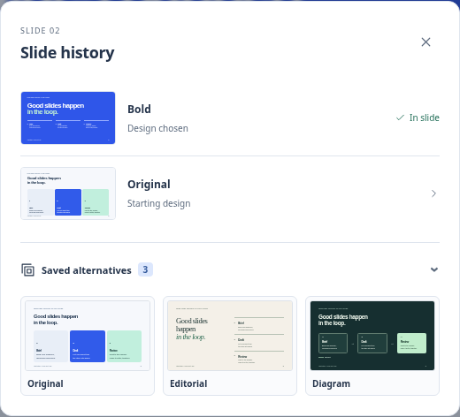

# Slide design alternatives — UX draft

This is the earlier UX exploration. The implemented feature and current screenshots are in [Slide design alternatives](../../SLIDE-DESIGNS.md); the implementation uses a bold border and check for the chosen design.

An interactive, fictional editor prototype for parallel **whole-slide designs**. Open `index.html` through a server rooted at the repository, for example:

```sh
uv run python -m http.server 8791 --bind 127.0.0.1
# http://127.0.0.1:8791/docs/prototypes/slide-alternatives/
```

The chooser runs entirely in memory. It makes no product API calls, generates no designs and saves no presentation changes. The surrounding editor is illustrative. Production controllers and agent tool schemas are unchanged.

## Proposed experience

1. **Discover.** A compact stacked-cards control with a “3” sits on the slide thumbnail. Hovering reveals a fan of actual design previews just above the cursor, with subtle depth and a lift when hovering a card. Click a card to preview that design on the main canvas, or click/tap the count to open the chooser. Keyboard focus also exposes the fan; Arrow Down enters its previews and Escape dismisses it. Hovering alone keeps the canvas and chosen design unchanged. The editor's Designs button counts the original plus the three alternatives. The agent's chat reply also opens the options. Alternatives are parallel design directions, separate from chronological version history.
2. **Preview.** Click a named thumbnail or use arrow keys, Home and End. A blue selection identifies the preview. “In slide” continues to mark the actual chosen design, including on its thumbnail. The preview state and **Use this design** stay beside the canvas even if the options row is collapsed. Escape returns to the chosen design.
3. **Compare.** Compare the current design with a proposal, or any two proposals. Both previews share dimensions and alignment. Either visible design can be chosen directly. On phones the previews stack; short screens use the two dropdowns instead of squeezing in another thumbnail row. The decision controls remain available while previews scroll.
4. **Decide.** **Use this design** adopts a proposal. **Keep current** explicitly keeps the existing slide, including its notes and approval. Either decision collapses the options and decision bar, removes the prominent Designs count, and reduces the chat attachment to a quiet confirmation. Both offer **Undo** and preserve all proposals. A replacement returns the slide to review; choosing a design and approving a slide are separate decisions. Approval is hidden while previewing. Present uses the chosen design.
5. **Refine.** A chat context chip names the design being previewed. In the real feature, feedback and questions must carry that design's identity so an agent refines the intended option. Human speaker notes stay attached to the slide. Navigating to another slide ends a temporary preview.
6. **Return later.** The quiet History icon records “Design chosen” or “Kept current design”. Its Saved alternatives section starts collapsed. Opening a saved design previews it for another explicit decision. The thumbnail's count now appears only on hover/focus, with direct access on touch devices. Revisiting the slide or cancelling an exploration keeps the options collapsed.





[Choice and Undo](screenshots/03-chosen.png) · [Dark appearance](screenshots/04-dark.png) · [Phone preview](screenshots/05-mobile.png) · [Phone comparison](screenshots/06-mobile-compare.png)



[Full hover view](screenshots/07-hover.png) · [Hover in dark appearance](screenshots/09-hover-dark.png)



[Keeping the original design](screenshots/11-kept-current.png)

## Iterations made in the browser

- Reduced the thumbnail row's width to preserve space for the slide and expanded notes.
- Hid Approval during temporary previews to keep the decision unambiguous.
- Extended comparison from current-versus-proposal to any pair, with a direct choice of either design.
- Aligned both comparison canvases and kept the decision controls visible on short screens.
- Added dropdown switching on compact comparisons, kept the current-design marker visible, and corrected accessible names and muted footer contrast.
- Replaced the filled “3 alternatives” badge with a quiet count on the thumbnail and a cursor-adjacent preview fan. Cards lift without shifting their hover area, remain clickable, and open a temporary canvas preview. Keyboard and touch retain direct access to the chooser; reduced-motion preferences disable the fan animation.
- Added an explicit Keep current decision, including in comparison. Either decision closes the prominent chooser and simplifies the chat attachment. History records the decision and keeps saved alternatives behind a collapsed section; reopening or cancelling an exploration never silently changes the chosen slide.

## Behavior to retain in implementation

Agent publication must add proposals without switching the chosen design, the user's preview or keyboard focus. Each proposal needs a stable identity, a short name, a renderable preview, its source slide revision and an optional brief rationale. Generation can expose ready proposals while others finish; failures should stay local to their proposal.

Choosing must check the slide revision before applying a proposal. If the underlying slide changed, show that conflict and let the reviewer inspect the latest slide before replacing it. Keep the original and remaining options available. Preserve human notes, discussion and pending feedback; bind element anchors and proposal feedback to their actual design revision. Changes to a chosen design must not silently rewrite another proposal. Presentation/export uses the chosen design, never a temporary preview.

Keeping the current design records a review decision without rewriting the slide or resetting approval. History distinguishes actual decisions from proposals that were never chosen. A completed decision stays quiet across navigation; only newly requested/arriving proposals should regain the prominent pending state. Human feedback drafts must retain the design identity they were written for when the reviewer changes or keeps a design.

## Components next

Reuse **discover → preview → compare → choose** for a selected component: “Chart · 3 options”, anchored to that selection. Preview within the full slide so surrounding context stays visible. Compare at the same scale; choosing changes only that component and offers Undo.

Component proposals must be tied to one chosen slide design and a stable component/group identity. A chart from one whole-slide proposal cannot be assumed to fit another proposal. Free-form HTML compositions also need a reliable selection boundary before component alternatives are safe. Start with whole-slide alternatives, validate that experience, then introduce component alternatives on that foundation.

## Verification

Browser review covers mouse and keyboard switching, safe preview, either-side comparison choices, apply/undo, keeping the existing design and approval, preserved notes, quiet settled states across navigation, History and saved alternatives, presentation using the chosen design, and light/dark layouts at 1440, 768, 390 and 320 pixels. The hover review exercises pointer entry/exit, moving onto the cards, clicking all three proposals, Arrow Down/Enter, Escape with focus restoration, touch access, and reduced motion. Axe-core 4.14.0 reported no A/AA violations in 34 sampled states; this is not a complete accessibility certification. Comparison decision buttons remain clickable at tablet widths and inside the viewport at 320px. The standalone download was exercised offline without external requests.

Screenshots are direct Chromium captures of this prototype with fictional data; they are not images of an implemented product feature. [Capture provenance and sampled results](captures.json) accompany the eleven images. Physical-device and user usability testing remain follow-up work.
